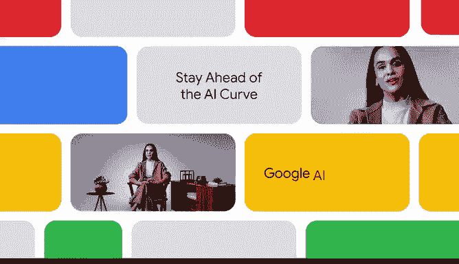

# 谷歌《AI基础知识（LLM、ChatGPT、Stable diffusion等）｜Google AI Essentials》中英字幕 - P40：1_01_01_课程5简介-保持人工智能领先优势.zh_en - GPT中英字幕课程资源 - BV1DM4m1r7rJ

🎼Part of staying knowledgeable involves learning about innovative uses of AI。

One thing that excites me is how AI continues to develop in new ways。

 This means there's always more to learn。 More tools。

 more examples of how people have integrated AI into their work。

 more guidelines on how to use AI responsibly， and even new types of models。😊。

Staying informed about new developments in AI can empower you to use it more effectively。

My name is Sharbani and I'm a senior director in the corere Ma Learning Group at Google。

That means the teams I work with both the infrastructure and tooling that helps you build and produce amazing AI innovations faster and easier。

 I am excited to help you learn more about how to stay current with developments in AI。😊，First。

 you'll learn how to evaluate new AI tools。 You'll explore inspiring AI innovations and consider how others have integrated AI in their fields。

😊，Lastly， you'll identify opportunities to leverage AI in the workplace。

 I hope you're excited to continue this journey and explore strategies to stay up to date with AI as it advances into the future。

 Let's begin。😊。

