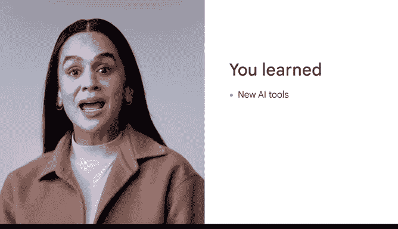

# 谷歌《AI基础知识（LLM、ChatGPT、Stable diffusion等）｜Google AI Essentials》中英字幕 - P46：7_04_01_总结回顾.zh_en - GPT中英字幕课程资源 - BV1DM4m1r7rJ

The possibilities of AI are inspiring， and I hope you continue to find ways to apply AI to your work。

In this section of the course， we explored how you can continue to grow your understanding of AI。

 First， we went over how to discover and evaluate new tools。 Next。

 we covered how to find inspiration from AI innovations。

 We explored inventive AI models and discovered some of the creative ways AI is already being incorporated into certain fields of work。

 Finally， we identified opportunities to leverage AI in the workplace。

 and we reflected on how an understanding of AI can benefit you。😊。

Great work。 I enjoy guiding you through an exploration of AI and the future。😊。

