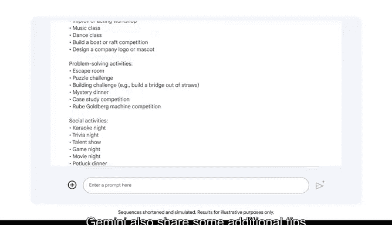

# 谷歌《AI基础知识（LLM、ChatGPT、Stable diffusion等）｜Google AI Essentials》中英字幕 - P6：06_02_02_生成式AI基础.zh_en - GPT中英字幕课程资源 - BV1DM4m1r7rJ

Advancements in AI technology are reshaping how we work。

 Let's explore one of the key developments at the center of this transformation。 generative AI。

 as the name suggests， generative AI is AI that can generate new content。 such as text。

 images or other media。 a unique quality of generative AI tools is that you can use them with natural language。

 Natural language refers to the way people talk or write when communicating with each other。

 Here's a simplified overview of how a generative AI tool works with natural language。 First。

 you provide input。Input refers to any information or data that's sent to a computer for processing。

 Many generative AI tools accept text and speeches input， and some also accept images or video files。

 Next， the data is processed by the AI tool。Then an output is generated in the form of text， images。

 audio or video。Generative AI and the ability to interact with computers using natural language has introduced a world of possibilities for what people can create with AI。

 For example， you might be marketinging a new business。 You need fresh。

 engaging content like a promotional poster to advertise a new product。

 but you don't have a creative team to bring your ideas to life。😊。

No need to stress with a few instructions， generative AI can help you create a poster。

If the generated content doesn't meet your expectations。

 you can provide additional instructions until it produces something that meets your needs。

This is just one example of how generative AI can complement your skills。

 But there are many other ways it can benefit you and your work。 For example。

 generative AI can boost your productivity by helping you with tasks like drafting replies to emails。

It can help you avoid mistakes。And it can improve your decision making process by answering questions and brainstorming ideas with you。

 whether you work in health care， education， finance， retail or any other field。

 There are a wide variety of generative AI tools that can cater to your needs。

One example is a conversational AI tool。A conversational AI tool is a generative AI tool that processes text requests and generates text responses。

 You can use it to brainstorm ideas， answer questions， and booster productivity。

Throughout Google AI essentials， you'll gain practical experience using a conversational AI tool by Google called Gemini。

 Gemini can be used to get some creative inspiration when you're feeling stock。

 build on your ideas and provide detailed explanations that help you explore topics easily。

 For example， let's ask Gemini to brainstorm a list of team bonding activities for our summer work retreat。

 The AI tool responds with a wide range of ideas from a fun beach party to a relaxed pottery class。

 Gemini also share some additional tips to consider when planning a successful work retreat。😊。

Generative AI has paved the way to exciting new frontiers。

 But before we can tap into what this technology has to offer。

 it's essential to investigate the capabilities and limitations of AI as a whole。

 Coninue to the next part of this lesson to get started。

