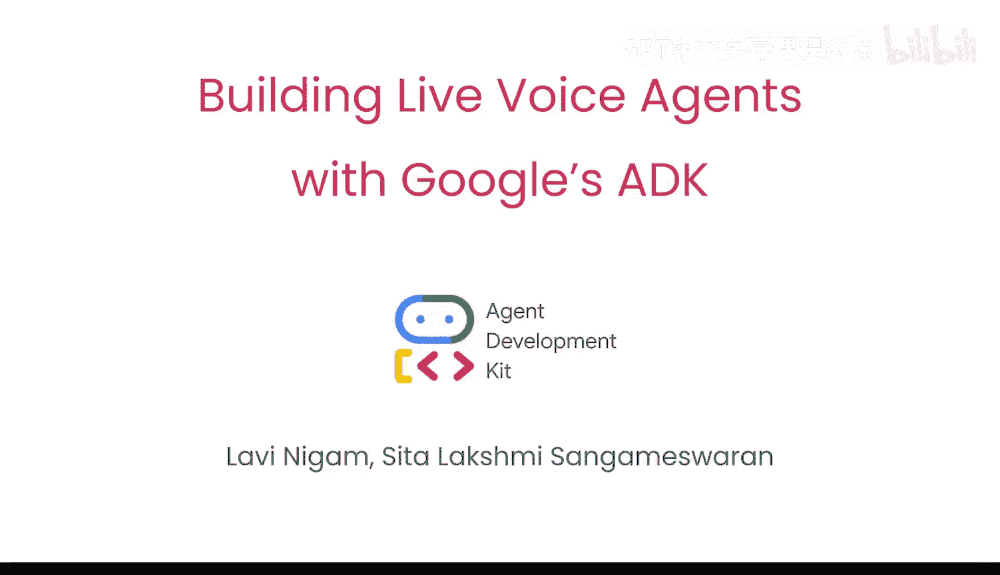
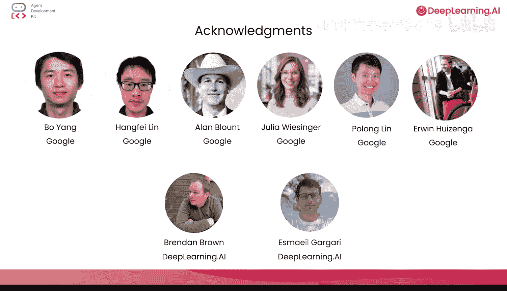

# 谷歌《使用 Google ADK 构建实时语音代理｜Building Live Voice Agents with Google ADK》中英字幕 - P1：1.intro.zh_en - GPT中英字幕课程资源 - BV1HeyhBiEDM

Welcome toBuild Live voice agents with Google's  ADK。

 both in partnership with Google and taught by Lavi Miel and Cta luxury Saanggawaran。

 who are both machine learning engineers at Google Cloud AI。In this course。

 you learn how to build multiagent AI applications using Google's agent development kit or ADK。

 you build a podcast AI agents that gets live voice input from the user research a topic plans and episode draws a multiperson transcript and finally produces a podcast audio file Google's ADK is an open source framework that makes it easy to build simple agents with just a few lines of code and can scale up to complex multi-agent systems ADK includes building workflow patterns to control behavior of different agents and also supports flexible drivenven orchestration where an own determines what sequence of steps to tape。

 It provides common agent building blocks including models， tools。

 memory and observability features like providing traces and evals This course also acts as a quick introduction to live voice conversational interfaces with agents which you really build with just a few lines of code will also explore multi agent。

Systems where each agent is focused on specific tasks and most of such agents collaborate to accomplish a more complex goal at the end。

 you have built your own agent system generate thanks Andrew to start this course you'll create a simple voice agent using Google8K and Gemini life model your agent will take in user voice input use a language model to reason and then send back a voice output and you learn about the cobuilding blocks of ak like session state and memory session is like a container that keeps all parts of one interaction together If you start talking to an agent the session begins and everything you say and the agent replies stays inside that session Similarly state is the scratchpad or the short termm memory for your agent it tracks the agent progress so that the agent doesn't lose track of what's doing in the midflow next is memory memory extends this further by letting the agent recall past inputs outputs or tool calls and use when responding。

ther these primters form the foundation of every agent you'll build with ADK Age become much more useful with tools such as Google search or any external API This gives your agent the ability to access a wider world fresh and factual information and to take actions To can be functions in your code or MCCP service or public APIs as your agent system becomes more capable it can do more things and you need to constrain or control what it can and what it should not do。

 This is easily done through callbacks and ADK which lets you intercept before and after every single model tool and agent call you can add code or remote APIs or simply a specialized agent to handle each of these callbacks you start by building a single podcast agent and then turn that into a multi agent system in the multiag system you can have one agent carry or figure out the plan and then a second one to do background research。

And the third one to write。 And you see how to decompose a complex task into subtask for different agents to carry out。

 which turns out an important design pattern for implementing agent workflows。

 Many people have contributed to this course。 I'd like to thank from Google Boy Yao Han Fei L。

 Alan Bunt， Julia Weiseinger， Hollong L， Erwin Husinger and many others behind the scenes who had made AK possible from deep learninging AI。

 Brendan Brown and Imer Greggari also contributed to this course。

 This course will help you learn not only agent building with Google AK。

 but also how to bring voice capabilities to your AI applications。 In the next lesson。

 you built your first voice agent。 So let's go to the next video and get started。😊。

