# 谷歌《使用 Google ADK 构建实时语音代理｜Building Live Voice Agents with Google ADK》中英字幕 - P2：2.build-your-first-agent.zh_en - GPT中英字幕课程资源 - BV1HeyhBiEDM

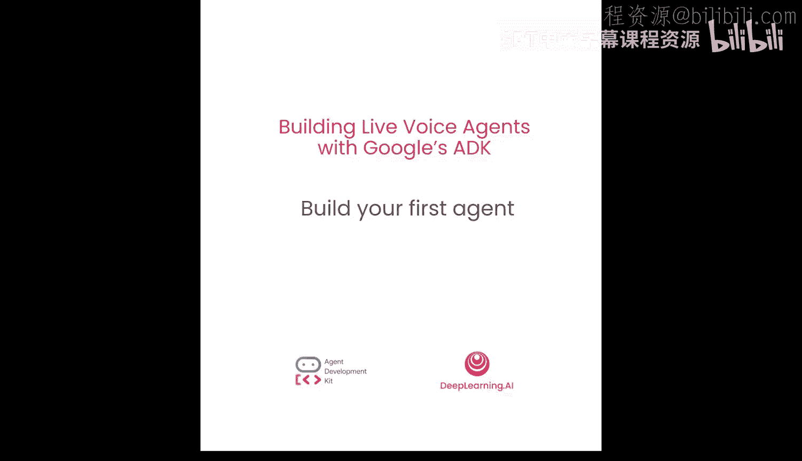

In this lesson you'll build your first agent using Google's 80K and give it the power to access realtime information from the web。

 you learn the fundamental structure of an agent and explore the8K web UI which is a convenient way to trace your agent' thinking and interact through live voice conversations you'll also briefly explore other ways of building agents including a Yaml configuration for declarative development and a ADK web builder let's dive in so what exactly is an agent imagine an AI that doesn't just talk but does thing that's the age at its heart it has a powerful language model like Demini which acts as its brain but what makes it truly special is that we can give it tools like the ability to search the web or access other applications allowing it to interact with the world and get things done and in this course we will be building an AI agent that can help us to research and build a podcast。

And by the very end of the first lesson you will have built a functional conversational agent First things first。

 we need to get the ADK installed on our system。 It's a straightforward process we'll use install to install Google ADK and once that's finished you will have access to the ADK library and a handy set of command line toast that will make up development journey much smoother and now let's create the foundation for our agent in the next cell from the ADk create command so what did we just do the ADK creates a PI command that simplifies creating a full structure to build our agent it initially is a new folder in this case a 01 and creates three new files in the folder a Python init file and agent do p file that will contain all the agent code and in do Eb file which basically contains the authentication credentials like the API key in this command and throughout this course we will be using the ADk create command to create folders and then write it to the agent do p using the cell magic in the。

Okay， now let's create a very first agent Here you see we have few lines of an agent core。

 It's a very simple and concise agent， and we have a root agent variable here。

 which is basically instantd to an agent object let's go ahead and see what each of these parameters mean。

 So we have a name for the agent and we have a model again Gen2。

 of flash live model here and we have an instruction which says you are an AI news assistant and one thing to note here is the Genline2。

 of flash live model that supports both forms of modality like text and audio Now let's open up a terminal to run our and this is going to open up a terminal and we're going to call the8k web command to open up the8k web Ui and we'll run the8k web command give it a host and a port number and this should start a server running locally。

 Now in order to access this server we have to run the cell and this will give us the URL to access our server and when you open up the inter in a browser you will see this Ui let's select the agent。

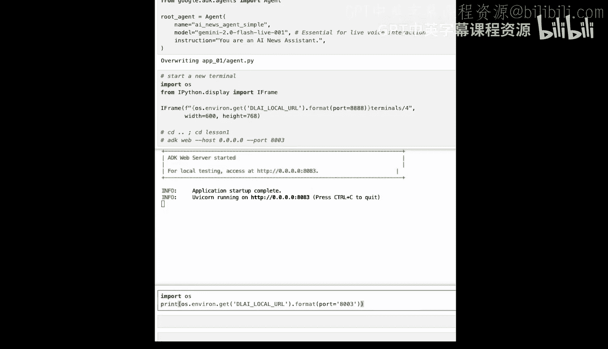

From the dropdown， which is the a01 that we created and now let's try asking it what's the latest AI news Give me Google's recent LLM model launches Google is recently launched Gemini 1。

5 pro and also introduced I3 would you like more details on either of those and now that's exactly the response that we wanted because if you see the model that we were using has a knowledge cutoff date and you can expect it to fetch realtime information So which is where we be adding tools to our agent to given the ability to fetch external information and to go ahead。

 let's go and create a new folder here and we're going to copy the code that we had previously but then to just one simple modification of adding a tool and this is an in built tool in Google 80k meaning this comes prepackd with the library and you don't have to write any code for it let's add this tool and let's run our agent again and let's switch to our。

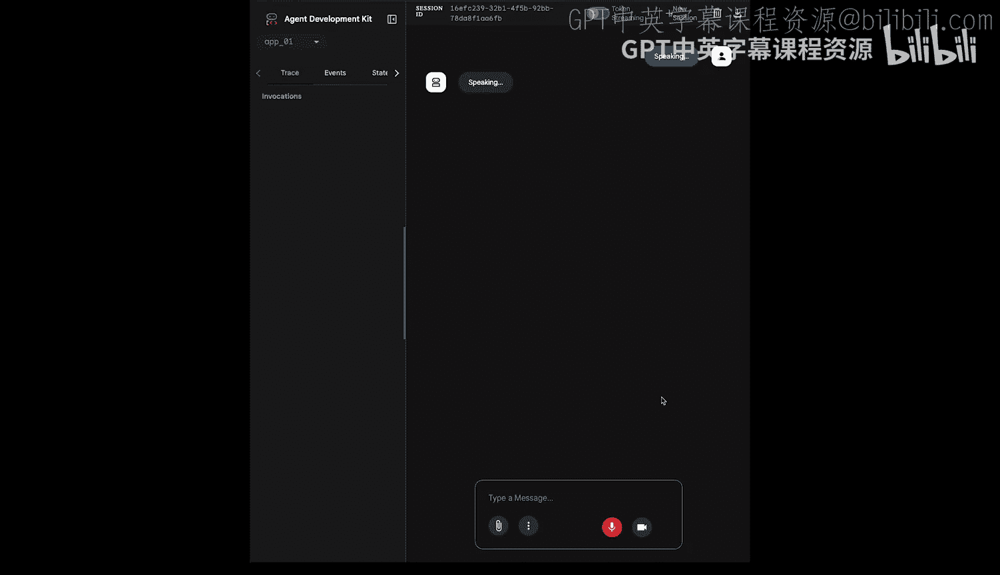

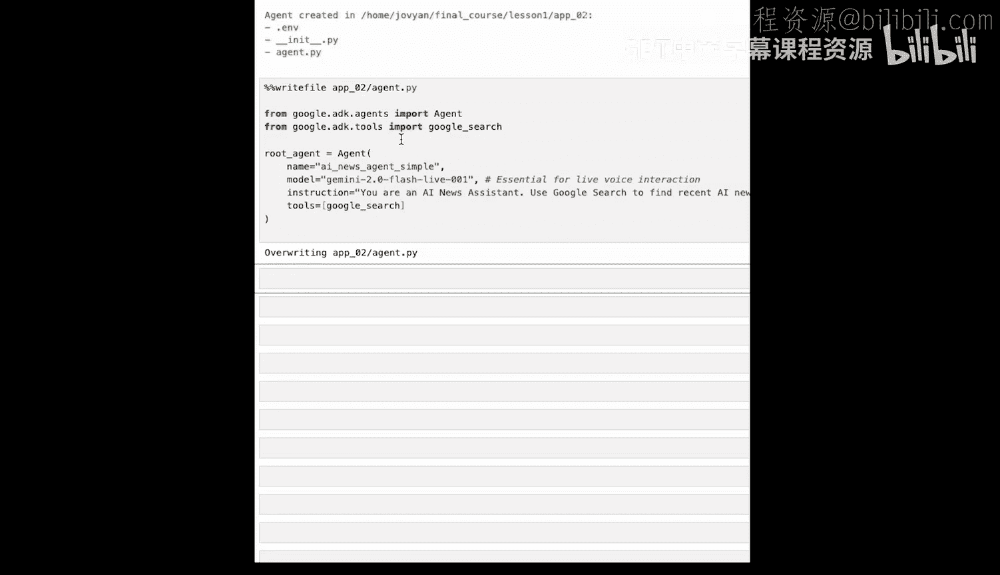

Again this time you're going to be selecting the app 02 folder to make sure that we have the agent with the tool that we just created and I'm going to use the same query now can you tell me the recent LLM model launches from Google Here's a summary of recent model launches from Google V3 a video generation model with improvements in real worldorl physics and details like lip sync I an image generation model that is faster than image3 flow an AI filmmaking tool that uses text video and image models to stitch together consistent scenes Let's go to our code and what we've seen so far is basically creating an agent and adding it the tool which gives it access to realtime information Great so far we've seen how to interact with model and have a live voice conversation but the format to have a text conversation is actually not very different from what we just did's go ahead and create another folder for a new agent and let's go ahead and run。

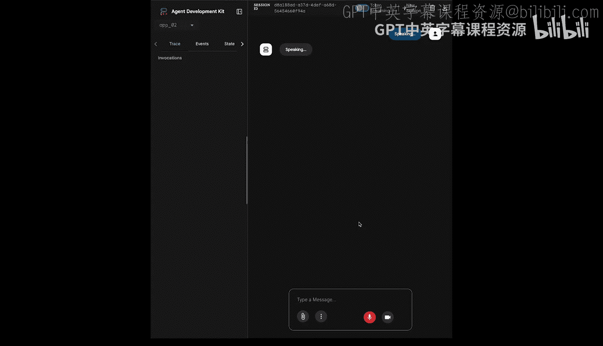

This specific agent So if you look at the code， everything basically stays the same except for the model lighting and here instead of the line model。

 you are using the Ge92。5 flash model， which is basically all the change that you would need to switch from a voice to a text agent let's go ahead and run this code and I'm switching back to a WI and selecting the third folder that we just created and let's give it a text this time I've asked it for the latest AI news and the agent is working in the background and now you see you've got all of this new information that the agent has given us the left pane actually has a series of tabs where if you click on the ins。

 This is going to give you a detailed trace of what the agent actually used and you can also see the spans of each call and this will be really important for agent observability and if you look at the events tab this is set of events that the agent produced and we also have a nice little graph of the agent architecture and of course our is a very basic agent right now which has one single agent with one single Google search tool。

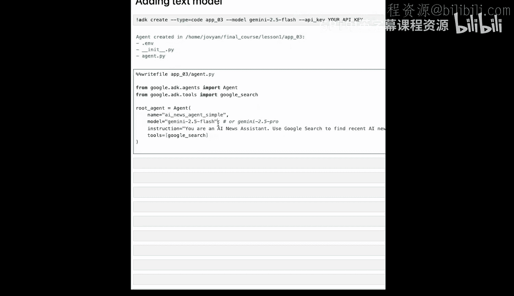

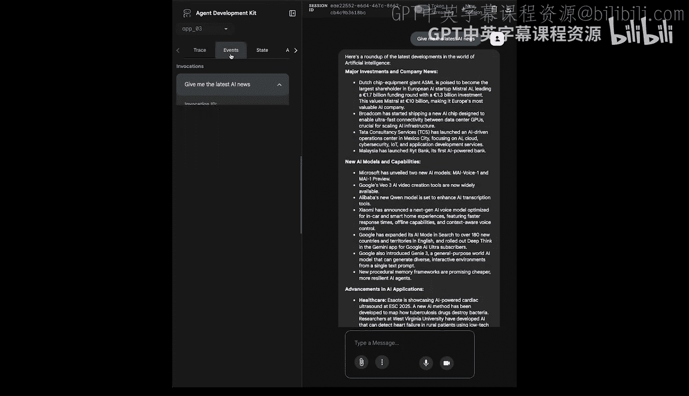

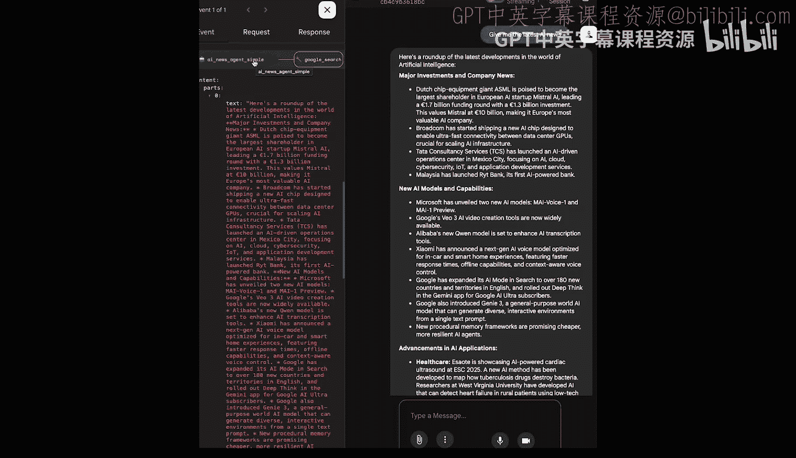

Let's switch back to our code and now we've seen how to invoke agents using both text and voice models and we've done this with8K web CI command ADk also provides you with a couple other options to run your agent basically using an ADK run command which is again a CI command but it will invoke your agent right in the terminal and an8K API server which will turn your agent into a rest API that any application can call and this is how youre deploy to production but in this course we' primarily be using ADK web and moving forward if Python is actually not a cup of tea or if you prefer more declarative style development of agent like basically like a telephone config then ADK also provides you the option to build agents with the Yal config let's go ahead and create a new folder for the Yamel configuration and if you look into the output the ADK create command is basically created as three different files and it has created something called a root agent do Yaml file and what you're going to do now is basically rewrite。

That Yammal file with this Yammal declarative structure that we have and this resembles exactly the python code that we created。

 It has a model。 It has a name， a description instruction and a Google search tool。

 and basically running this would again give us the same8K dev Ui experience that we did with Python Okay now we've seen the different ways to create agents and run them and one final step in this lesson is to play with the agent' instruction let's find you our instruction for the agent that we just creative。

 remember how our agent just has one line of instruction which says you're a news assistant And when we're building a podcast agent this is especially not super helpful or it doesn't scope it down。

 So what we're gonna do now is basically let's create another agent let's first start by creating the agent folder。

 but this time let's provide a very comprehensive instruction to our agent let me go ahead and run this and let's work through the instruction So the instruction says the agent score identity and the sole purpose which basically sets。

😊，Context for the scope of the agent it also has a refusal mandate。

 which means any topic other than the AI news should now be refused when we run this agent and we also give it a workflow saying you must use Google search to find information and strictly base your results and also cite your sources So this basically scopes down the agents operating space So it will now know the workflow that it has to execute on let's grown this agent and switch to our w let's switch a folder to the recent app that be created and let's actually ask about the weather this time What is the weather today in San Francisco sorry I can answer anything about this I am only supposed to answer about the latest AI news and as you can see the agent refuses because it is non AI news to recap you've learned what an agent is install the Ak and created a functional agent that can search the web for real time information we've seen how to build it with Python and also alternative methods like Yamel and the web builder for the rest of the scores well be sticking with Python to build a。

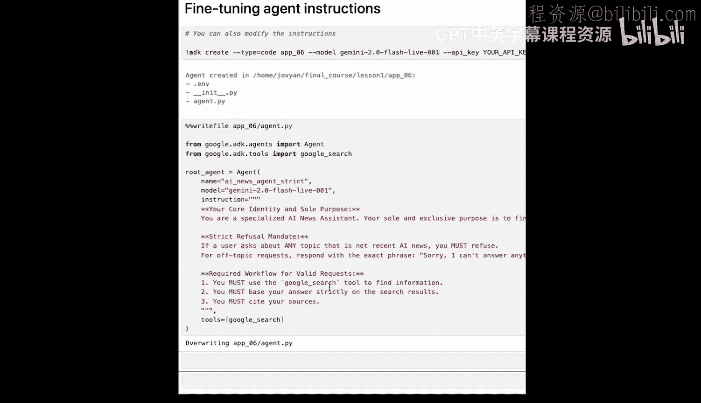

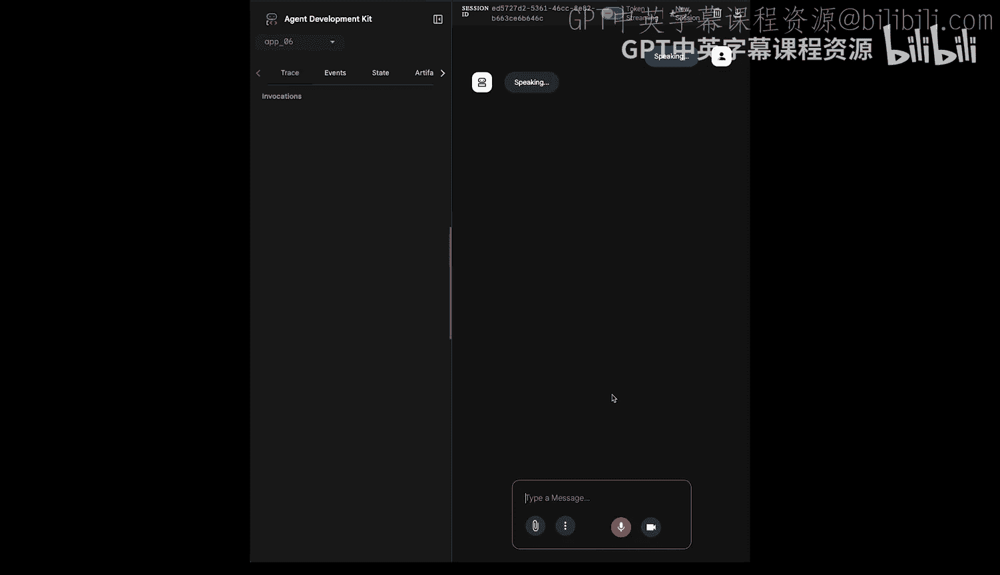

cast agent because it gives us the maximum flexibility that we need。

 but knowing these other options are available is also part of what makes ADK over style。

 you've taken a huge step in building conversational AI agents and in the next lesson we'll explore the primitives of ADK a little more such as session state and memory。

😊。

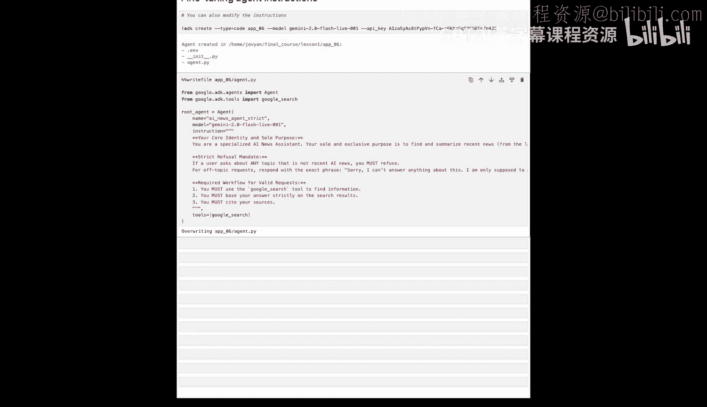