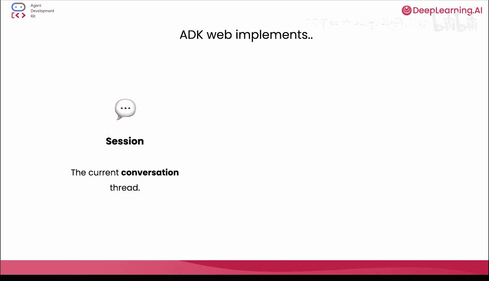
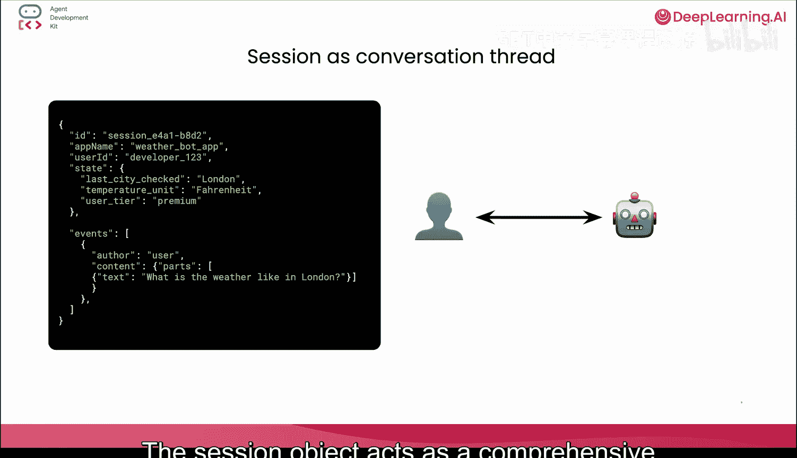
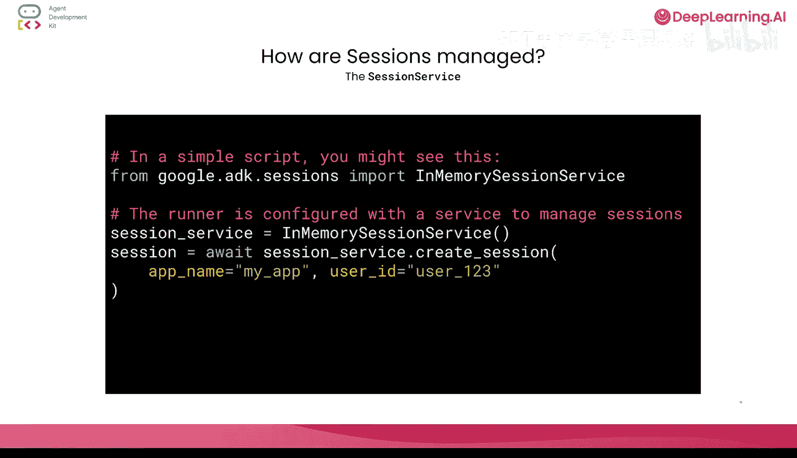
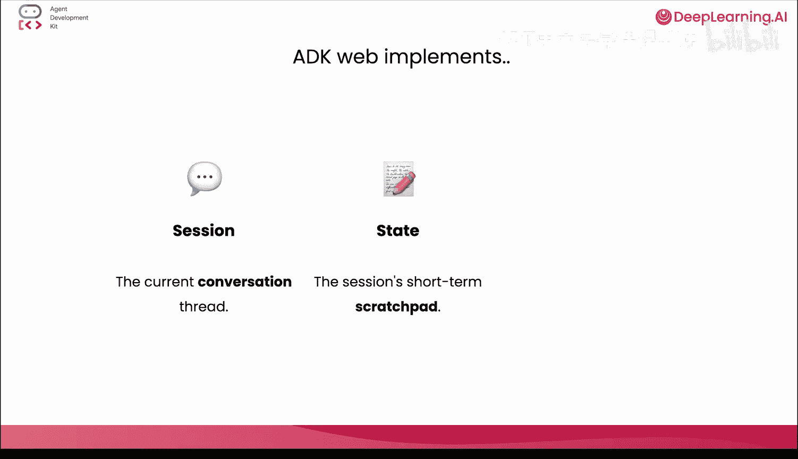
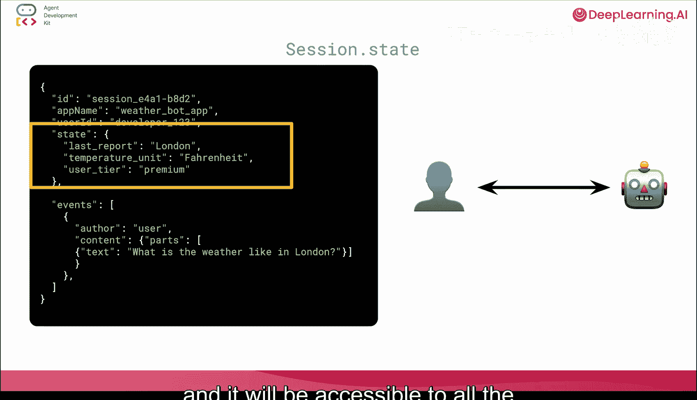
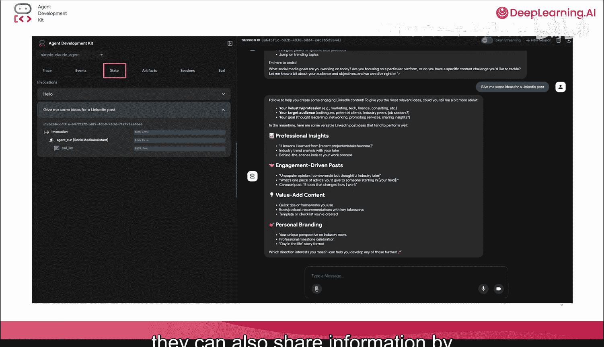
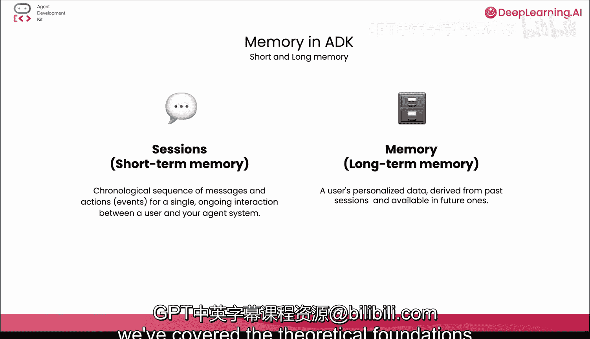

# 谷歌《使用 Google ADK 构建实时语音代理｜Building Live Voice Agents with Google ADK》中英字幕 - P3：3.adk-primitives---session,-state,-and-memory.zh_en - GPT中英字幕课程资源 - BV1HeyhBiEDM

In the previous lesson， we saw how to create an agent。

 add a builtin tool and have live conversations but we didn't do any of the heavy lifting8K web hides away most of the complexities like session and memory management in this lesson。

 Let's take a quick detour from the handson building and understand what these services are。

 let's get started in the previous lesson。 we created a basic agent with a builtin tool。

 The8k web interface handle much of the underlying complexity for us。 However。

 as you build more sophisticated agents， you will need finer control of course services like session state and memory。

 and that is exactly what we're going to be discussing in this lesson。 let's start straight in。

 think of session as a container for a single conversation it begins when a user starts interacting with your agent and in many cases ends when that interaction stops。

 For instance， if youre running an agent in a notebook。

 the session terminates when you stop the runtime。 The session object acts as a。😊。

Comprehensive data log for the conversation capturing state events and metadata ADK manages sessions through a session service and a default is an inmemory service。

 which is temporary and does not persist after the conversation ends。 However。

 you can also configure to persist in session service to store and retrieve session data for later use。

 And what you see here is a very simple example of what the session might contain。

 It has a state It has the events and an app name， but it is basically a data dump of all the conversations of all the logs that goes into your agent。

 Next is the state。 So state does a session short term scratch by。

 It is basically a dictionary of key value pairs that holds the current context of the conversation。

 You can write any information to the state。 and it will be accessible to all the tools and agents within that session。

 This makes it a powerful mechanism for communication。 For example。

 if youre using multiple tools or multiple agents that are involved in the same task they can。😊。

Also share information by reading and writing to the session state。

And the third one is your memory service。 Mem is very different from session in that Session is actually your data dump of everything that happens in an agent。

 but memory is more long term。 It provides your agent with the long- term persistence。

 So remember how we saw the JO for a session it basically holds a ton of information but not everything is actually useful for the agent to remember long term So memory is a compacted version of that information the agent needs to remember for long term。

 For example， if you tell your agent that your favorite coffee order is an old melaad day。

 you would likely want to remember for a long time and not forget it again tomorrow and that is exactly what memory provides you with In most cases。

 in memory services， most of the memory services uses an LLM to actually go through the session data and extract key valuable piece of information that needs to be remembered long term and then saves it。

 and ADK offers different memory service implementations including an inmemory service。😊。

And an integration with a vertex AI in memory bank will explore the memory bank in a later session in this course。

 and with that well cover the theoretical foundations of session， state and memory in 80k。😊。

