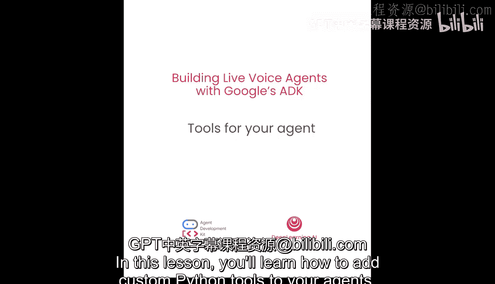
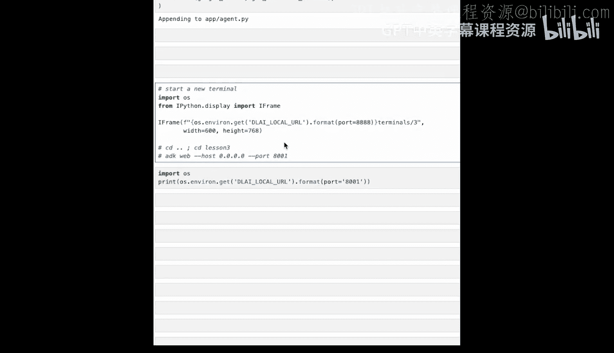
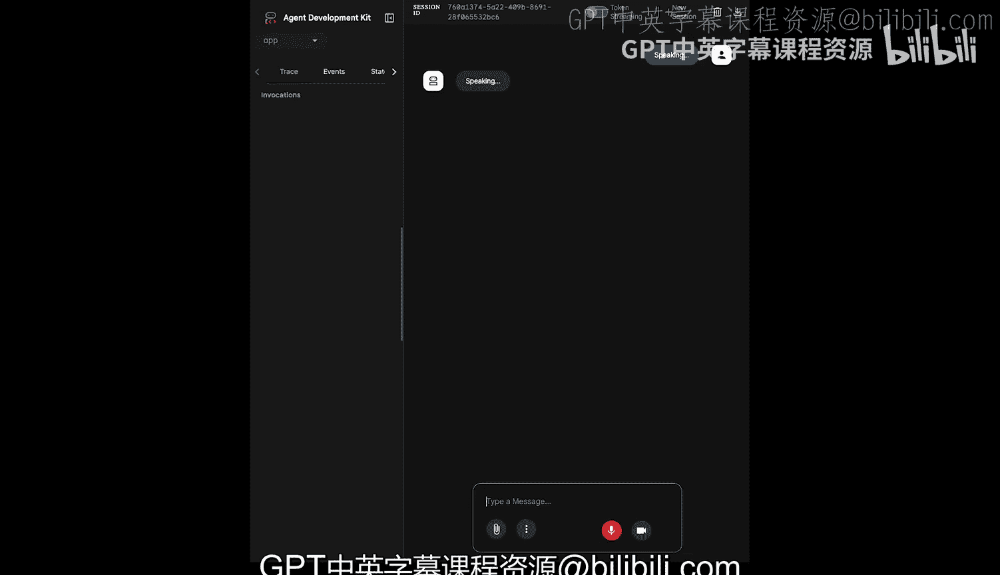

# 谷歌《使用 Google ADK 构建实时语音代理｜Building Live Voice Agents with Google ADK》中英字幕 - P4：4.tools-for-your-agent.zh_en - GPT中英字幕课程资源 - BV1HeyhBiEDM

In this lesson， you learn how to add custom Python tools to your agents。

 You'll integrate an external API to fetch financial information。

 We then look at best practices for defining tools and how to modify the agent instructions to effectively use these tools。

 All right， let's get to it。 make sure that the latest version of AD and other dependencies are installed on your environment。

 And since you've already done that， we can move forward the first step is to always create a AD folder as we have been doing with all the lessons。

 you don't need to add your key in the current lab。

 but if you choose to run this in your own environment or computer。

 make sure to pass gemminina API key in the ADk create command。

 You can get that from Google AI studio or vtex AI studio。

 Now as we discussed our goal for the lesson is to enhance the new search with one more additional source of information。

 we currently get the latest news in AI from all over the companies and it would be great if you can somehow also understand the financial market performance For example。

 if the latest news from Google is about， let's say the new launch of your three feature then。

obbserving the stock prices and percentage changes can give us an indirect signal if that news is positive or negative。

 generally speaking again， disclaimer here is that it's not a stock buying recommendation。

 and increase or decrease in the price is not direct correlation with news but we are trying to see if we can get more information from a live data by adding a simple Python function to achieve this。

 we have a get financial context function Now as he said this is a function tool for our ADK agent。

 The AD framework is incredibly smart about these。 It actually reads the functions description parameters and even the type hence to understand what the tool does That's why having a clear dock string like the one we have here is so important for the agents to know when and how to use this tool effectively。

 Let's look at the code as well。 the function is named get financial context and it accepts one argument which is stickers which are specified must be a list of string This is where the stop pickers like Gg or ND will be passed。

Inside the function we first created an empty dictionary called Financial data This is where we store the results for each sticker before returning them all in the end Next we loop through each sticker symbol in the tickers list that the agent provides the code of the magic happens inside the loop we use a popular Python library called Y finance to do the heavy lifting the line stock equals to y finance or ticker creates an object that represents the specific stock we are interested in that info equals to stock do info fetches the whole dictionary of information about that stock we are interested in two specific piece of data the current price and the percentage change for the day we use the dotge method to safely access these values。

 this is a good practice because the data isnt available for some reason a code won't crash As we successfully get both the prize and the percentage change we then format them into a clean readable string for example dollar 175。

20 plus 1。25% and this is just an example and we add this string to a financial data dictionary。

Ter symbol as the key and because things can sometimes go wrong。

 maybe a ticker is invalid or there's a network issue。

 we've wrapped this whole logic in a try accept block。 This is a safety net。

 If any occurs we simply record the error message for the ticker and move on to the next one Finally after the loop finishes the function returns the financial data dictionary which now contains the financial context where every ticker the agent asked for Now let's run this code and see the output。

 What you see here is that we have abated our agent do p5 with a tool that we have just written Now let's move on to the root agent itself。

 This is the brain of our operation the agent is defined with a name and a model and most importantly a detailed set of instruction and list of tool it can use。

 we are using the Gemini 2。 flash live 001 model the live part is a key here。

 It indicates that we are using a model designed for real time by direction streaming This is what enables the natural voicedn conversation where you can even interrupt the agent and it can respond in。

The real power， however， lies in the instruction of the prompt This is where we shape the agent's personality and workflow。

 we've given it a very specific set of rules For instance。

 if you just say something like give me AI news the agent is instructed to respond with sure I can do that how many news item would you like me to find it won't proceed until it has that number Once you provide a number the agent follows its workflow step one is to use its Google search tool to find the news。

 step2 is to analyze that news to identify a company tickers and step3 is to use a new get financial context tool to fetch the stock data for those tickers notice how we explicitly tell the agent to cite its tool in the response starting with using Google search for news and get financial context via via finance to market data the transparency is a key part of her agent design This entire interaction is made possible by the aK session and state management when you start a conversation the ADK creates a session。

That acts like the agent shot term memory each message back and forth is a turn in the conversation the agent can store information in the session state。

 for example， when you tell it you want three news items。

 it remembers that numbers for the next step。This is how it maintains context because this state is preserved throughout the session。

 you can ask followup questions。 For instance， after it tells you the headlines。

 you can say tell me more about the second one and the agent can refer back to the information it previously gathered to give you a detailed summary。

 So when you speak to the agent， the live model transcribes your audio and the agent logic processes your request。

 It uses its tool in the sequence we define and it steams back the audio response all while keeping track of the conversation history and its session state。

 This creates a seamless and intelligent conversation experience。

 Now let's run this and add this to our agent Pi Excel Now that we have quoted both our custom tools and route agent that uses it。

 the next step is to bring our AI news analyst to live。

 Now let's run our AK web UI and test our agent Hi， can you help me with a latest in the AI news。

Sure， I can do that。 How many news items would you like me to find Find tea for me using Google underscore search for news and get underscore financial underscore context via Y finance for market data here the top headlines top publicly traded AI companies to know N 177 and33 plus384。

75% coreweave stock rises on news of Nvidia backed firms Vc Fund for AI investments No ticker available AI boom sends Oracle stock to record high near 1 trillion mark O 328。

33 plus3594。88% Which of these are you interested in or should I search for more En Mo about the1 here's more on the first headline The article discusses top publicly traded AI companies Nvidia is highlighted as a key player in the AI。

Space according to the get_ financial underscore context tool MVDA is currently trading at $177。33。

 which is plus $384。75% What else would you like to know What's the best recipe for chocolate cake I can only provide recent AI news for US listed companies Excel as you saw we were able to get the financial data for the companies while searching for the news and it followed all the instructions。

