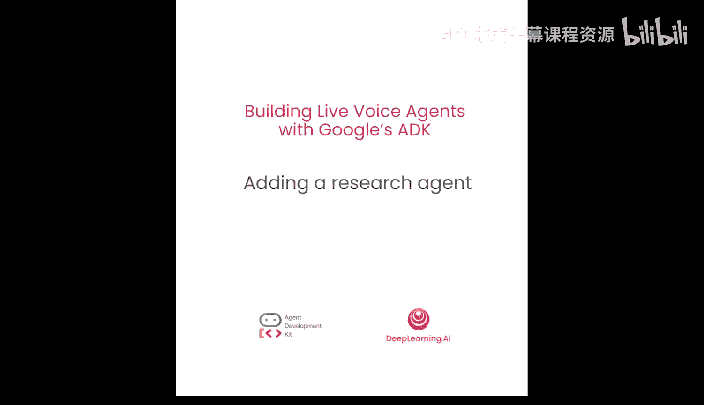
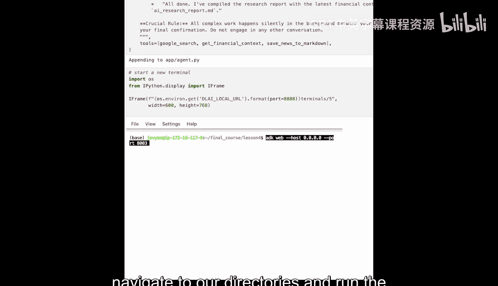
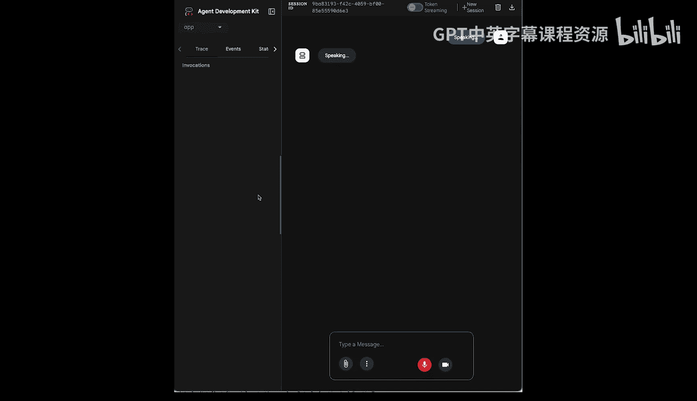
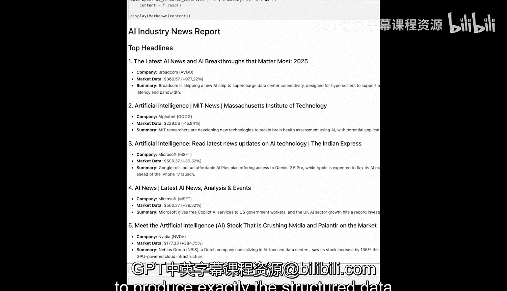

# 谷歌《使用 Google ADK 构建实时语音代理｜Building Live Voice Agents with Google ADK》中英字幕 - P5：5.adding-a-research-agent.zh_en - GPT中英字幕课程资源 - BV1HeyhBiEDM

In this lesson， you learn how to get back a structured response from your agent using a defined schema and save the research as an external file。

 We also see how we can change the behavior of our main agent as a coordinator rather than a news reader。

 All right， That's good。 In our last lesson， we built a fantastic interactive news assistant。

 It could hold a conversation which news and financial data in real time and discuss the headlines with us。

 But now we're going evolve that concept into much more powerful pattern。

 which is called as the coordinator dispatcher model。 Think about it。

 A real world task like preparing research for a podcast。

 You don't want to sit and listen to any read out every single headline it finds。 That's inefficient。

 Instead， you want to act like a director。 You give a command and your research assistant goes off。

 Does the work quietly in the background and then comes back to you only when it complete formatted report is ready。

 That's exactly what we are building in this lesson。

 It transforming our agent from the conversationist into a silent efficient。😊。

backgroundground researcher it'll take our request。

 coordinate its tool to perform the research and dispatch the final output to a file only updating us on its progress to achieve this。

 we'll be making three key changes we are adding a new tool to its toolkit。 Second。

 we are fundamentally rewriting the instruction for our root agent to change its behavior。 And third。

 the way we track with it will be much simpler focused on initiating the task and receiving the final product as with the previous lessons。

 the initial setup is the same we first ensure the latest version of8ks installed and all the other dependencies are also there。

 Then we create the folder and boilerp files for our agent using ak create Since we have done this few times。

 let's jump straight to the code changes next， let's start with the tools just as in lesson3。

 our agent still has the get financial context function jobs remains the same to take a list of stock pickers and return their current price and daily percentage range。

 We don't need to change anything there。 Now the new addition to。

agentent dot Pf file is a function called as save news to markdown This is another custom function tool its job is very straightforward it takes two argument file name and content to be saved inside the function it simply writes the content into a markdown file The tool is the final step in our agent workflow allowing it to save its complete research for an external file which we named as a research report dot M。

Now， for the most important part， the new instructions of a root agent。

 This is where we define its new personality as a background AI research coordinator。

 The instructions are now incredibly specific to enforce its new behavior。First。

 we have implemented a strict two message interaction workflow when you make a request like find me the latest A news。

 the agent's only immediate response will be an acknowledgement like okay。

 I'll start researching the latest A news This might take a moment。After sending that message。

 the agent goes silent。 This is the background processing phase。

 It is now executing a precise sequence of tool calls what we define in its instruction。

 Itll first use Google search to find five articles then itll internally extract the stock tickers from those articles。

 Next， itll pass those stickers to our get financial tool to ensure the output is perfect every time we have embedded a required report schema directly into the agent's instruction。

 This is one of the most powerful feature of using large language model like Geac with the ADK by providing a clear markdown template in the prom。

 Were giving the model a precise blueprint to follow。

 It understands the structure and will meticulously format the research to match it exactly。

 it is worth noting for more complex data structures。

 the ADK allows you to define a pedantic schema and pass it as an output schema。

 It'll explore that more advanced pattern when we get to multiagent systems。 but for a current needs。

 defining the schema directly in the prom is。Highly effective and simple way to guarantee a consistent output。

 Finally， it calls our save news to markdown tool passing in the file name AI research report do M and the formatted content。

 only when the file is successfully saved。 Does the agent speak for the second and final time it deliver its confirmation message like all done。

 I've compiled the research report and save it to AI research report M。

 is entire complex research process happens autonomously in the background between that first acknowledgement and the final confirmation。

 Now， let's run it。 you already know the drill will start the terminal navigate to our directories and run the A web command to start the server。

 Once you open the Web U is give it a simple command。

 get me the latest news about artificial intelligence。

 Okay I'll start researching the latest AI news。 I will enrich the findings with financial data and compile a report for you。

 This might take a moment All done。 I've compile the research report with the latest financial。

Text and saved it to AI underscore research underscore report do MD。

 Allright now let's look at the output。 remember we said that this is a background agent。

 which means it took our instructions or requirements and then it did the work in the back end and then save the file Now let's look at the file that it has saved and see what exactly do we have and what it has done as the background process。

 Wo as you can see here， the report starts with a clear title。

 which is a industry news report followed by a top headline Each of the five news item is neatly formatted with the headline itself followed by a bullet point detailing the company and its stock pick and the market data showing the current stock price in person and finally it also shows you the brief summary of the articlectic Now this is consistent predictableictable output is the derek result of providing that clear schema in our agent's instruction demonstrating how you can actually guide the model to produce exactly the structure data you need for your downstream task。

