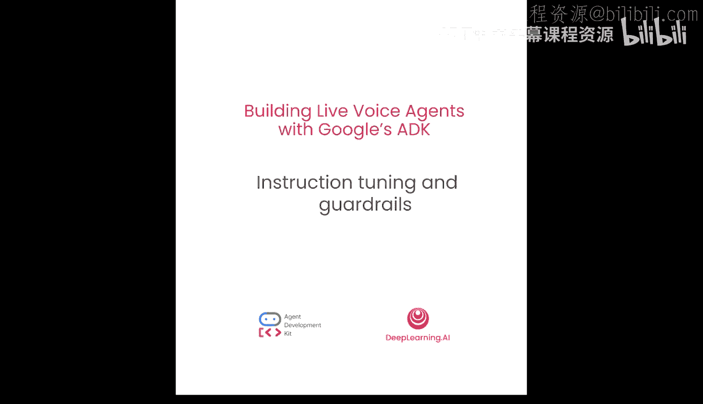
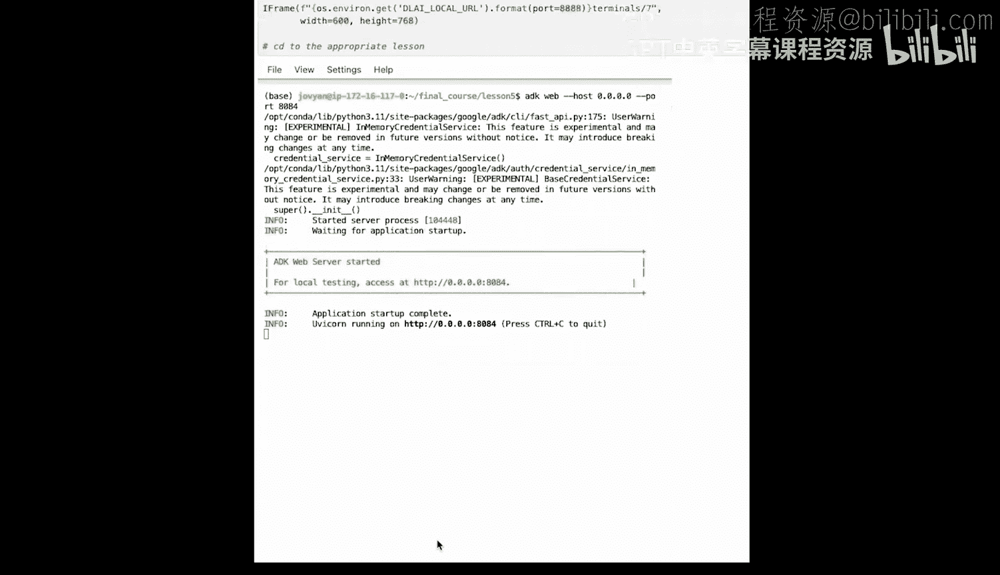
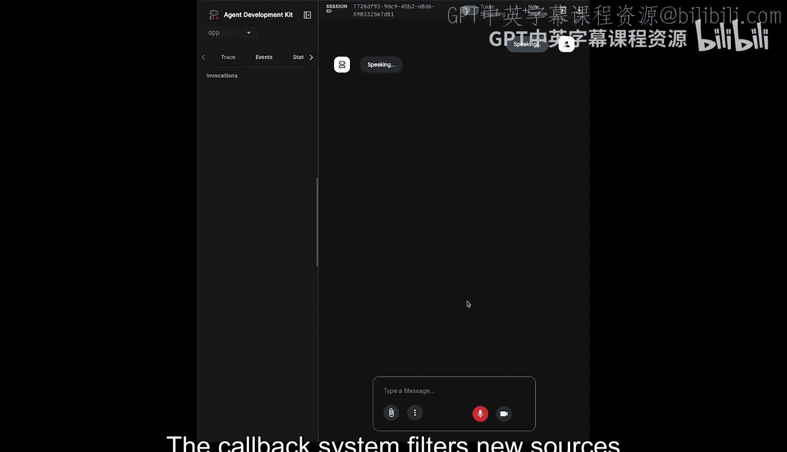
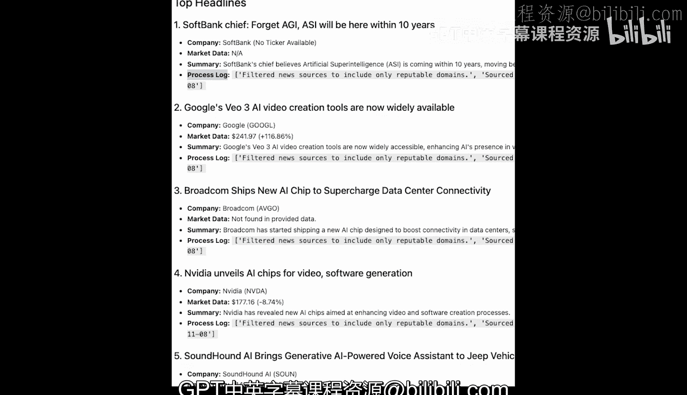

# 谷歌《使用 Google ADK 构建实时语音代理｜Building Live Voice Agents with Google ADK》中英字幕 - P6：6.instruction-tuning-and-guardrails.zh_en - GPT中英字幕课程资源 - BV1HeyhBiEDM

By definition， agents are nondeterministic， but that's not always the best case scenario。

 especially if you're in production。 This lesson teaches you to build agents that behaves somewhat predictably you would do further instruction tuning to optimize prompts and youll use powerful callback systems to programmatically enforce rules and create safety guardrails for production applications let's get started in the previous lessons we touched on the important topic of instruction tuning we started by providing our agent a personality by defining its core identity then defined its workflow and also gave it a few rules that scoped down the user's request to check if it was a valid request and only if it was a valid request for AI use it got passed and while these instructions guides the agent to steer the conversation and reject request that's like completely outside of its domain like maybe asking for a whether LLm is inherently nondeterministic and we wouldn't be。

Able to guarantee the execution of any of those instructions every single time。

 And this is actually a pretty serious problem when it comes to a production system and this further amplifies in a live voice agent So in this lesson you learn how to build agents that go one step further than guide and enforce callbacks at various execution points of an agent So what exactly is a callback they are actually python functions that run at various checkpoints of an agent's lifecycle giving you programmatic control over agent behavior the various callback points in ADK R before after agent before and after tool and before and after an LLM call。

 let's say for example if you define a python function for a before model callback and added to an agent。

 then that specific callback which can be a deterministic piece of code will be executed each time before an LLM call is made and these executions or lifecycle points in the agent can be a great place to apply a set of generic functions that you want。

😊，be executed for each agent tool or model like say for example you want to observe and debu the tools and log detailed information or customize and control the data that is actually flowing between an agent and a subag and even and for safety rules like checking the prompt for prompt injection before passing it to an agent or validating input and output and disallowing certain operations so it's great that we have the checkpoint but how exactly does a callback work well when ADk encounters a point where callback can actually run let's say for example just before a tool call。

 it checks if you have provided a corresponding callback function for that agent and if you did。

 the framework then calls that particular function and inside the callback function itself。

 you have access to a special object called the callback context or tool context Well these objects contain vital information about the current state of the agent's execution including the in details of which agent actually called it you can use these context objects to understand。

the situation and interact with the framework。 And when the code execution is actually done within the callback。

 you can return one of the two values from callbacks。

 which would influence the agent's subsequent actions。

 You can return the value none from the callback which will allow the agent to actually continue its normal execution flow。

 But if you return another object other than none this would override the default behavior of the agent。

 let's now see this in action in the next steps when we add a callback to filter new sources for our podcast agent let's create a new agent project structure using the ADk create command。

 and like usual this just creates a folder structure for our agent and sets up everything nicely。

 and I'm going to go ahead and start adding in code from a previous lessons to our new apps agent let's go ahead and copy paste that get financial context tool and the save news to markdown tools。

 So here are the two tools we've built in our previous lessons I'm going go ahead and run this theres no change in the code I'm just copy pasting。

From the previous lessons so we can continue building our agent on top of these with that I'm going go ahead and paste in the small code that I have for our callback function and we're gonna break this down and explain in detail what's going on so just by looking at it there are a few different things to unpack here first the definition of the function itself which takes in a few special arguments like the tool the as and the tool context and these arguments are actually very much dependent on the type of the callback since we'll be adding this callback as a before tool callback to our agent it has access to these special tool arguments but if you were to add let's say and after agent or before agent or a model callback you would have very different parameters than what you're seeing here okay let's go ahead and see what each of these arguments mean tool actually gives you the name of the tool that interrupted or invoked this callback and as are the arguments of the LLm put together to pass it to the actual tool which then got interrupted and tool context。

😊，Like we saw earlier provides a tool access to certain external context like session and state so this specific callback actually looks at a Google search tool and then blocks few domains that we have defined here it demonstrates the programmatic policy enforcement so if you look at the condition at the right at the top you see an if condition that narrows the call back down to only execute if the tool is the Google search tool meaning if this callback was triggered when the agent called the Google search tool and then this callback interrupted it that's the only time this will get executed and next we look into the as that got passed to the Google search tool itself and then fetch the query argument to actually look if the query contains any of the block domains that we have declared here we just have a random list of block domains here which may or may not be useful for a podcast like for example let's say we want to fetchulate this new AI news they we're not going to do it from archive。

😊，Information so we're just using few of the sites to block so based on the result of this if condition it will either return an error object if the query is actually blocked or it will return a none notice also how the error messages are super disruptscriptive because this provides context with the agent of why this query was actually block and prevents any confusion that might arise later okay I'm going to go ahead run this cell for us and we are going to add this specific callback to our agent and so far we've seen how to actually define a callback and block some domains but we're going to quickly do an aftertool callback before we add both of these to our agents I'm going to quickly copy and help a function and then an actual callback here and let's walk through the code together so this specific callback which is inject process log after search it is basically a utility tool that we are using here to log what sources of information that our agent actually used so let's say if it use the Google search to fetch。

😊，formation from Reddit or from YouTube or anywhere it's gonna to create a log in a file that P will be generating in a maron file。

 So let's say if it used Wikipedia or Reddit or YouTube or anything it's going generate a log in the maron file that people will be generating at the end so I'm going go ahead and add both these callbacks to our agent and this little helper function here actually does nothing but writes the process log to the tool context using the state key So remember how we said that the tool context actually has state information within it and this is exactly how you write information so basically our call back list all the sources that the Google search tool used to do the search and then it writes it to the state here using the tool context do state function okay with that let's not go ahead and add both these callbacks to our agent Okay let's break what this agent actually does if we scroll。

Then go to the bottom of this code you will see that we've now added two of our callbacks right here。

 the before tool callback， which actually runs before the tool is called and it makes sure that the tool in this case the Google search doesn't use few sources of information or few domains and then the after tool callback which runs after the tool basically when after the search is done and then logs all of the information and the sources which the Google search tool actually used and let's say you have multiple callbacks in the before and after tool callbacks Now this would mean all of your callbacks would run one by one in the sequence in which you defined and now the next step is actually to update our agent instructions to provide context about the new callbacks that we added to it and these are all the instructions that are new to this callback let's break this down we provide our agent which。

Awareness saying you have a Google search tool which is enhanced by pre and post processing callbacks and then we also tell it to write a process log of the sources which it used to do the search and we also have a small snippet here。

 which then says when it's testing callbacks it asks our agent to be chatty So it can actually explain you what's going on behind the scenes。

 and this is all the new code that we've added to our agent and now it's time to actually run the agent and verify that callbacks work Let's start up the terminal again and Cd to the right folder。

 I'm going to run the ADk web command again to bring up our Wi and we'll also run this small snippet which should give us the proxy URL to access the Wi Can you give me the latest AI news all done I've compiled the research report with the latest financial context and saved it to AI underscore research underscore report do M Can you tell me with sources you use。

To fetch this news the news was gathered from softbank go crescendo indianexpress co and greennews the A Reddit I am programmed to only use reputable news domains and avoid sources like Wikipedia and Reddit do you have a callback that prevents it is call filters sources to include only reputables prevents fetchy news Wikipedia Redit just saw the agent the call make a decision sources fetch the informations the created verify thee innippet go and to include sources and that brings us。

To the end of this lesson you built a production ready control system combining instruction tuning and programmatic callbacks your agent also now refuses off topic requests consistently and blocks certain domains to fetch information from in the next couple lessons will expand beyond single agents to build specialized agent teams that can work together and actually give us the podcast episode。

