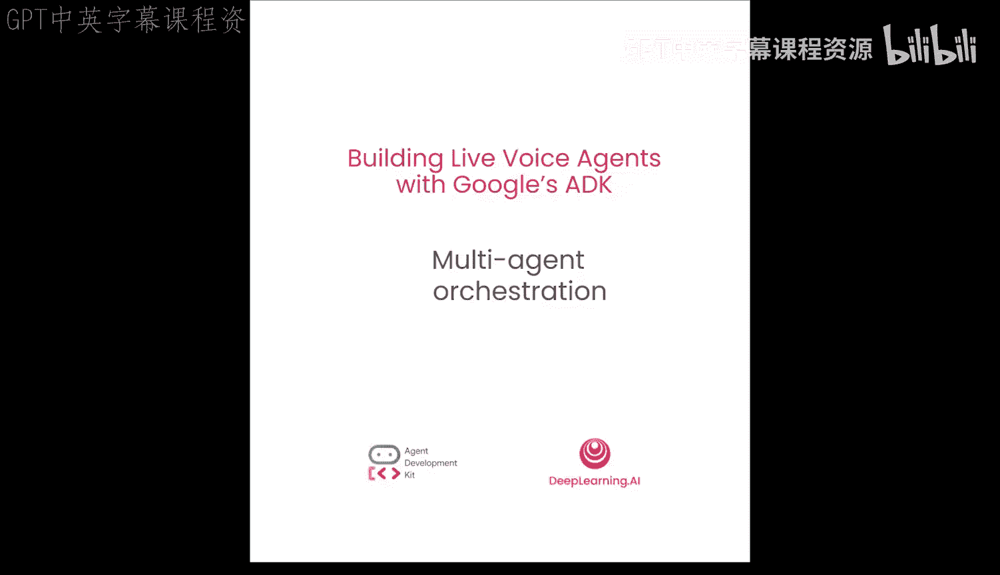
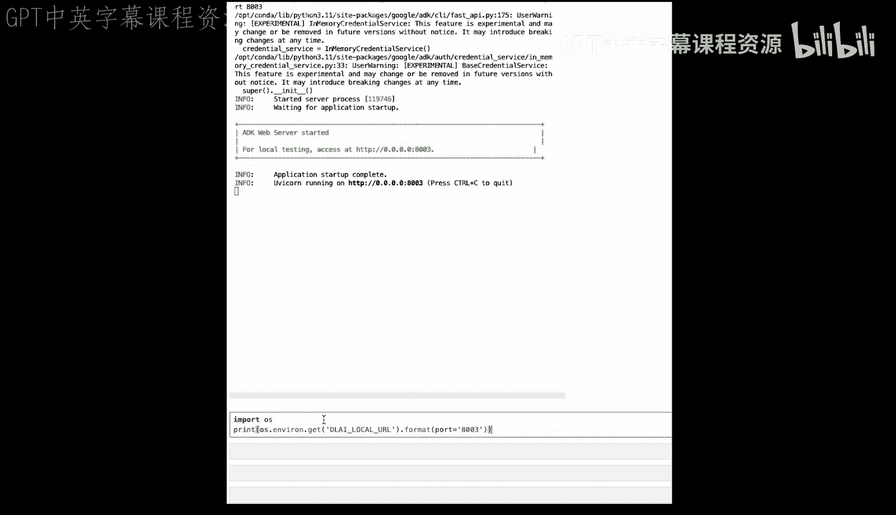
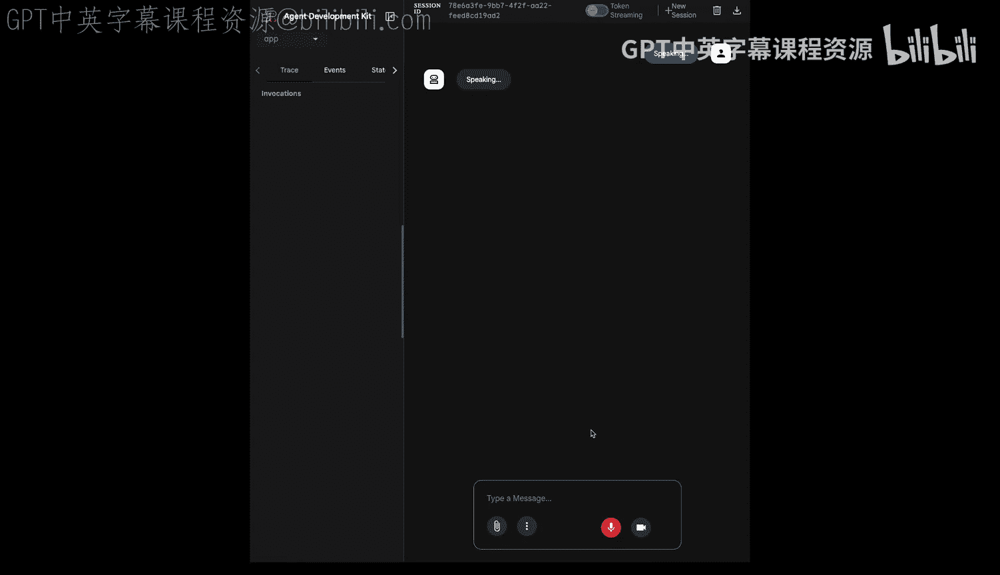
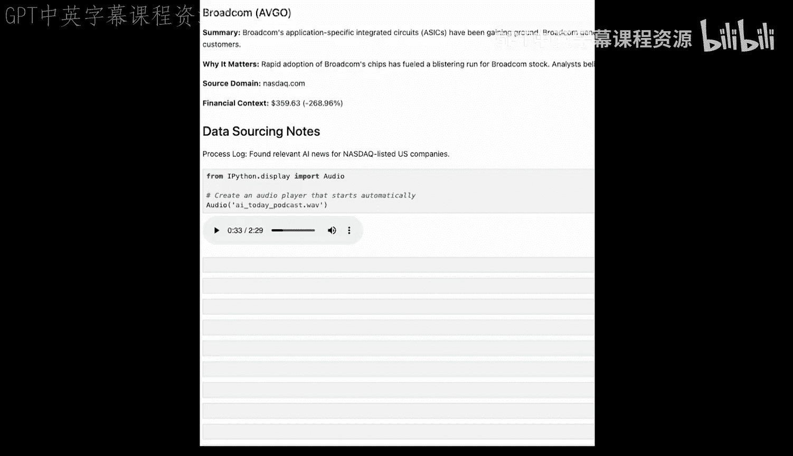

# 谷歌《使用 Google ADK 构建实时语音代理｜Building Live Voice Agents with Google ADK》中英字幕 - P7：7.multi-agent-orchestration.zh_en - GPT中英字幕课程资源 - BV1HeyhBiEDM

In this lesson， you learn production rate multiag patterns where you refactor your system into a threeter architecture with proper separation of concerns。

 creating a scalable foundation for complex applications。 Let's dive it to the code。

 over the past few lessons。 We have progressively build a sophisticated research agent。

 We started with a simple live voice agent evolved it into a silent background worker。

 and then added robustbus cardres using callback。 Now。

 we assemble all those pieces into a complete endto end content production pipeline。

 Our goal is no longer just to create a research report。

 It's to take a user request and automatically generate a finished two-per audio podcast to achieve this。

 we are introducing three major advancements。 a multiage architecture。

 robustbus data structuring with Byedantic and a new tool that brings a project into the world of audio。

 Before we get on to the code。 Let's quickly talk about the architecture。

 We are now moving into a multi agent system， a root agent， which we can now。😊。

Think of as a producer will orchestrate the entire workflow however。

 with the specialized task of audio generation itll delegate the work to a new dedicated agent。

 the podcaster agent this is made possible by the agent tool which allows one agent to be used as a tool by another This pattern of using specialized agent for a specific task is fundamental to building complex and scalable system Now let's start building the code and before we start as you know we always data folder let's do that quickly。

Now let's go to the code block by block The first thing that we see is the new tool classes at the top of our agent do Pva。

 which is new story and AI news report。 This is a significant upgrade from our previous method instead of putting a markdown schema in the prompt you are now using pedantic schemas Think of this as a strict contract for our data a new story class defines exactly what information we need for each article like the company clicker and a new field why it matters the A news report class then acts as a container for the whole report holding a title As and list of all these new story object This ensures a data is always clean structured and predictable Allright our next action is to add our tools the very first two tools that we're going create is tools that are going to be used for creating and generating the podcast The first one is the wave file which will save the output that is coming from Gemini Tts to a local file folder with a dot wave format Next is a most exciting new tool which is the generate podcast audio。

This function is a gateway to multimodal output。 It takes the text script as an input and uses the Gemini text to speech model to convert it into audio。

 The key feature here is the multispeak voice config weve defined two distinct speakers Joe and Jane with different prebi voices this allows the model to generate a natural sounding conversation podcast not just a monotonous reading The function then takes a raw audio data from the API and saves it as a dot v file in our project directory the most important element for this is Gemini 2。

5 flash preview pts model which are the text to speech models we are using for this use case Now let's add this into our agent do Next we have the same get financial context and save news to markdown as we have seen in the previous lesson we quickly run them now that we have added tools the next step is to actually add our callbacks which we have seen in the previous lesson as well you'll recognize filter news source callback which we had in the previous lesson and we have added one more which is。

data freshen callback There is another before tool callback is always is very simple but crucial。

 It intercepts the Google search call and adds a parameter to the query that restricts results to the past be ensuring our podcast is always based on current events Now the second callback is inject process log after search and it's after tool callback。

 This one is very clever。 it runs after the search is complete。

 it looks at the result figures out which of our whitelist domains were actually used and then modifies the tool response instead of just returning the search result as a string。

 it returns a dictionary containing both the result and a process log This makes the invisible work of our before tool callback visible to the agent which we then instructed to include in the final report for full transparency we have the tools and we have the callback Now the last missing piece is essentially adding the agents let's add our agent Now what you see here are two agents Poer agent and the route。

Aent is is our first multiagent system。 The podcaster agent is a specialist。

 It has one job and one tool， which is to generate audio。

 The root agent is a producer by wrapping the podcaster agent in an agent tool we give a producer the ability to delegate the task of audio generation to the specialist which is a much cleaner and more scalable design Finally all of this comes together in a new instruction of a root agent its identity is now an AI news podcaster producer its workflow is complete10 step production pipeline from acknowledging the user' request to generating the final audio crucially we now connect all the pieces we tell it to use a AI news report schema for its output by setting output schema equals to AI news report we instruct it on how to handle the new dictionary output from the callback modified Google search tool we add a new creative step which is to create podcast where it must write a natural conversation based on its finding and the final step in its background work is to call the podcaster agent。

To and you run this final agent the user experience is as simple as ever。

 but in the background the sophisticated system of agents tools schemas and callbacks will execute delivering not just research report but the finished audio podcast so let's get into it Now let's start a server and run our ADK web。

As we have seen earlier， we can directly access the UI with this link。

 Now that our ADK web is running。 let's ask for a podcast。 Hi。

 can you help me get the latest AI news in a podcast Okay I'll start researching the latest AI news Nasdaq listed U company I will enrich the findings with financial data we are available and compile report for you This might take a moment Now you saw that we were able to talk to our agent and it told us that it'll do all the things in the background and Voa it actually did save the report as well as the final podcast。

 Let's look into it Here we are actually reading the AI research report M file that got generated by the background process that our agent did As you can see this is very detailed report。

 It has all the listed companies that we asked for。 it also has the financial context。

 it has the domains from where it is speaking。 It has both the headline and the summary of white matters。

 This is really interesting but the most interesting part is the podcast which is what we have been waiting for。

Ever since we started from lesson one and I'm not going to say much about it。

 I would like you to listen to what it has produced podcast script AI news roundundup。

Hey everyone and welcome to the AI Today podcast I'm your enthusiastic host Joe and I'm Jane here to provide the analytical perspective on today's AI developments Today we're diving into the latest AI news Nasdaq companies Jane what's catching your eye Well Joe it's clear that AI is rapidly transforming the tech landscape Let's start with Microsoft MSF amazing is what we have been wanting to accomplish and just few blocks of get two percent this is mindbing and we have come a long from a simple that was us about live news to this we have a the latest news to achieve this had to learn so many different elements of ADK and I can't really wait for you to find more out of the box ideas withK and Gemini life model。

Happy building。