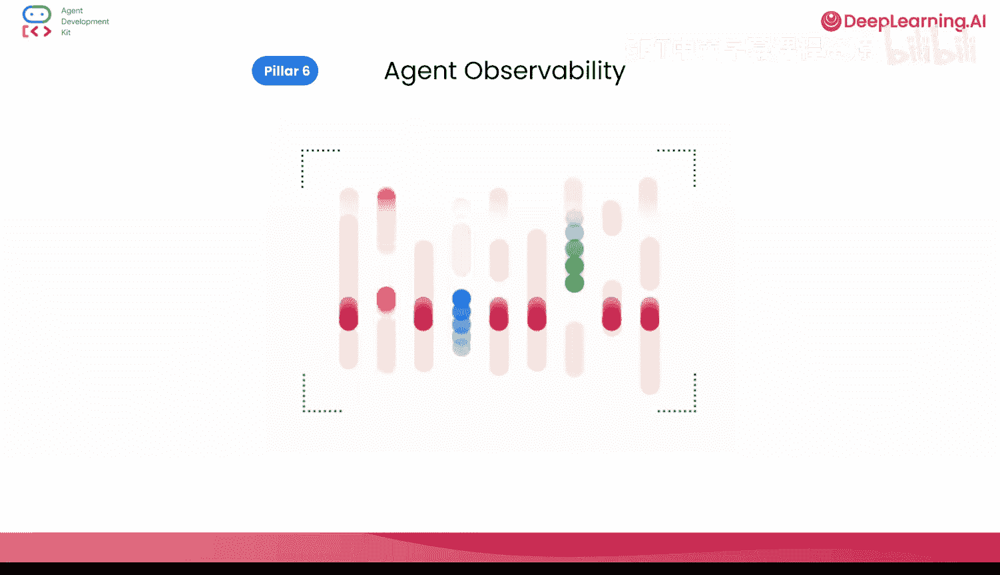
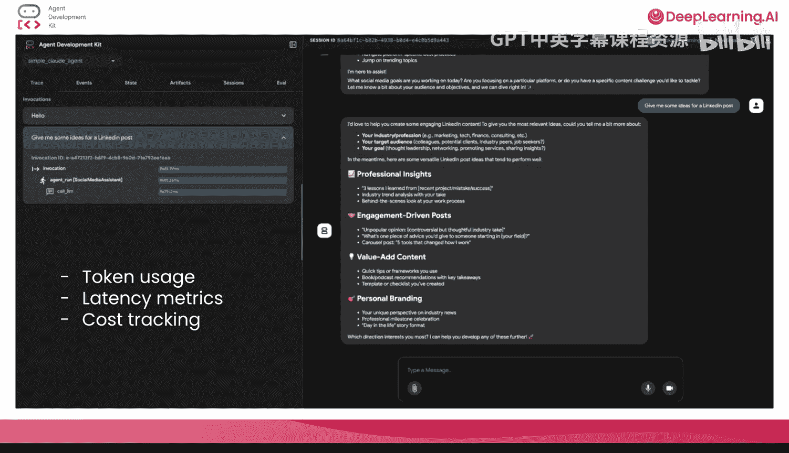
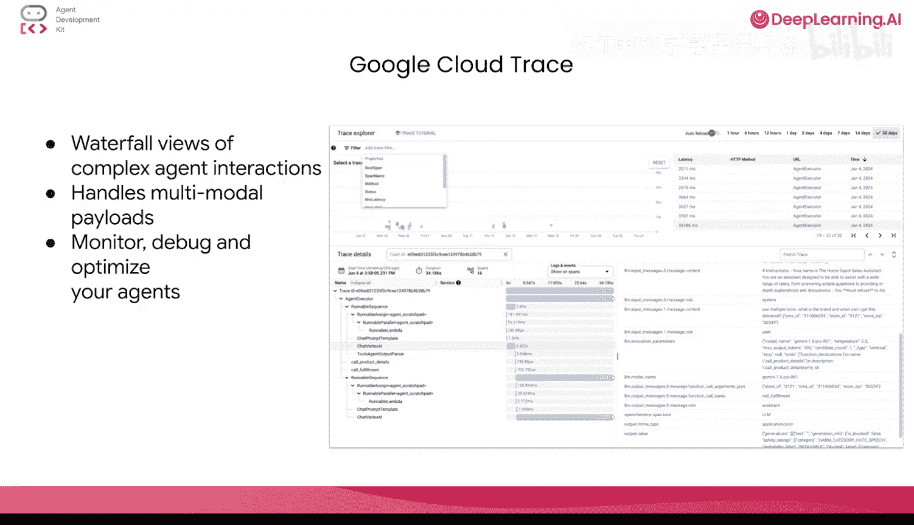

# 谷歌《使用 Google ADK 构建实时语音代理｜Building Live Voice Agents with Google ADK》中英字幕 - P8：8.-optional--productionize-your-agent.zh_en - GPT中英字幕课程资源 - BV1HeyhBiEDM

This lesson takes your multiagent system from development to production。

 Youll learn how to evaluate your agents to ensure reliable behavior。

 give your agents persistent in memory using vertex AI memory bank and deploy to a scalable cloud environment using vertex AIs agent engine we'll also briefly discuss the live bidirectional agent architecture。

 let's make the magic happen。 Wee to this lesson in our journey throughout this course weve built a sophisticated multi-agent podcast system which can take in voice input from the user and written a podcast episode and in our final lesson we are going to cover the important topic of productionizing the agent we just built there's a crucial gap between our local development setup and a production ready system and production AI agents face unique challenges that development environments don't expose and in this lesson we'll explore six fundamental pillars of production AI system we'll walk through these by first looking into the live bi-directional architecture and Ak something that you would use in a production environment。

😊，As you build more complex agents and move out of the ADK web and then we'll give our agent persistent memory that it needs for a production system Now once both these are done。

 our agent is now in a place where we can evaluate its performance and then comes a standard practice of deploying our apps to scale adopting agent security practices and making sure that we have agent observability that our agents are not a black box and as we walk through these practices well also see the different capabilities。

 ADK and Google Cloud provides to address them let's start with the live bidirectional streaming using real-time conversational interfaces is a huge unlock as humans we evolved for thousands of years to talk to each other and now we can translate that and choose to speak with our agents instead of typing and for it to actually feel natural you will need extremely capable models and low latency streaming connections to their APIs and this requires bidirectional streaming audio processing and something that actually feels instantaneous to feel it humanlike for natural conversations it requires more than fast response you need。

Understanding pause and the ability to interrupt and be interrupted naturally the Gemini Live bidirectional A enables true conversational AI through web socket connections that maintain persistent realtime communication the system handles complex audio crossssing pipelines multilingual voice synthesis with multiple speaker options and emotional aware responses that adapt to the user and tone and when you put all of this together what you get is a conversational experience that feels more natural and humanlike and ADK provides a very simple interface to plug in this Gemini live API in this course we ran all of our agents with ADK web but simplified and head most of the complexities involved in creating a live bidirectal agent we is still interacting with the Gemini live model and got a voice responses output in real time using web sockets but as you scale your agent further you might want to integrate with your existing systems and client and at that point you might want to have final controlable how。

implementmment the live bidirectional streaming and let's have a very quick look at how you might do this with ADK ADK abstracts the core agent logic from the transport layer through two fundamental primitives a live request queue to send data to the agent and a live event stream you receive responses from the agent this design means your agent logic is completely independent of whether you use web sockets or server sent events or other protocols the live Requi queue handles different message types like text realtime audio blobs and activity signals for natural conversational flow Meanwhile the live events stream is realtime events including agent responses turn completion signals interrupts and streaming tool outputs and then you orchestrate both of this using a runner or run live method that ADK provides there are links for you in the resource section to learn more about this live bidirectional streaming architecture and how to implement it and next up is to provide your agents with persistent memory and we actually briefly discuss this in lesson2。

Agents seem much more intelligent if they can actually remember conversations across sessions。

 learn user preferences and maintain context， even when systems restart and agenttic memory is actually of two text volatile which disappears on session starts and persist memory which is the longterm memory packed up somewhere and that is exactly the kind of memory that we're talking about here for production agents need to build understanding over time recognize patterns in user behavior and provide increasingly personalized experiences and ADK gives you an interface for everything memory included in add a provider for any memory service like vertex AI is a memory bank Mem0ro or any other DBs with your agent memorybank is Google Cloud's managed service that transforms raw conversation history into intelligent searchable knowledge unlike simple session storage。

 memory bank actually uses an L powered processing to extract meaningful information from your session data and then consolidate it with existing knowledge and provide semantic search capabilities so the next time。

😊，Ask your agent a question from one of your previous sessions。

 it might actually be able to use this long term memory and fetch the context and give you the exact answer。

 And this actually enables agents not only to remember what you just said but what you meant what you prefer and how you like to work The service also handles complex challenges of memory consolidation determining what's worth remembering and how it connects to existing knowledge And with this your agents evolved from fixed it systems to intelligent personalized assistance that grow smarter with every interaction。

 And after implementing both the bidirectional live streaming and the personalized memory we are actually in a good spot to perform agent evaluation at this point。

 and fun fact， when I started learning about AI agents。

 I used to think agent eval was something like unit testing。

 the agents's behavior but turns out I'm completely wrong。

 well if you're writing traditional unites for your agent。

 you're trying to measure a dynamic system with a static ruler the very probabilistic nature of Lms needs out change and approach and that is exactly where we go from verifying correct。

To assessing quality and both these mean very different things verifying correctness can be done through unit tests but which do not translate to the world of AI agents because you're non-deterministic but instead we need to assess how helpful harmless and reliable your agent is and that is a core of evaluating and agent broadly speaking there are two categories of quality checks that we can perform in an agent we can look into the agent's trajectory verify if it took the right steps if it called the right tools use the right subag to get something done and we can also look into the final response from the agent to check if the answer was any good and if it matched our expectations ADK provides again with a comprehensive evaluation framework and built in metrics like tool trajectory scoring response matching and safety evaluation you can evaluate agents through the WebI if you want to debug your agent or even programmatically by a pie test for CCD integration or also through the Ci with each ADK e the framework supports both test files for unit testing。

Comprehensive evaluation sets for integration testing iss also another option Vertex evaluation services which integrates seamlessly with ADK providing cloudbased evaluation capabilities including advanced NLP metrics for coherence and safety assessment this service uses prebuilt metrics like coherence for response quality scoring and safety for harmlessness evaluation processing your agent data and the cloud and returning results with a configurable pass or fail thresholds and this makes our decision much simpler when we have a pass or a fail with this integration you can combine local ADK metrics for trajectory analysis with cloudbased vertex Ai metrics for sophisticated language understanding assessment and finally once we're done with agent Eval it's now time to deploy our agents to production a single agent running locally can't handle thousands of concurrent uses Product applications of all types need automatic scaling load distribution and infrastructure management without manual intervention actually scaling。

😊，Applications for AI agents isn't actually about handling more requests， but it's much more。

 it is about maintaining performance， managing your costs and ensuring reliability as the demand fluctuates Google Cloud's vertex AI agent engine provides turnkey serverist deployment specifically for agentic AI workloads unlike Gen compute platforms it understands agent lifecycls manages model loading efficiently and provides builtin integrations with AI services actually agent engine isn't just only your runtime it has providers for sessions and example store service which is basically your rack for multishor examples it also has memory bank and more the platform auto scales based on AI specific needs and resources which are configurable by you ensuring low latency and high availabilityva for your users ADK's tightly integrated with agent engine and you can deploy agent to agent engine with just one C command ADK deploy and at the end of the day agents are just another type of application you can containerized agents。

And run them anyway that you actually run your other applications if you prefer to build all of the agentic services yourself。

 you can use cloudrun， which is our serverless runtime built for scale reliability and flexibility or if you want full control or the power of Kubernetes GK is also a good option AI agents press in very unique challenges when it comes to security they process natural language make autonomous decisions and may actually have access to sensitive information and powerful tools and this makes robust security mandatory like robust authentication content filtering input validation and production against prompt injection and misuse well let's walk through each of those security is actually a defense and depth game and agentic security requires multilayed protection there are two ways in which your agent can authenticate either using the agent's credentials or using the user' credentials the first approach actually works when every user who's using the agent has the same privileges but if that's not the case can the agent actually needs to borrow the user' credentials to get the job done and in this scenario。

😊，You also need to implement authentication that goes beyond simple API keys to include OFflows。

 service account credentials and fine grain identity control based on whether agents act with their own permissions or the user permissions or accommodation of both authorization to resources is also another common concern limiting the scope of agents tools APIs and resources and any principle can access to and this is especially important as you scale up and need to govern a huge fleet well this brings us to another important topic of how important it is to perform user input sanitization as it helps your agent be more secure against prompt injection content manipulation and any items to make agents perform unauthorized actions content filter actually combines builtin safety measures from the LLM model itself with configurable harm category that shows and policybased well Al lets you define before callbacks to sanitize your inputs and you can do it by implementing custom checks or using LLM to decide if a users prompt is actually safe to pass or you can also use special services。

Mod Lamer， which is a Google cloud service designed to enhance security and safety of your AI applications It works by proactively screening LLM prompts and responses。

 protecting against various risks and ensuring responsible AI practices and the same after callbacks can saveguard againsts generated output from the agents that you do not want to expose maybe let's say the agent generates some information about a competitor that you don't want to expose and since you are in control of this callback you can actually handle these exceptions and then maybe simply call the model again to get a new output and this is exactly what people mean when they talk about cards and ADK gives you the flexibility and control and the tools to do it there are also plenty of the safety measures that you can take like sandbox code execution environments setting up a virtual private cloud and adopting comprehensive safety evaluation frameworks to ensure your agents operate within defined boundaries while also maintaining functionality and this brings us to the final topic of observability Age are general purpose systems which are capable of many things。

need complete visibility into what your agents are actually doing how they are performing and whether they are actually operating safely and this brings us to the final topic of agent observability Ages are actual gender purpose systems which are capable of doing many things but you need complete visibility into what your agents are actually doing how they are performing and whether the operating safely when agent evaluation indicates you have a problem with the quality of your agent observability is actually how you debug them so having visibility is super crucial ADK provides comprehensive observability built on top of open telemetry standards This includes end to end tracing from user input each internal step and all the way to the final response it also includes realtime monitoring of agent interactions and detailed performance analysis including token usage latency metrics and costt The framework integrates with leading observability platforms like B for realtime visualization arise for enterprise monitoring Phoenixix for selfposted observability and agent tops for specialized agent。

Each provides different capabilities from session reps to custom evaluators to automated downloads you can also use Google Cloud tracece which aggregates the same traces and provides waterfall views of complex agent interactions across any distributed system Cloudtrace handles large multimodal payloads and is actually helping to shape the open teletry standards for LLMs and agents This comprehensive observability and shows you can monitor debug and optimize your agents in production environments congratulations you've completed the journey from understanding basic agents to architecting production ready AI systems and you're ready to build the future of conversational AI check out the various exercises across all of the different lessons and the resources section for further reading。

