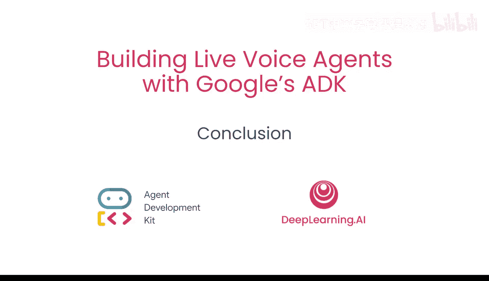

# 谷歌《使用 Google ADK 构建实时语音代理｜Building Live Voice Agents with Google ADK》中英字幕 - P9：9.conclusion.zh_en - GPT中英字幕课程资源 - BV1HeyhBiEDM

Congratulations you've just completed the course you started with a basic agent and built up to a multiagent system that you can speak to which has access to tools like Google search we built callbacks and fine tune instructions that control and modify the agents's behavior Finally we saw different agents working together to generate the file script and podcast check out the resource section to learn more about ADK and live agents you cannot now take what you have learned and applied to any use case and we can't wait to see what you built with it。

😊。