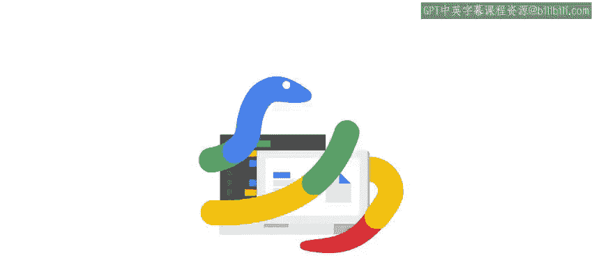
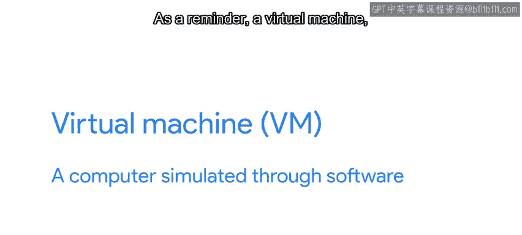
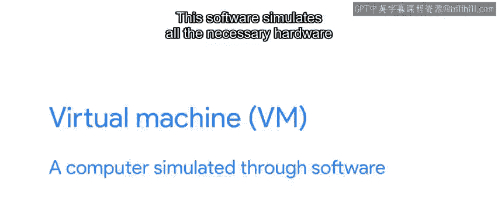
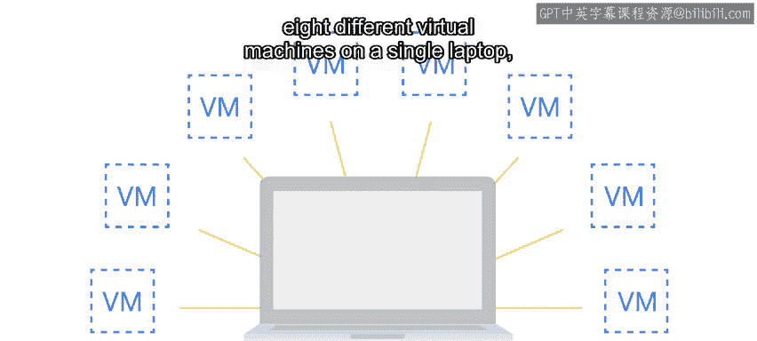
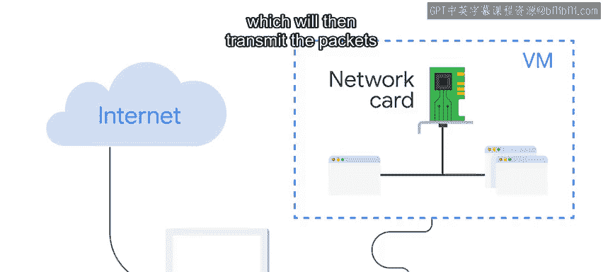
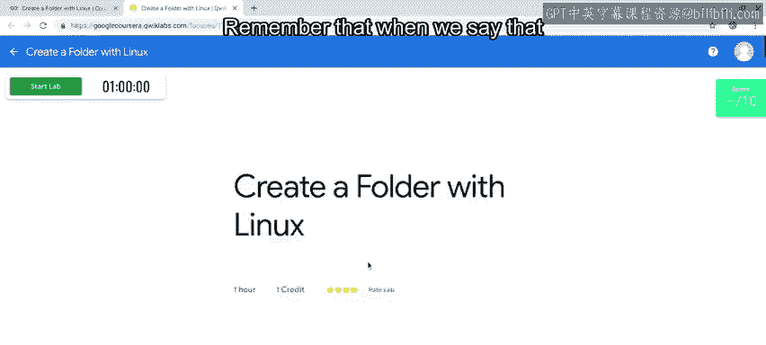
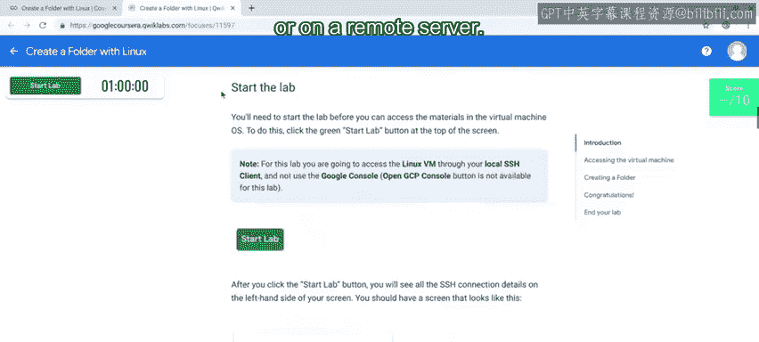
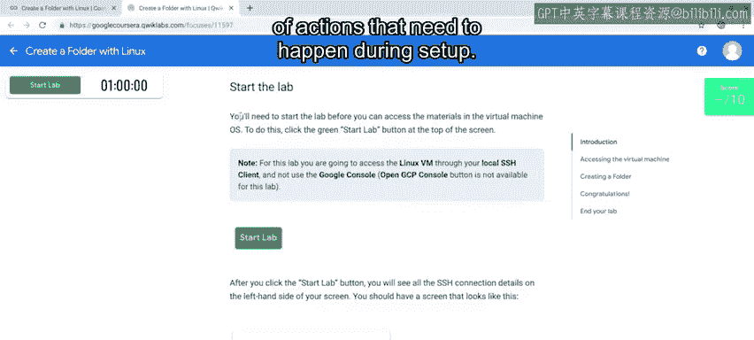
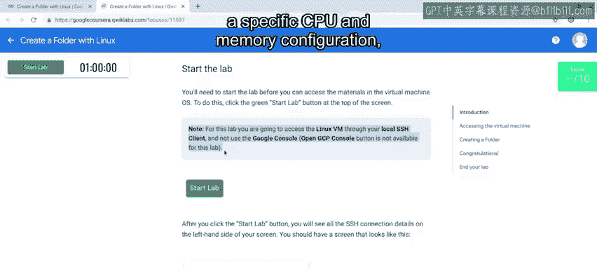

# 谷歌《用Python进行IT自动化办公1、2课（Python、控制操作系统）｜Google IT Automation with Python》中英字幕 - P100：26_什么是 Qwiklabs.zh_en - GPT中英字幕课程资源 - BV1gw411E7E1

🎼。う。

For the grade assessments in this course， we'll use the Quicklabs online learning platform Before we dive into our first lab。

 let's learn a little bit more about Quicklabs。 QuickLbs is an online learning environment that takes you through live real world scenarios you might come across as an IT specialist。

Quick Labs works with the Google Cloud console to spin up and create virtual machines。

As a reminder of virtual machine or VM for short， is the computer simulated through software。

This software simulates all the necessary hardware to the operating system that's running inside the machine。

For some simulated hardware， the VM will use a portion of the underlying hardware for the simulation。

 For example， you can run eight different virtual machines on a single laptop or even more。

Each with a portion of the disk base， memory and CPU time， In other cases。

 it will simulate the hardware by talking to the operating system， running on the physical machine。

For example， a VM will use an emulated network card to communicate with the outside world。

The networking packets going through that emulated card will be transmitted between the software that runs the VM and the operating system of the physical machine。

Which will then transmit the packets over the physical network。

 Viual machines have become a staple in a lot of IT departments。

 since they allow us to create new virtual computers on demand。

We can also reclaim the resources they use when they're no longer needed。If， for example。

 you want to use software that's only available on one specific OS。

 It's easier to create a new virtual machine， Use a software and then delete the virtual machine once you're done。

 Looking back， I wish I had VMs to play around with when I was first learning Python。

I mostly learn from books and online videos。To practice。

 I'd find sample math problems and try to solve them by writing code。

 It was nearly impossible to simulate real world applications。

 like finding ways to practice how to write automation scripts without having a bunch of servers。

It would have been so cool if I had virtual machines to practice with。😊，Enter Quicklabs。

 these virtual machines run in the cloud so you can have access to them over the internet wherever you are。

Remember that when we say that a service is running in the cloud。

 we mean it's running in a data center or on a remote server。

 each lab has a preconfigured list of actions that need to happen during setup。

This includes spinning up a VM with a specific CPU and memory configuration and installing the VM with a specific operating system。

The lab will also configure any other cloud resources needed for the exercise。

This could include additional virtual disc for the virtual machine or maybe a second machine。

During the lab， you can access instances of Quicklabs created for you by using SSH。

 which is a command that allows you to interact with remote Linux computers。

You can operate with the VM in the same way you'd use a physical machine running Linux。

Once the lab is finished， Quicklabs destroyed this virtual machine。This way， any CPU， memory。

 and storage that the VM use is returned to the provider's pool of available resources。

It can also be used by other virtualing machines doing other work。After this video。

 we'll give you detailed instructions on how to access and complete the labs。

You'll use the quick Las for this and other courses in the program。

 so it's a good idea to spend some time learning your way around it Quick Labs is a powerful tool that we'll use in this course and throughout the rest of the program。

With Quick Labs， you'll get to experience solving real world tasks through scripting。Of course。

 you'll need to know how Quick Labs works， but it's just as important to remember why we've chosen this tool。

It will let you continue building confidence as you progress through your Python scripting journey in the next video and in the next reading we'll give you more info on how to log into Quicklabs to tackle the assessments in this course you can always go back to them if you ever need help。

