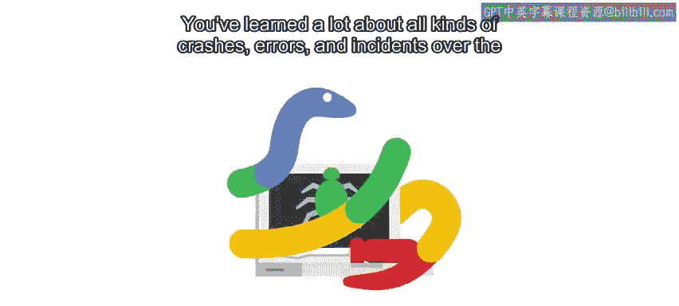

# 谷歌《用Python进行IT自动化办公3、4、5、6课（Git、debug、云端、实践）Google IT Automation with Python》中英字 - P100：42_模块 3 总结 - 崩溃程序.zh_en - GPT中英字幕课程资源 - BV1LW4y1F7XW

。

Congratulations on making it all the way here。You've learned a lot about all kinds of crashes。

 errors and incidents over the past videos。 We've covered examples of what you can do to work around a problem when you don't have access to the code。

 We've looked at ways to solve the issues when you do have access to the code。

And checked out how to deal with larger incidents that involve complex systems and large teams of people。

 Learn about the different ways computers and software can fail can seem scary at first。

 but remember that all of these tools help us get better at coming up with solutions。

 One of the things I love most about it is that there are so many different ways to accomplish any task。

 So if you get stuck， you can always try a new angle。

 There's nothing like the feeling of solving a tricky problem throughout our examples We've been applying the same techniques that we learned the beginning of the course。

 We gathered information until we understood the problem。

 We found the root cause and then worked on the short term and the long term remediation。😊，By now。

 you have a better idea of what you can do when an application crashes unexpectedly。

 how to use elimination to figure out what's wrong and what kind of solutions you can apply depending on the failure。

 Coming up， we've got some problems for you to solve one where a program is crashing and you can't change the code and one where you can change the code。

 This might sound tricky， but remember， you can always review the available material to help you figure out what's going on。

 Good luck and you've got this。