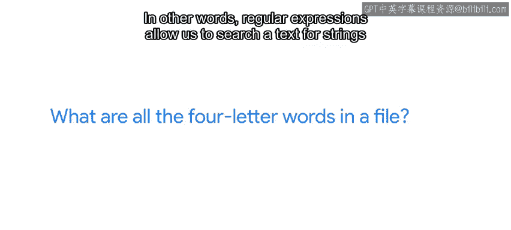
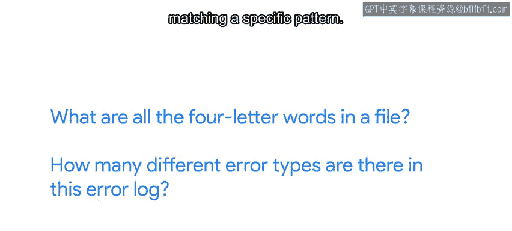
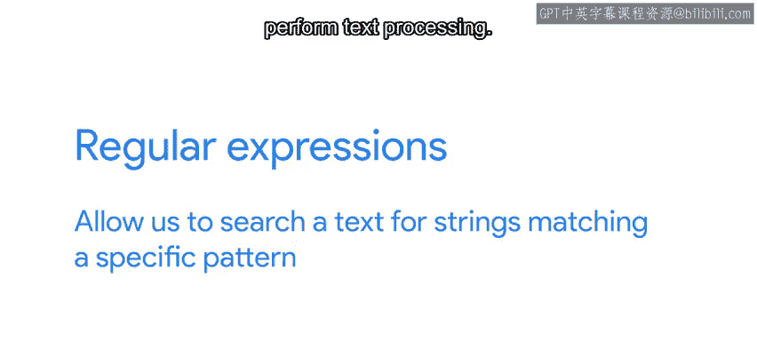

# 谷歌《用Python进行IT自动化办公1、2课（Python、控制操作系统）｜Google IT Automation with Python》中英字幕 - P103：29_什么是正则表达式.zh_en - GPT中英字幕课程资源 - BV1gw411E7E1

🎼。う。

We said we'll be talking about regular expressions。

 so what are these expressions and why are they regular？A regular expression。

 also known as RegX or RegX， is essentially a search query for text that's expressed by a string pattern。

When you run a search against a particular piece of text。

 anything that matches a regular expression pattern you' specified is returned as a result of the search。

Regular expressions let you answer your questions like。

What are all the four letter words in a file or how many different error types are there in this error log？

In other words， regular expressions allow us to search a text for strings。

 matching a specific pattern。

Knowing about regular expressions can be useful for anyone who needs to perform text processing。

From IT specialists to software engineers， system administrators and data analysts。

 a working knowledge of regular expressions is a handy tool to well have handy As a system administrator。

 I use regular expressions when I need to pull information from a file that has other information in it。

For example， if I have a file that lists NFS mounts and options。

 and I want to pull only the server name， I can write a regular expression that strips each line of the excess data and returns only a list of the information I need。

Regular expressions are a pretty big topic in IT， and this course we'll aim to cover the most important parts。

 but we won't go through them all。For your scripts。

 basic Regexes will usually be enough to get you started and they'll enhance your program's ability to process text with time and practice you'll pick up even more advanced techniques。

There are lots of different ways that we can apply regular expressions。

 We can use them in a whole wide range of programming languages， which， of course， includes Python。

We can also use command line tools that know how to apply redexs like GrP， set， or OC。

We can even use regular expressions inside text processing tools like code or document editors as with other widely used technologies。

 there's a broad range of tools that incorporate regular expressions and implementation details may vary from tool tool or language to language。

 but thankfully the principles are always the same once we learn the basics we can very quickly apply the same concepts to different applications。

Over the next several videos， we'll explore the Python module that deals with regular expressions。

We'll check out how we can apply the red X's to processing， parsing。

 and extracting meaning from text read by our scripts。

And we'll look at a bunch of different examples where we can use regular expressions to solve some real world problems。

Are you as eager to get going as I am？Great， let's go。

