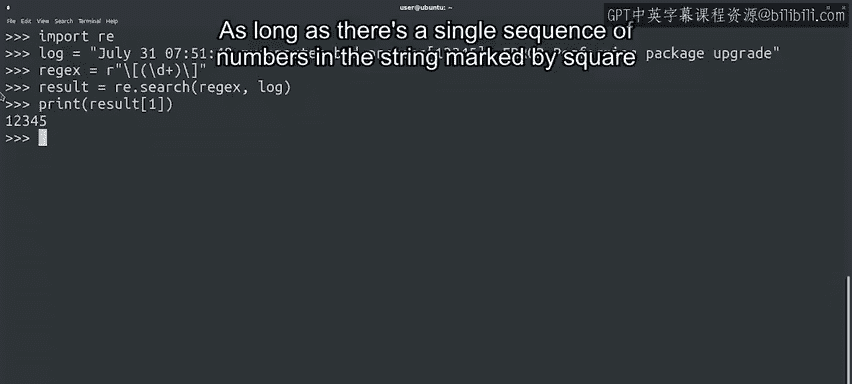

# 谷歌《用Python进行IT自动化办公1、2课（Python、控制操作系统）｜Google IT Automation with Python》中英字幕 - P104：30_为什么使用正则表达式.zh_en - GPT中英字幕课程资源 - BV1gw411E7E1

At this point， you might be wondering， why do I need more processing power than just looking for strings in a text。

 which I already know how to do in Python？The answer lies in the power and flexibility of regular expressions。

 For example， let's say we have log entries with a typical log line format like this one。

We want to extract a process identifier from this line。

 which is a number between the square brackets，1，2，3，4，5。

There's a lot of extra text in this log line that we don't need， like the date。

 the computer name and other info。 we could extract a process ID by using the index method to find the first square bracket in the string。

Remember that when accessing strings， the index of the character is the position of that character in the string。

 starting from zero。In this example， the index of the first square bracket would be 39。

If we don't want to capture the square brackets， we will start at the next position and include five more characters after that。

Let's give it a go。H， although we get the text that we wanted。

 we might hit a few bumps down the road。 Can you spot them。

One problem is we don't know for sure how long the process I string will be in all cases。

 In this example， we can see that it's five characters long。

 but that may change in the future of the computers we， or the number of processes increases。

 This could also break if， for any reason， the line includes another square bracket before the process Id。

So it's a solution， but it's a very brittle one。Any other ideas？Instead。

 we could use a regular expression to extract a process ID in a more robust fashion。 For that。

 we're going to import the R module， which lets us use the search function to find regular expressions inside strings。

Great， this regular expression will work no matter where a process ID shows up or how long or short the line is。

As long as there's a single sequence of numbers in the string marked by square brackets。

 this rex will extract those numbers for us。

If the regular expression stored in the rex variable looks like gibberish at this point， don't worry。

 that's expected。 We'll explore the syntax and how we use these expressions in upcoming videos。

At this point， the key takeaway is that regular expressions are both powerful and flexible tools。

By the end of this module， you'll be able to read and unpack statements like the one in this example。

 We're off to the strong start。 Next up， we'll learn how to use some very basic matching with the Grep command。

