# 谷歌《用Python进行IT自动化办公3、4、5、6课（Git、debug、云端、实践）Google IT Automation with Python》中英字 - P104：46_网络饱和.zh_en - GPT中英字幕课程资源 - BV1LW4y1F7XW

。

When you work in IT， you interact with services all over the internet。At one moment。

 you might connect to a service running on your local network。 and the next。

 use another service running in a data center located on a different continent。

If your network connection is good， you might not be able to tell the difference where the website you're browsing is hosted。

 but if you're dealing with a network service that isn't exactly up to speed。

 you might need to get more details about the connection you're using。

 The two most important factors that determine the time it takes to get the data over the network are the latency and the bandwidth of the connection。

 The latency is the delay between sending a bite of data from one point and receiving it on the other。

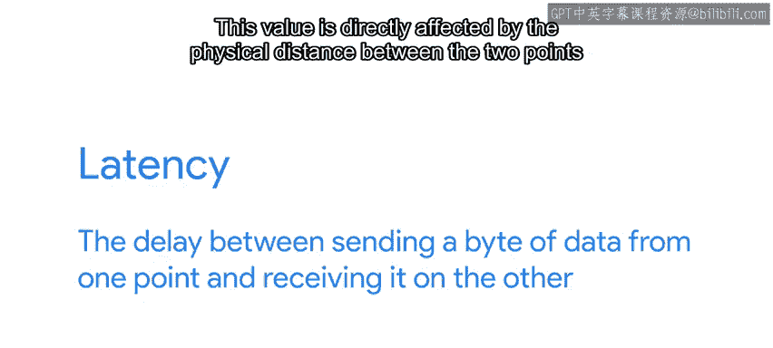

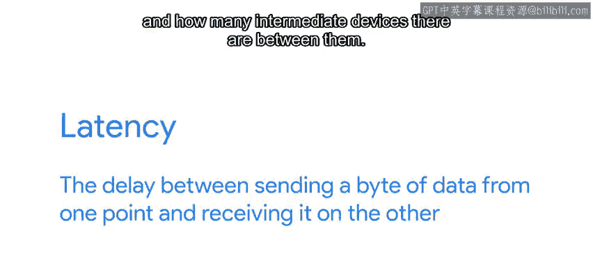

This value is directly affected by the physical distance between the two points and how many intermediate devices there are between them。

 The bandwidth is how much data can be sent or received in a second。

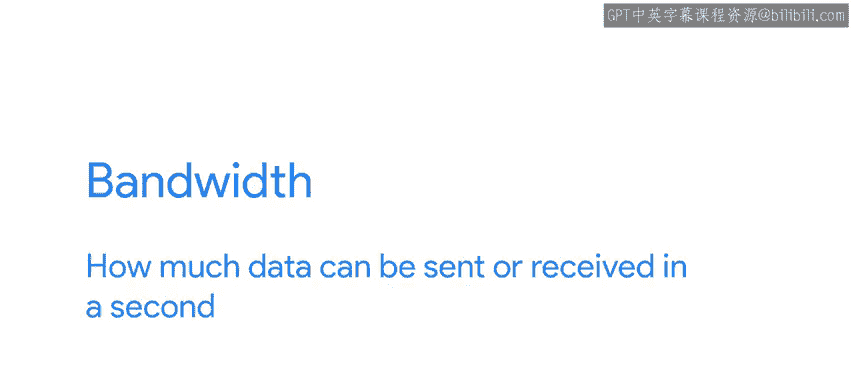

This is effectively the data capacity of the connection。

Internet connections are usually sold by the amount of bandwidth the customer will see。

 but it's important to note that the usable bandwidth to transmit data to and from a network service will be determined by the available bandwidth at each endpoint and every hop between them to understand how latency and bandwidth interact。

 Think about what happens when you try to visit a website over the internet。

If the web server is hosted somewhere across the ocean， the latency might be 100 milliseconds or so。

That's the time it takes for your request to reach the server。

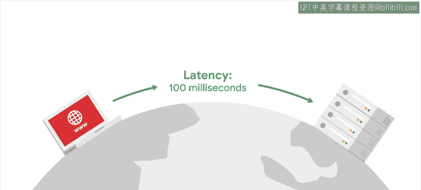

The server will then generate a response and send it back to you。

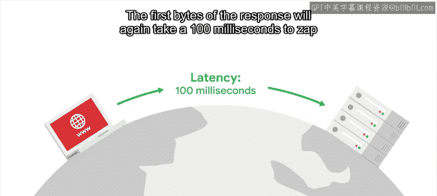

The first bites of the response will again take 100 milliseconds to zap across the pond to your computer。

Once the response is on its way， the time it takes for the rest of the data to arrive is determined by the bandwidth。

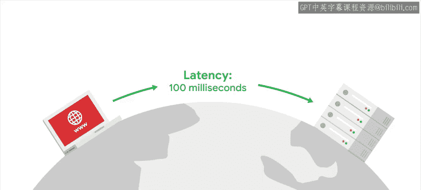

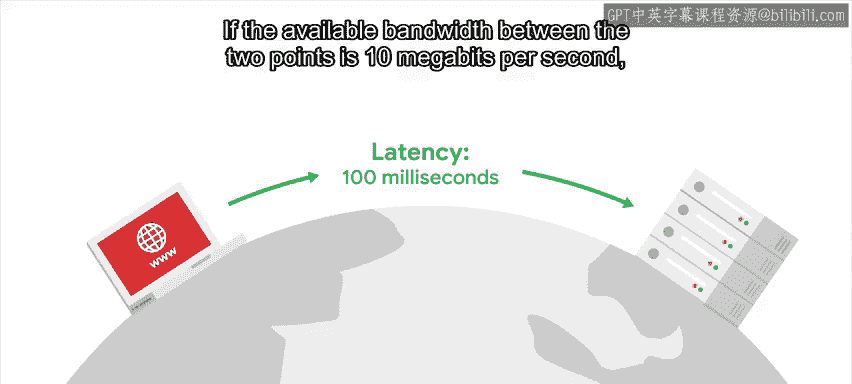

If the available bandwidth between the two points is 10 megabits per second。

 you'll be able to receive 1。25 mebys every second， so for a website of about 1 megabyte of content。

 that large initial latency will be noticeable since it's an extra 20% on top of the total time to download it。

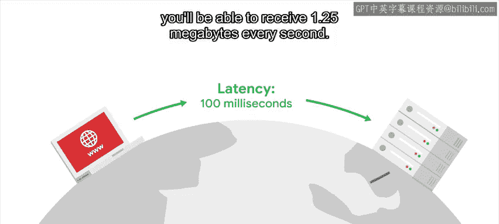

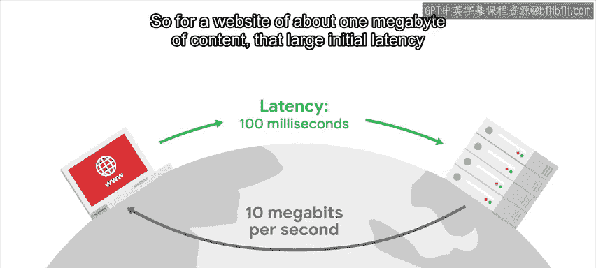

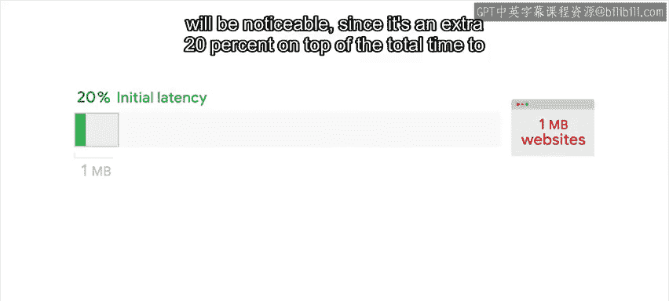

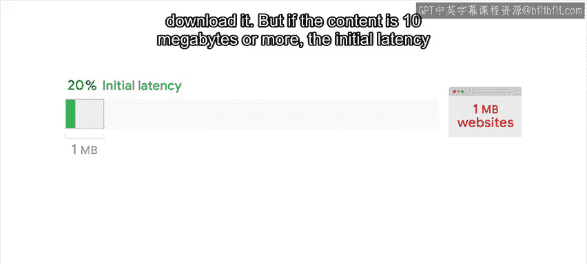

But if the content is 10 megabytes or more， the initial latency will be less than 5% of the total time to download it。

 so it matters less。

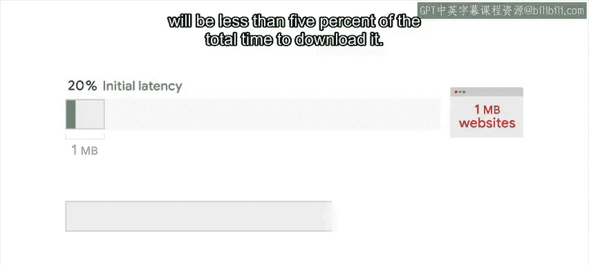

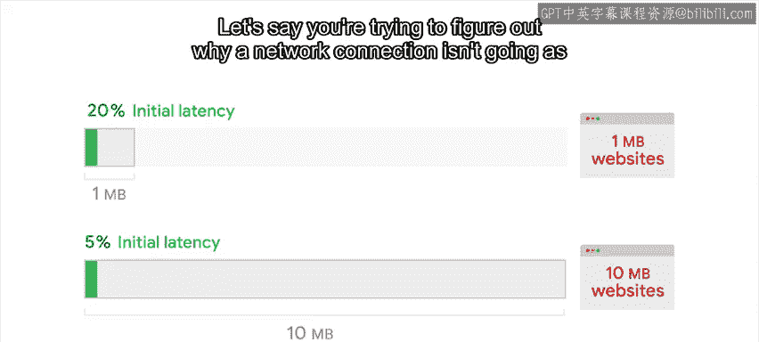

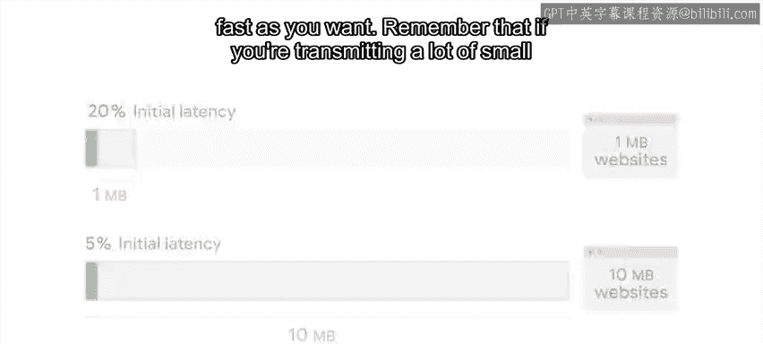

Let's say you're trying to figure out why a network connection isn't going as fast as you want。😡。

Remember that if you're transmitting a lot of small pieces of data。

 you care more about latency than bandwidth。

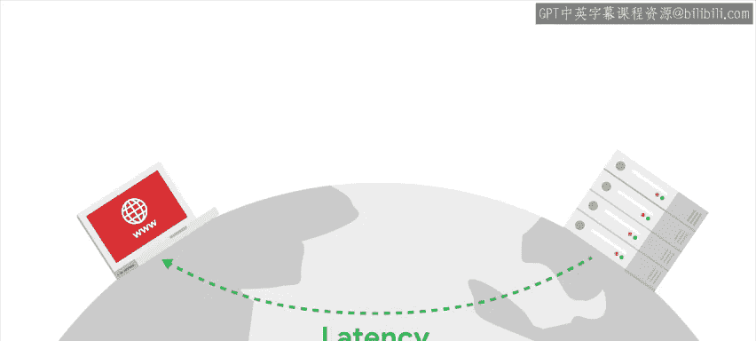

In this case， you want to make sure that the server is as close as possible to the users of the service。

 aiming for a latency of less than 50 milliseconds if possible。

 and up to 100 milliseconds in the worst case。

On the flip side， if you're transmitting large chunks of data。

 you care more about the bandwidth than the latency。

In this case， you'll want to have as much bandwidth available as possible。

 regardless of where the server is hosted。

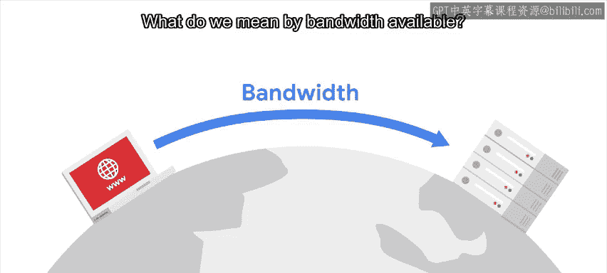

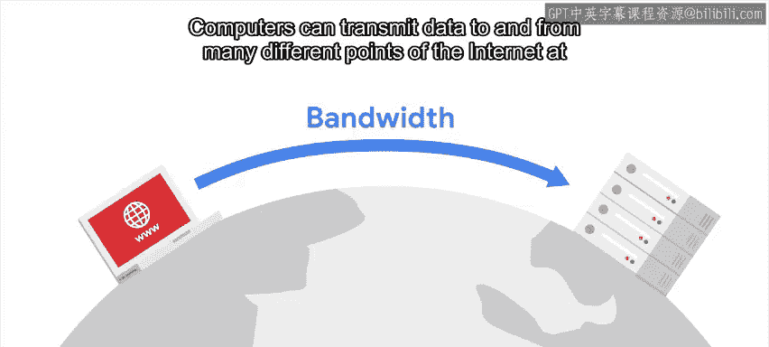

What do we mean by bandwidth available， Computers can transmit data to and from many different points of the Internet at the same time。

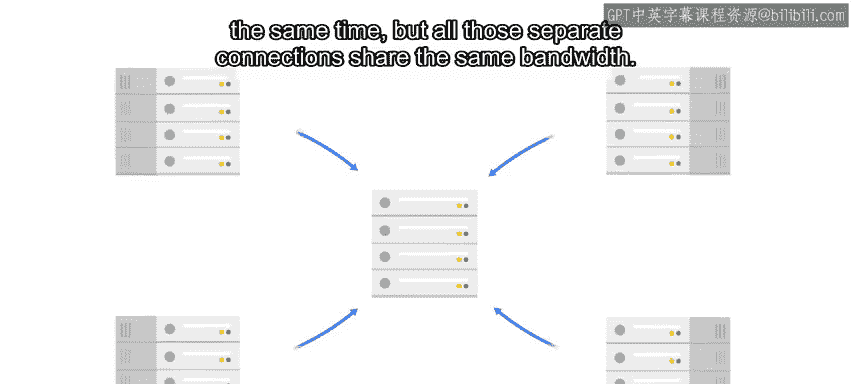

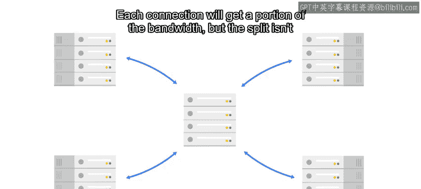

But all those separate connections share the same bandwidth。

Each connection will get a portion of the bandwidth。

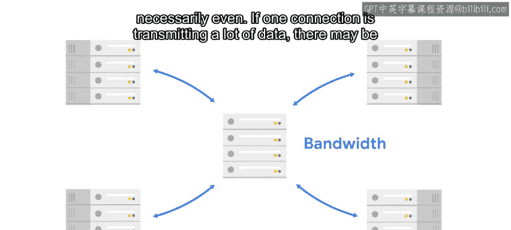

But the split isn't necessarily even。

If one connection is transmitting a lot of data， there may be no bandwidth left for the other connections。

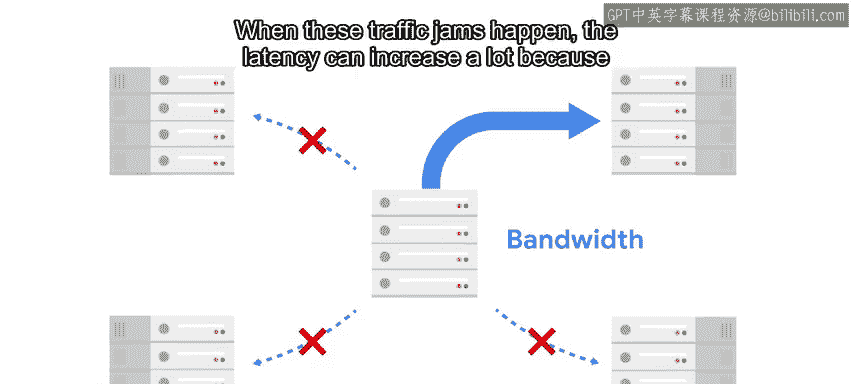

When these traffic jams happen， the latency can increase a lot because packets might get held back until there's enough bandwidth to send them。

 you've probably experienced this already on your own computer。

If you've ever run several applications using the same network at once。

 the overall connection speed may have seen slower。

You can check out which processes are using the network connection by running a program like IFT。

 This shows how much data each active connection is sending over the network。

 You might also have noticed that the more users sharing the same network。

 the slower the data comes in。This is true for home connections and office connections alike。

 No matter how much bandwidth you have， it's a limited resource。

 So you'll need to be careful with how you share it among its users。

 If some applications are using so much bandwidth that others can't transmit any more data。

 It's possible to restrict how much each connection takes by using traffic shaping。

 This is a way of marking the data packets sent over the network with different priorities to avoid having huge chunks of data。

 use all the bandwidth。

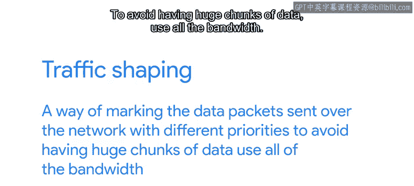

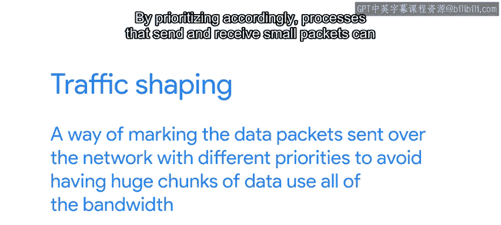

By prioritizing accordingly， processes that send and receive smaller packets can keep working fine。

 while processes that need the most bandwidth can use the rest。

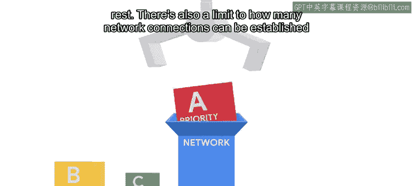

There's also a limit to how many network connections can be established on a single computer。

This isn't usually a problem， but there could be bugs in the software that causes it to open way too many connections or keep old connections open。

 even if they're no longer in use。If this happens on a server。

 no new users will be able to connect to it until whatever's keeping those connections open closes them。

Up next， we'll try our hand at solving another real world example。

 This time we'll be dealing with a memory leak and adjusting our program to make better use of our resources。

