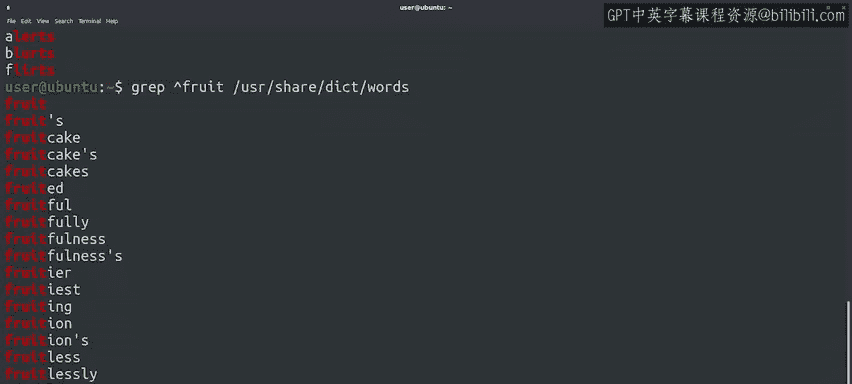

# 谷歌《用Python进行IT自动化办公1、2课（Python、控制操作系统）｜Google IT Automation with Python》中英字幕 - P105：31_使用 grep 进行基本匹配.zh_en - GPT中英字幕课程资源 - BV1gw411E7E1

In our last example， we used a pretty complex regular expression from a Python program to look for a processed ID。

 This is just one example of something we might want to do when processing text from our Python scripts。

We can also use regular expressions with a bunch of command line tools。

GreP is an especially easy to use， yet extremely powerful tool for applying Regex's。

It's a great way to easily try out some expressions and get familiar with them。

 So let's look at some basic matching we can do with Gr。😊。

The simplest of all matchings is just to search to see if the string is present。

Remember that GrEP works by printing out any line that matches the query that we pass it。

So for our simplest query of passing a plain old string。

 GrE will print any lines containing that string in the file that we give it。

Let's try this out using GrP to find words inside the/us/ sharere/dt/word file。

 which is a file that some spell checking programs use to verify if a word exists or not。

This file contains one word per line。We'll start by looking up words that contain the particle fawn。

Let's see what happens。So when we call GrP with F as the pattern to match on。

 and we pass our list of words as a file， we see that it matches with a bunch of different words。

These words all contain the string， thawn somewhere inside of them。

 which is why they appear in our results。 We also see that the output is highlighted for us。

 showing us the matching part of the line in a different color。😊。

This added visual indicator is something that Grp does for us so that we can easily see where the match occurred。

It's worth calling out that the string we're passing the gripep is case sensitive。

 so it needs to be matched exactly。If we use uppercase letters。

 they'll only be matched by uppercase letters。If we wanted to match a string regardless of case。

 we would have to pass the dash I parameter to the Gb command like this。Nice。

 so we now know that any basic string is already a regular expression。

 which will match a line that contains that string。To get the most out of regular expressions。

 we need to learn more of their syntax， which can be as complicated as it is powerful。In particular。

 we have to know the reserved characters that give extra meaning to the patterns that we create。

It's these characters that allow us to do more advanced matching than just checking for a literal string。

 For example， a dot matches any character。This means that if we include a dot in our expression。

 that dot is a wild card that can be replaced by any other character in the results。

Let's check out an example of this。Here， we're looking for the pattern L dot R T S within the list of words。

 This pattern matches three different words， alerts， blurts and flirts。

Check out how for each of those words the dot in our pattern was substituted by a different letter。

Are you starting to see the power of regular expressions？With them。

 we can find portions of texts that match a given pattern。

 even when the pattern isn't the whole word。We could use this， for example。

 to look for entries in a log file that matches certain format。

Or to find rows in a CSV file that share the same characteristics。

 even if they're not exactly the same。Really helpful， right？

Other easy examples of special characters that we can use in our regular expressions are the carrot or circumfl and the dollar sign anchor characters。

 These tell us where in the line the rex should match from。😊。

The circum indicates the beginning and the dollar sign indicates the end of the line。For example。

 to look for all the words that start with a string fruitru， we would write Grep， circumfl， fruitru。

 and our file。See how reexes can be an extremely fruitful tool。Let's check out one more example。

 We'll use Grep to find all the words that end with cats by writing Gr， cat dollar sign and our file。

That worked just perfect。Are you starting to get it now。

 One thing to remember is that the circumflux and the dollar signs specifically match the start and end of the line。

 not a string。Take a log file， for example， where each line contains a lot of different words。

 We can use a circumfl to check if a line begins with a pattern or use a dollar sign to check if it ends with a pattern。

But our patterns will match only if the line fits that criteria， not the contained words。

 There are many other characters like these， and we'll go over a bunch of them the next few videos。

 But before moving on to more syntax and examples， it's time for a quick quiz。

