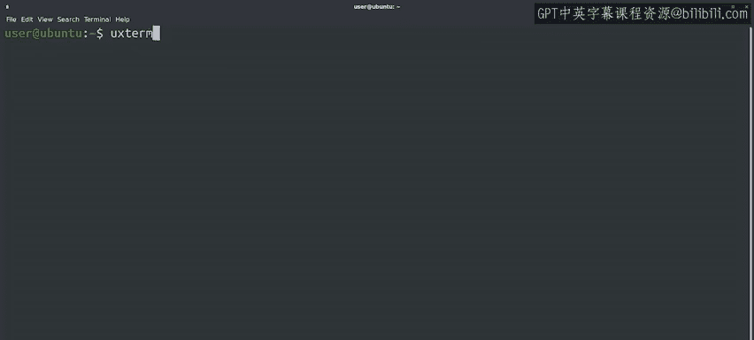
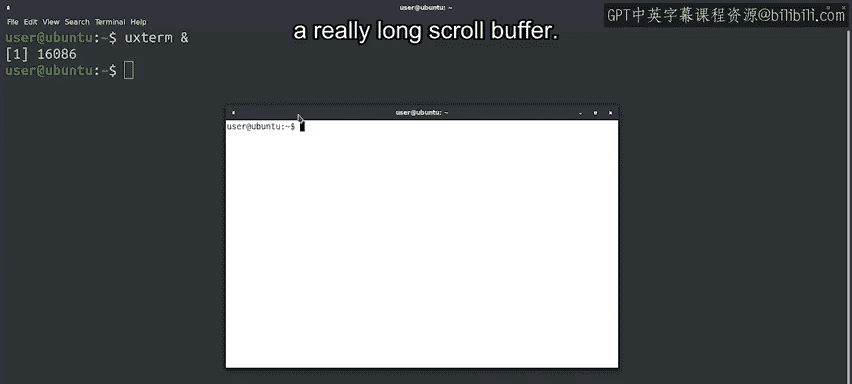
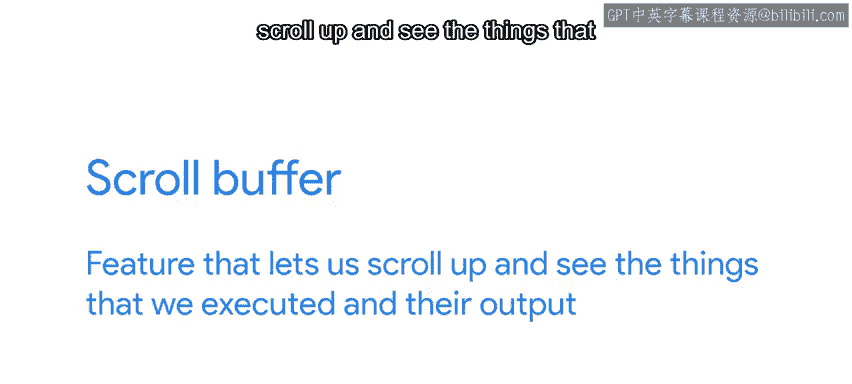
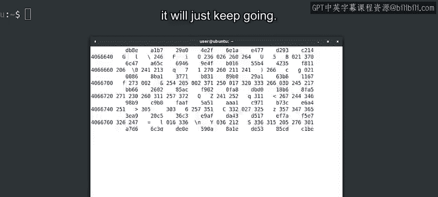
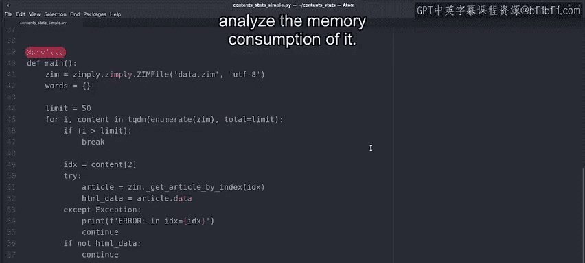
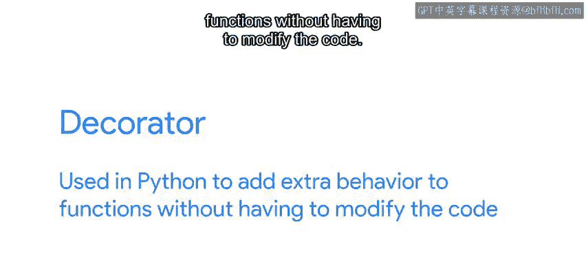
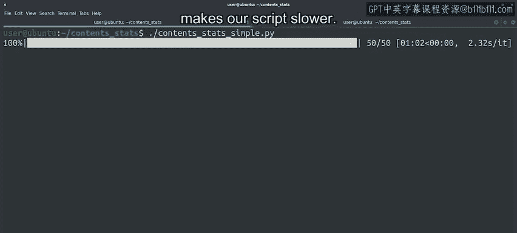

# 谷歌《用Python进行IT自动化办公3、4、5、6课（Git、debug、云端、实践）Google IT Automation with Python》中英字 - P105：47_处理内存泄漏.zh_en - GPT中英字幕课程资源 - BV1LW4y1F7XW

。

There's a ton of reasons why an application may request a lot of memory。

Sometimes it's what we need for the program to complete its task。

Sometimes it's caused by a part of the software misbehaving。 First。

 let's trigger the misbehavior ourselves to see what this looks like。

We'll use a terminal called UX term for that。

We've configured this terminal to have a really， really long scroll buffer The scroll buffer is that nifty feature that lets us scroll up and see the things that we executed and their output。

The contents of the buffer are kept in memory。So if we make it really long and we manage to fill it。

 will cause our computer to run out of memory with normal use， it might take ages until that happens。

But if we run a command that keeps generating a lot of output。

 we could manage to fill that buffer pretty quickly， say we ran a command like OD CX dev Uranom。

This command will take the random numbers generated by the U random device and show them as both characters and hexadecimal numbers。

And since the Uranom device keeps giving more and more random numbers， it will just keep going。

Our command is filling up the scroll buffer， making your computer require more and more memory in a different terminal。

 let's open top and check out what's going on。Pressing Shi M。

 we tell Top that we want to order the programs by how much memory they are using。

We see that the percentage of memory used by Xtterm is going up super quickly。

 Let's stop the process that's filling up the buffer by pressing control C。With that。

 we stopped the command that was filling the buffer。

 but the terminal still has that memory allocated， storing all the lines in the scroll buffer。

Let's look at the output of top in a bit more detail。

 There's a bunch of different columns with data about each process。

 The column labeled RES is the dynamic memory that's preserved for the specific process。

The one labeled SHR is for memory that's shared across processes。

 and the one labeled VIRT lists all the virtual memory allocated for each process。

 This includes process specific memory， shared memory and other shared resources that are stored on disk。

 but mapped into the memory of the process。It's usually fine for a process to have a high value in the VIRT column。

The one that usually indicates a problem is the REES column。All right。

 let's close the other terminal so that it releases all the memory that it reserved。In this example。

 we saw what a program that keeps requesting more and more memory looks like。

This was a super extreme example。 Most memory leaks don't happen at this speed。

It can usually take a long while until we notice that a program is taking more memory than it should。

 and it might be hard to tell the difference between memory that's actually needed and memory that's being wasted。

But looking at the output of top and comparing it to what it used to be a while back is usually how any investigation into a memory leak starts。

 Let's look at a different example。 We have a script that analyzes the frequency of words and web pages this script works fine when it's just a few web pages。

 but if we try to give it all the Wikipedia contents， it starts using up all the memory。

Let's run it first and see what happens。Okay， this is running and it will take a long while to finish。

 It's processing a huge amount of articles after all。 while this is running。

 let's look at the output of top in a different terminal and see what we find。

We see that there's a bunch of different content stats processes running。

That's because our script is using the multiproces techniques that we saw in an earlier video to parallelize the processing of the information and get the results as fast as possible it seems like these scripts are taking a lot of memory。

 so let's sort it out to see the details。Whoa， we see that the memory used by one of the processes in particular keeps growing and growing。

 The application is processing a bunch of data and generating a dictionary with it。

 so it's expected that it will use some memory but not this much。

This looks like the program is storing more than it should in memory。This program is pretty complex。

 so we could use the help of a memory profiler here to figure out what the problem is。

 Let's stop it now and use a profiler to figure out where our computer's memory is going。To do that。

 we'll need to use a simplified version of our code as profiling the memory of a multiprocess application is extra hard。

 and instead of processing all the articles， we'll just handle a few so that we can check out the memory consumption quickly。

 Let's open our simplified script and have a look。😊。

We'll be using a module called Meory Profilr This is one of the many different memory profilers available for Python。

We've added this app profile label before the main function definition to tell the profiler that we wanted to analyze the memory consumption of it。

This type of label is called a decorator， and it's used in Python to add extra behavior to functions without having to modify the code。

In this case， the extra behavior is measuring the use of memory。

The rest of the code is basically the same as the original one。

 it just uses a single process and is limited to 50 articles instead of the thousands of articles that the other script was going through。

We're running the script with the memory profiler enabled， this is just reading through 50 articles。

 but it takes a bunch of time because all that memory profiling makes our script slower。

Once the program finishes， the memory profiler gives us information about which lines are adding or removing data from the memory used by the program。

The first column shows us the amount of memory required when each line gets executed。

The second one shows the increase in memory for each specific line。

We see here that after going through 50 articles， the program already took 130 megabytes。

 no wonder we ran out of memory when we were trying to process all the articles。

We can see that the variables that require the most memory are article and text with about four and three megabytes respectively。

Those are the articles we're processing， and it's fine for them to take space while we're counting the words in the article。

 but once we're done processing one article， we shouldn't keep that memory around。

Can you spot the problem。Right at the end， the code is storing the article to keep a reference to it。

But it's storing the whole article， if we want to keep a reference to all the articles that include a word。

 we could store the titles or the index entries， definitely not the whole contents。😡。

There's a ton more to say about memory management and memory profiling that we don't have time to cover here。

In the next reading， we've gathered a bunch of interesting links to information about managing scarce resources。

 After that， there's another practice quiz for you。😊。

