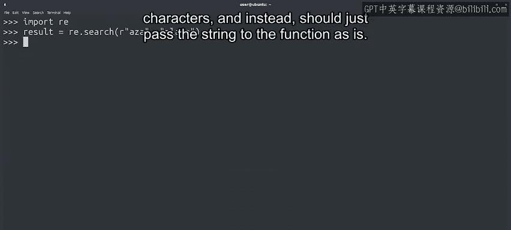
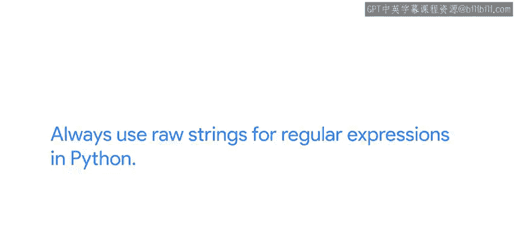
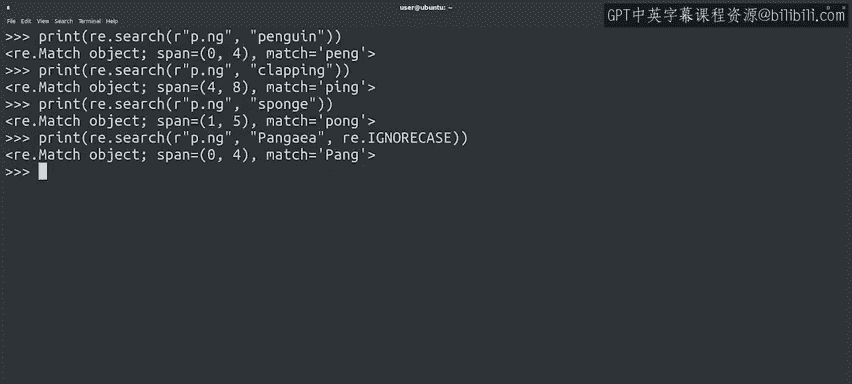

# 谷歌《用Python进行IT自动化办公1、2课（Python、控制操作系统）｜Google IT Automation with Python》中英字幕 - P106：32_在 Python 中进行简单匹配.zh_en - GPT中英字幕课程资源 - BV1gw411E7E1

Welcome back。How are we feeling about rexes so far？Remember， this stuff is pretty tricky。

 so it's okay。 It takes a bit of time for it to sink in。As we called out before。

 we use the REE module to apply regular expressions in Python。

This module includes a bunch of different functions that can help manipulate strings。

Let's see how we can use this module for some basic matching。

So we called the search function on the R E module and told it to use the pattern Aza on the string Plaza。

 We then stored the return value of that function in the result variable。

 The R at the beginning of the pattern indicates that this is a raw string。😊。

This means that Python interpreter shouldn't try to interpret any special characters and instead should just pass the string to the function as is。

In this example， there are no special characters。 The raw string and the normal string are exactly the same。

 but it's a good idea to always use raw strings for regular expressions in Python。😊。

So we'll be using raw strings in all of our examples。With that said。

 let's print the result of the variable and see what we get。Great， our result is a match object。

The output we get when calling print already shows some interesting information。

 like the position in the string that matched and what the actual matching string was。

Let's try this out again with a different word。In this case。

 we can see that the span attribute is different。 That's because the match substr is in a different position inside the string。

 The match substring is still the same， though， because we're matching with a plain string。

 No special syntax yet。 What do you think will happen if we pass a string that doesn't match the expression。

😊，Let's try and find out。Did you guess right， If the expression doesn't match the string that we pass。

 we get none as a result。 Remember， none is a special value that Python uses to show that there is not an actual value there。

So when we're applying regular expressions， we now know that if the search function returns none。

 it means it didn't find a match。Let's practice the special characters that we've seen up until now with a few examples。

Here， we told the search function to use a circumflex X pattern on the string xenon。

We can see that it matched at the beginning of the line on our X as we expected。

What happens if we use a dot which can match any character？

Now we're using P do NG as a search pattern。 It matches the word penguin that we're passing。

 and in the match object， we see the matching string is pen。

 Let's try it out with a couple other strings。Nice。

 so here we can see the match attribute always has the value of the actual substr that match the search pattern。

 and the span attribute indicates the range where the substr can be found in the string we passed。

 We can also pass additional options to the search function。For example。

 if we want our match to be case insensitive， we can do this by passing the re。 ignorere case option。

Great， now we know how to apply in Python the basic regular expressions that we used earlier with the Grb command。

 you can now use your local Python installation to practice these and any other examples of regular expressions that you can think of。

So how about experimenting on your own and so you feel comfortable with them。Take your time。

 You'll get the hang of it。Coming up， we're going to dive deeper into the syntax of regular expressions and what we can do with them。

