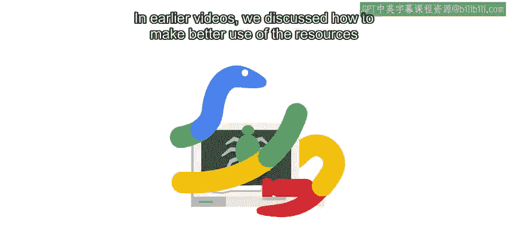
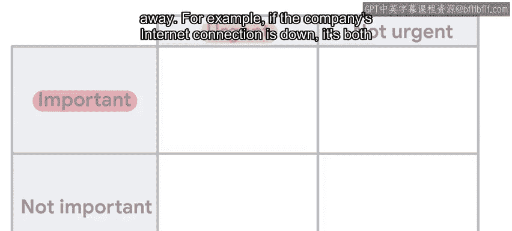
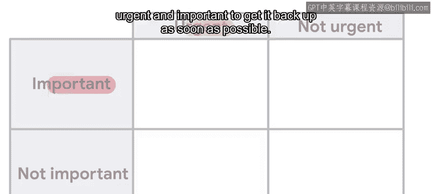
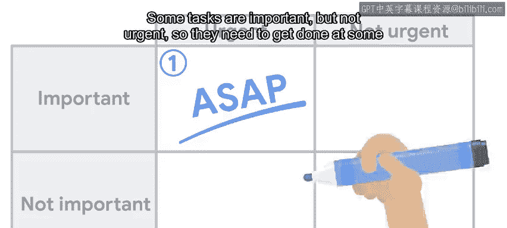
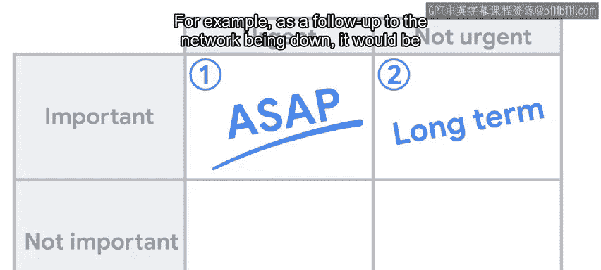
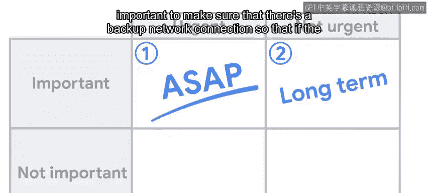
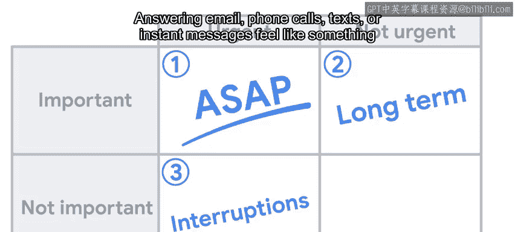
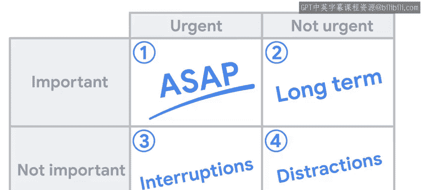
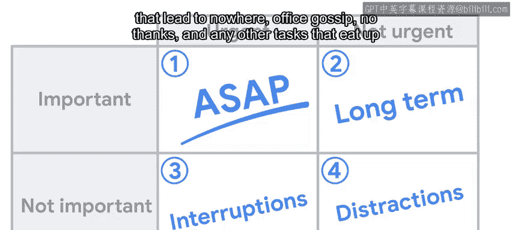
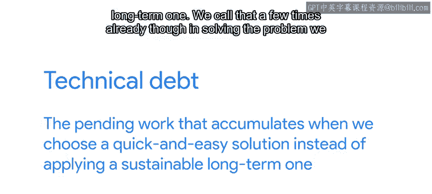

# 谷歌《用Python进行IT自动化办公3、4、5、6课（Git、debug、云端、实践）Google IT Automation with Python》中英字 - P106：48_专注于重要任务.zh_en - GPT中英字幕课程资源 - BV1LW4y1F7XW

。

In earlier videos， we discussed how to make better use of the resources available on our computers and systems like the CPU。

 the memory， the disk。The network and so on。But there's another resource that's even more valuable in our day to day。

Our time as humans， we want to make sure that we spend our time doing meaningful activities。

 like work that we enjoy and earning the satisfaction of a job well done when working。

 we need to optimize the time we spend to bring the most value to the company。

 finding the right balance is hard but that's what we' are here for from updated calendars to social media detoxes。

 there's lots of different ways to optimize our time。😊。

One that's super effective when working in IT is the Eisenhower decision matrixtrix。

When using this method， we split tasks into two different categories， urgent and important。

 There are tasks that are important and urgent。 drawaw alarm bells around them if you'd like。

 because these need to be done right away。

For example， if the company's internet connection is down。

 it's both urgent and important to get it back up as soon as possible。

Some tasks are important， but not urgent， so they need to get done at some point。

 even if it takes a while to complete them。

For example， as a follow up to the network being down。

 it would be important to make sure that there's a backup network connection so that if the existing one is ever down again。

 the company can stay connected using the backup Other tasks might seem urgent。

 but aren't really important a lot of the interruptions that we need to deal with are in this category。

Answering email， phone calls， texts or instant messages feel like something that we need to do right away。

 but most of the time are not really the best use of our time。 And finally。

 there's a whole category of tasks that are neither important nor urgent。

These are distractions and time wass that shouldn't be done at all。

These include meetings where nothing useful is being discussed， email threads that lead to nowhere。

 office， gossip， no thanks。And any other tasks that eat up our time without giving anything valuable in return。

 in general， to make the most of our time， we need to make sure that we're spending the majority of it on tasks that are important。

Of course， we'll want to get to the urgent tasks as soon as possible。

 but we need to block some time for long term planning and execution spendingending time on long term tasks might not bear fruit right away。

 but it can be critical when dealing with a large incident。For example。

 setting up your infrastructure so that you can easily roll back changes or deploy new servers when needed。

 takes a large chunk of time， but investing in the future can save you even more time and user frustration when responding to a problem。

 researching new technologies is another task in this category。

 IT is always evolving and it's important to have time set aside to stay up the date。

 Figure out if it's time to migrate the web server to different software。

Update the mail server to a new OS version。Or deploy voiceiceover IP throughout your company。

 Another important task that might not necessarily be urgent is solving technical debt。

When you work in IT， you hear this term a lot What does it mean Technical debt is the pending work that accumulates when we choose a quick and easy solution instead of applying a sustainable long term one。

We called out a few times already that when solving a problem。

 we might apply a short termm remediation to fix it right away。

 and then plan for a long term solution to prevent it from happening in the future。

Until we have a fix that sticks， the workaround we created is technical debt because we need to spend time keeping it in place。

 even if it's not the best solution， whenever we go for a short-term solution and leave the long-term solution for later。

 we're creating technical debt this might be the right decision in the moment to get us out of a crisis and let our users get back to work。

But we need to thensched time to apply the long- termm solution that will make our future lives easier Technical debt can also be generated by external parties For example。

 when a new version of the software we're using is released。

 we'll need to schedule time to upgrade it and until we do that pending upgrade is technical debt okay so we've made it clear that we need to focus our work on tasks that are important。

But what can we do about interruptions， which are urgent， but not important？

If you work in IT support， you'll have to be interrupted， it's part of the role。

So you'll need to plan to deal with those interruptions effectively if you work on a team。

 you can rotate the person dealing with those interruptions。

 maybe someone takes care of them in the morning and a different person in the afternoon。

Or you take turns each day。 if you work independently。

 you can try to establish a set of hours when users can expect to reach you for normal requests and the rest of the time only be available for emergencies。

 The key here is to have a window of time reserved when you're not going to be interrupted。

 That's the time when you can get the most important tasks done。

When you can fully concentrate on dealing with complex issues and finding solutions for tricky problems。

Depending on your role and how the company works， you might need to get this work done in a different location to avoid people walking up to your desk。

Or actively silencing any of your notifications to avoid getting interrupted and distracted by unimportant conversations。

Okay， so assuming that you've managed to set some time aside to work on these important but not urgent tasks。

 how do you make sure that you work on the right things with the right priorities？

That's coming up in our next video。