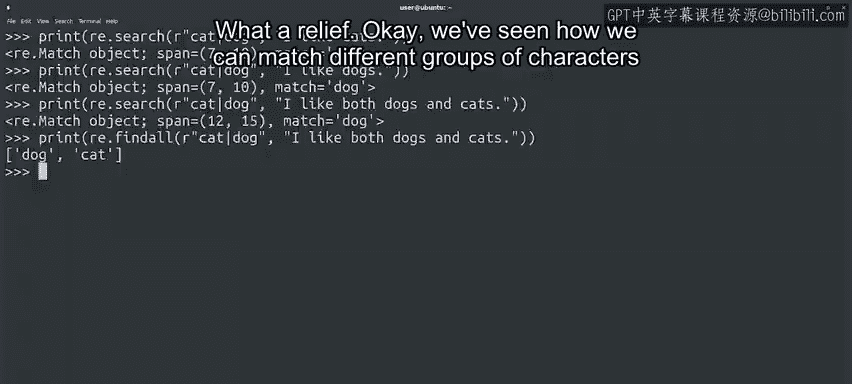

# 谷歌《用Python进行IT自动化办公1、2课（Python、控制操作系统）｜Google IT Automation with Python》中英字幕 - P107：33_通配符和字符类.zh_en - GPT中英字幕课程资源 - BV1gw411E7E1

We've seen by now how we can use a dot in our regular expressions as a special character that can match any character。

In the Rex world， this is known as a wild card because it can match more than one character。

 Using a dot is the broadest possible wild card because it matches absolutely any character。

But what if we wanted something stricter？Like checking if an answer given by a user contains a valid character。

 or finding all the username in a CSV file at start with a vowel。

We have to restrict our wild cards to a range of characters to do this。 For this task。

 we use another feature of rex is called character classes。

 Char classes are written inside square brackets and let us list the characters we want to match inside of those brackets。

 For example， say we want to match the word Python， but allow for both lowercase or uppercase P。

 We can do it like this。😊，Inside the square brackets。

 we can also define a range of characters using a dash。For example。

 we could use lowercase A to lowercase Z to state any lowercase letter。

 So if we wanted to look for the string way preceded by any letter。

 we could write the expression like this one。Cool， we got a match。

 The character class defined was matched by the letter H。😊，Let's try a different string。Dang。

 in this case， we didn't get a match。 That's because the string way is reced by a space。

 And that doesn't match the range that we defined。We can define more ranges like uppercase A to uppercase Z。

 for all uppercase letters or zero to9 for all digits。

We can combine as many ranges and symbols as we want， like this。So as you can see。

 we can match anything that's defined between the square brackets。 It's pretty cool， right。

 While this is super useful， sometimes we may want to match any characters that aren't in a group to do that。

 we use a circum inside the square brackets。 For example。

 let's create a search pattern that looks for any characters that's not a letter。😊，Here。

 our pattern matched the first space in the sentence。

What if we also added space to the list of characters that we don't want to match。

You might have guessed this because we added a space inside the character class。

 our example now matched the final dot in the sentence。

 which isn't in the list of characters to exclude。 If we want to match either one expression or another。

 we can use the pipe symbol to do that。This lets us list alternative options that can get matched。

 For example， we could have an expression that matches either the word cat or the word dog like this。

So since the string contains a substr cat， the search function could find it。

Let's try an example with dog。😡，This expression contains a substr dog。 So we found a match。

Let's try a sentence with both dogs and cats。In this string。

 we actually have two possible matches for our search， but we only get the first one。

 That's the way the search function works。 If we want to get all possible matches。

 we can do that using the find All function， which is also provided by the R module like this。

So if find all， we don't need to choose between cats and dogs。 What a relief。

Okay， we've seen how we can match different groups of characters or even completely different strings。

Are you starting to wrap your head around at all？Like I said before， this stuff is kind of tricky。

Feel free to take time to practice these functions on your own。

 These tools can be super useful in the IT world， so you'll definitely want to get a good handle on them。

😊，Now， what do you think we'd have to do if we wanted to match something more than once？

Once you're ready， meet me in the next video to find out。

