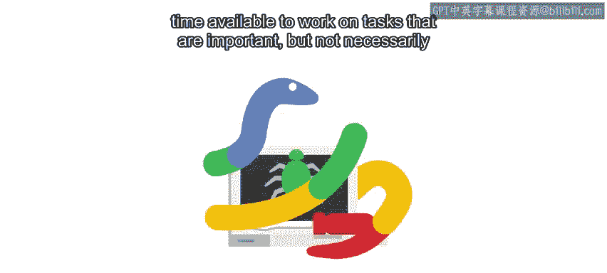
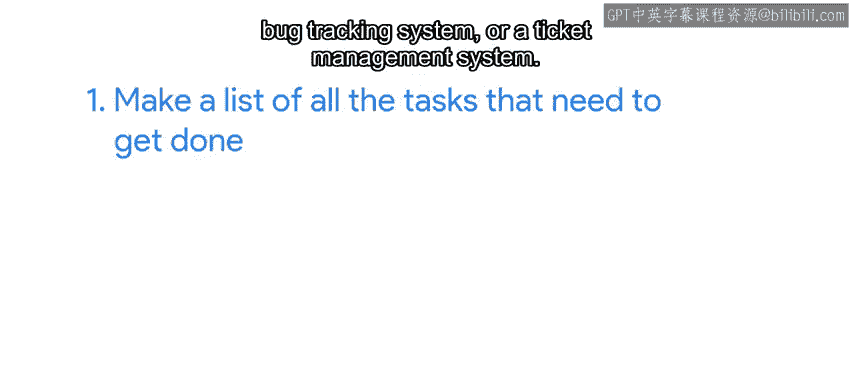
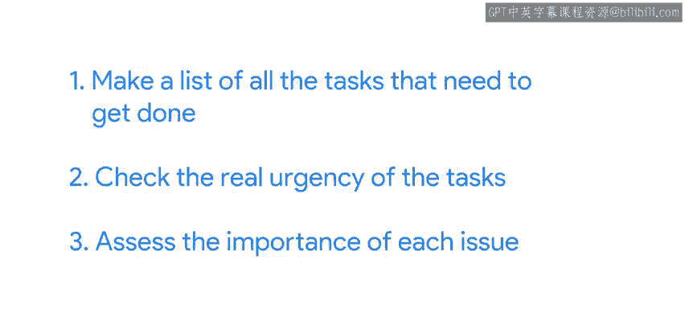
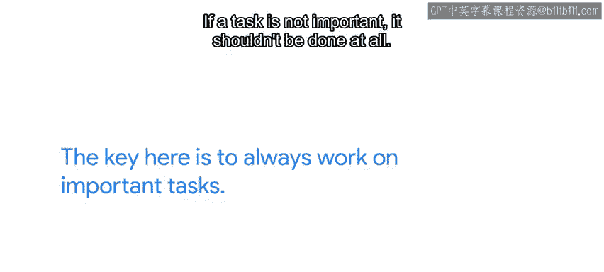

# 谷歌《用Python进行IT自动化办公3、4、5、6课（Git、debug、云端、实践）Google IT Automation with Python》中英字 - P107：49_优先处理任务.zh_en - GPT中英字幕课程资源 - BV1LW4y1F7XW

。

In our last video， we talked about how we need to make sure that we have the time available to work on tasks that are important but not necessarily urgent。

 but sometimes it feels like everything is important and everything is urgent。

Say you need to deploy a new computer for the person that's starting tomorrow。

 upgrade the VPN service to the latest version because the old one has a security vulnerability。

Fix a permissions problem that's preventing a group of users from accessing the inventory data。

Check out a problem with the mail system that's causing some emails to get randomly rejected and so many other things that by now you've lost track of them。

What can you do to figure out how to spend the limited time that you have there's a lot to say about this and everyone works a little differently so you'll need to find a system that works best for you。

But let's cover the basic structure that can help us get organized and prioritize our tasks。

 The first step is to make a list of all of the tasks that need to get done。

You can make this list on a piece of paper， a text file in your computer， a bug tracking system。

 or a ticket management system， whatever works for you。

 The point is to have all the tasks listed in one place to avoid depending on your not always perfect memory later once you have the list。

 you can check the real urgency of the tasks。Ask yourself if any items don't get done today。

 will something bad happen。If yes， then those should be worked on first。

 Once you're done with the most critically urgent tasks。

 you can look at the rest of the list and assess the importance of each issue。

Even when it looks like everything is important， you should be able to tell that some things are more important than others。

 For example， a task that will benefit more people is more important than a task that will benefit less people。

If there are a bunch of different tasks that depend on you completing one。

That roadb is more important to clear than the rest。 If it still seems like everything is on fire。

 you can try dividing the tasks into groups of most important， important， and not so important。

 And then sort the tasks inside each group。 But don't spend too much time doing this sorting。

In the end， the exact order isn't what matters What matters is that you spend most of your time working on the most important tasks。

 and if you work with a team of people， it's a good idea to share both the list of tasks and the standard of priorization among team members。

This helps you avoid having to do the work multiple times and coming up with different priorities。

 Once you have a list of the most important tasks to work on。

 you'll want to have a rough idea of how much effort they'll take。

We'll talk more about estimating times in the next video。 This isn't about exact timing。

 It's about assigning rough sizes。 One common technique is to use small。Medium and large。

 And when the range of sizes is big enough， include extra small or extra large if needed。

 Once you identify the most important tasks and how big they are， you can start working on them。

If possible， try to start with the larger most important tasks to get those out of the way first。

 but as we called out， when our work involves IT support。

 we know that we'll have to deal with interruptions and working on complex tasks while getting interrupted can be very frustrating。

 I hear that。One strategy that can help us with that is saving the most complex tasks for the moments when we're less likely to get interrupted。

 If you know that you get busiest in the morning and you tend to have more quiet time during the afternoon。

It makes sense to work on easy and quick tasks early in the day。

 saveve the most complex tasks for later。 when you'll have more time to concentrate on them。

 But when your focus time starts， you should make sure that you work on those large complex tasks and not on the easy ones。

 Otherwise， the complex tasks will never get done。 The key here is to always work on important tasks。

If a task is not important， it shouldn't be done at all。 really， we live by this rule here at Google。

Then select which task you're going to deal with， depending on urgency and how much time you can devote to it。

 starting with the biggest tasks that you can fit in the time you have available。 But keep in mind。

 this shouldn't stop you from taking a break or working on experimental projects。

Taking breaks is important because it allows our creative minds to stay fresh and working on a fun side project can help us research emerging technologies and come up with new ideas。

 Did you know that this very certificate program got its start as a side project at Google， Okay。

 but what if the unthinkable happens， What can we do if after all of this prioritizing。

 sizing and ordering， there's just too much work to be done and too few hours in the day。

 The first thing to know is this is normal。😊，Most people working in IT have too much to do and can't get all the things they want done。

Unfortunately， us humans can't multiply ourselves on command yet。

And working extra hours is not sustainable long term， which means there are basically two options。

 either you get extra help from other team members or you decide that some tasks weren't really that important and they won't get done。

For both of these options， you'll need to involve other people like your manager。

 and make sure that expectations get clearly communicated。

Some tasks like fixing the permissions in a directory。

 changing a faulty keyboard or installing a new application on a single computer can be self contained and completed in a small amount of time。

 Other tasks like upgrading the database software to a new version。

 Automating the creation of user accounts， or writing a rapper to adapt to incompatible programs or larger projects that can take several days or maybe even weeks to complete。

 when that's the case， it's important to have a rough estimate of how long the tasks will take to be completed。

 and to clearly communicate expectations to those affected。😊。

We'll cover these two aspects in the next couple of videos。

