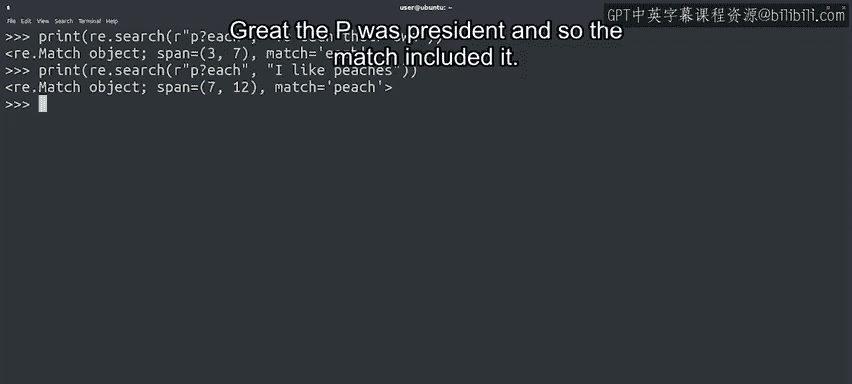

# 谷歌《用Python进行IT自动化办公1、2课（Python、控制操作系统）｜Google IT Automation with Python》中英字幕 - P108：34_重复修饰符.zh_en - GPT中英字幕课程资源 - BV1gw411E7E1

So far， we've looked at how to match one specific character， a group of characters。

 or even any character。 Now， we're going to check out how to match these characters several times。

Say we wanted to find the longest word in the string。

 or we wanted to find the host names in a loggged file by checking for a bunch of alpha numeric characters between brackets。

We can do this using another interesting Regxx concept， repeated matches。

It's quite common to see expressions that include a dot followed by a star。

This means that it matches any character repeated as many times as possible， including zero。

Let's see a couple of examples of this。In plain English， you could read his records as matchch pi。

 followed by any number of other characters followed by N。But with our dot star combination。

 we expanded the range of the match to the whole word。

See how the dot takes a different value for each letter。Let's try a different string。

 Python programming。What do you think the pattern will match？h。

 you might not have been expecting that。Remember， the star takes as many characters as possible。

In programming terms， we say that this behavior is greedy。

It's possible to modify the repetition qualifiers to make them less greedy。

 but we won't get into that now。To learn more about that， check out the next reading。

But back to our example， while our pattern could have matchshed the word Python。

 it expanded all the way until the last n in the string。

If we only wanted our pattern to match letters， we should have used the character class instead。

 like this。Remember how we said that zero times is also a possibility。

That would let the string pin also match our pattern。 Let's try that out。As we called out earlier。

 implementations of regular expressions aren't always the same。

 Reetition qualifiers are one way they differ。Some implementations like the one used by GrP。

 only include the star qualifier that we just discussed。 You can do a lot with just a star qualifier。

 so that's usually good enough。Other implementations like the one used by Python or by the EGp command。

 include two additional repetition qualifiers， plus and question mark that can help us construct more complex expressions。

 Let's check that out。 The plus character matches one or more occurrences of the character that comes before it。

Say we had the pattern O+ L+。Let's check out against a few words。In this case。

 there was one occurrence of each， and the match pattern shows us the shortest possible matching string。

Here， there are two of each。 Again， we can see the match is a whole string that matches the condition。

😊，Let's try something that doesn't match。So while our string here had an O and an L。

 it had another character in between them。Because of this， it doesn't match the search pattern。

 Does that make sense。The question mark symbol is yet another multiplier；

 it means either zero or one occurrence of the character before it。Let's see how this works。

The P wasn't present， but with a question mark， we marked it as optional， so we still got a match。

Let's see what happens when the P is present。Great， the P was present and so the match included it。

Nice job。 You're moving right along through basic regular expressions。😊，If anything's not clear。

 take some time now to check out the examples in your local Python environment。

I bet you'll get it all down Pat once you've tried things out for yourself。

You just learned about repetition qualifiers， and we saw how there's a bunch of special characters to match different kinds of strings。

😊，But what happens when we want to actually match one of those characters like a dollar sign or a question mark。

 Well， lucky for you， we're going to find out in the next video。

