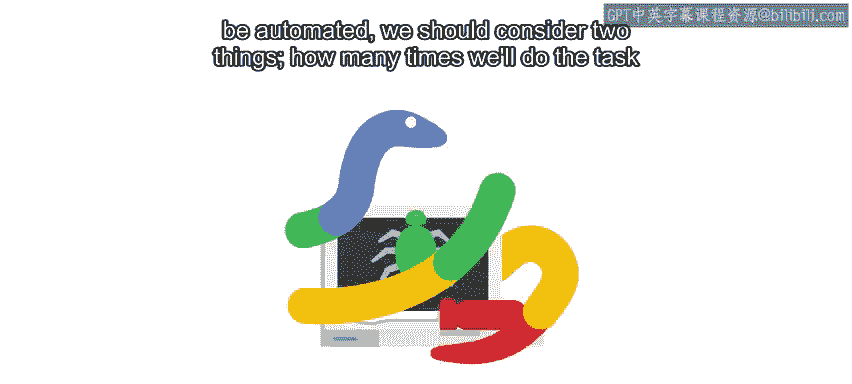
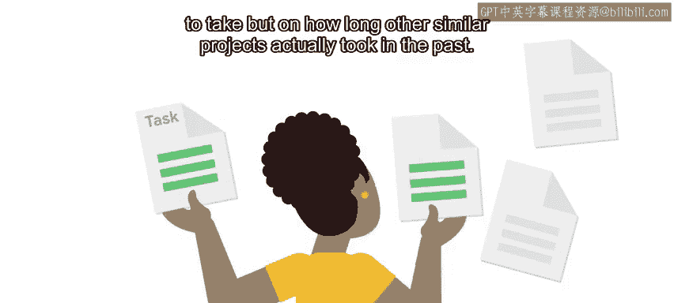
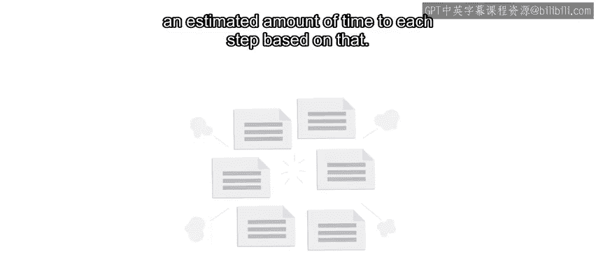
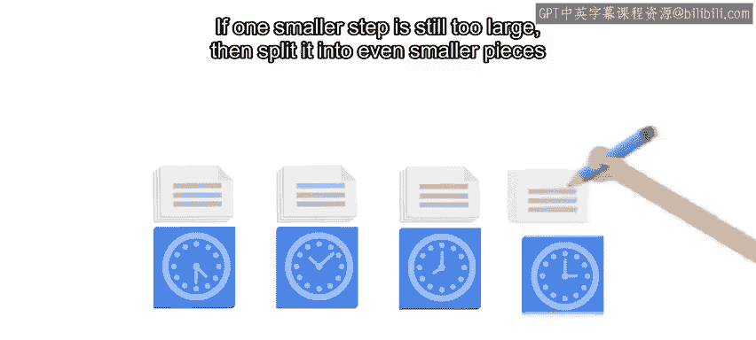

# 谷歌《用Python进行IT自动化办公3、4、5、6课（Git、debug、云端、实践）Google IT Automation with Python》中英字 - P108：50_估计任务所需时间.zh_en - GPT中英字幕课程资源 - BV1LW4y1F7XW

。

As we've called that before， when deciding whether a manual task needs to be automated。

 we should consider two things， how many times we'll do the task over a period of time and how long it takes to do it manually。

From there， we can figure out if that number is larger than the time it will take us to write the automation。

This sounds great in theory， but the problem is that we don't know how long it'll take us to write the automation until we've actually written it。

 All we can do is estimate it， and most of us are really bad at estimating how long tasks will take。

We tend to be too optimistic about the amount of time that a certain piece of code will take us to write。

 or a certain infrastructure will take us to set up。 Usually。

 our first instinct is to consider how much we can get done with an ideal amount of focus on the work and a full grasp of the problem are trying to solve。

 We forget to take into account the many obstacles that we might face like finding a bug that we don't know how to fix being interrupted by a problem that needs more urgent attention or discovering that a new tool doesn't work well with the rest of the tools we have in place。

 So if you're trying to estimate how long it will take you to complete a project， big or small。😊。

You need to be realistic。 Avoid being overly optimistic with your time estimates。

 The best way to do this is to compare the task that you're trying to do with similar tasks that you've done before。

This way， you're not estimating based on how long you would like the project to take。

But on how long other similar projects actually took in the past， if the task at hand is large。

 it might be hard to find something similar enough to use for comparison。

So to make a better estimate of a bigger than average project， you'll want to chop it up。

Split the task into smaller steps， compare each step to a similar task that you've done in the past。

 and assign an estimated amount of time to each step based on that。

If one smaller step is still too large， then split it into even smaller pieces until you can compare each piece of the puzzle with something that you've done before。

 Once you've got all those estimated times， just add them up and you'll have a rough estimate of how long the whole task will take。

 But even that's going to be optimistic Since putting all the pieces together will take additional time。

So once you have a rough estimate of the total time of all the steps。

 you want to factor in some extra time for integration this should also come from prior experience。

 Think about how long it took you to integrate the pieces of a project before and you'll have a rough idea of how much to add to the previous value。

Time really flies， huh？Knowing how optimistic we humans are。

 even after basing those estimations on previous experience。

 the number you come up with is going to be very close to the best possible scenario。

 Even if you're prepared for something to go wrong， It's impossible to anticipate new。

 unknown bumps in the road。So take this estimation and multiply it by a factor once again。

 this factor works best when it's based on previous experience。

 so if the last time you did this exercise， it took you three times longer to complete the task than you had planned。

 go ahead and multiply your estimation by3。This might seem like we're inflating the numbers。

 but remember， you want to have a grounded estimate of how long it will take you to complete the task。

That means taking into account the obstacles that you'll certainly run into but haven't come across yet。

 no matter how detailed we are， the final estimation won't ever exactly match the time it takes。

But it will give us a rough idea of whether we can complete the task in a few hours， days， weeks。

 or months。Once you've made your estimation， you want to note it down somewhere so that you can check later to see how close you were to the original number。

You can adjust future estimations based on that。You'll also want to communicate with those affected and let them know when they can expect the task to be done。

We'll talk more about that in our next video。