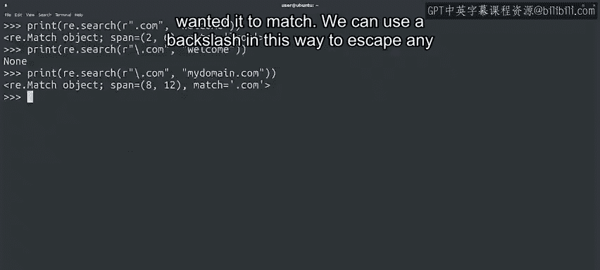
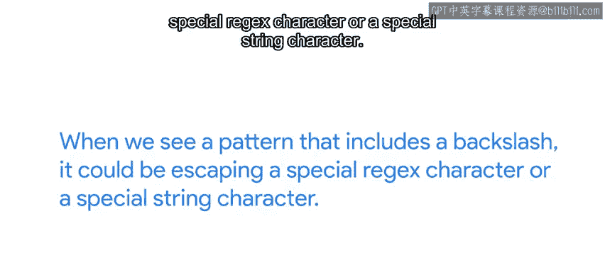
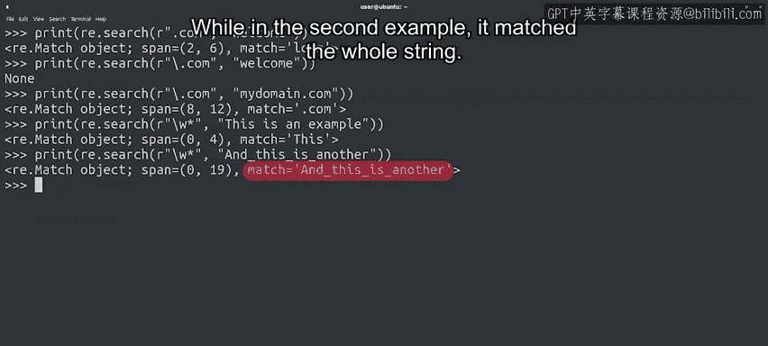
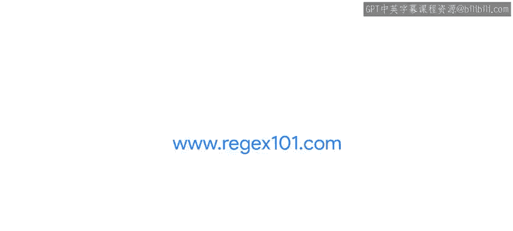

# 谷歌《用Python进行IT自动化办公1、2课（Python、控制操作系统）｜Google IT Automation with Python》中英字幕 - P109：35_转义字符.zh_en - GPT中英字幕课程资源 - BV1gw411E7E1

We've now seen a lot of special characters that we can use in our regulargular expressions to make them match different kinds of strings。

 dot star plus question mark， circumflex， dollar sign and square brackets。

 But what can we do if we need our pattern to match one of the special characters。 Sa， for example。

 that we wanted to check that a certain string contained a dot as part of it。

 If we just put a dot there， it would match any character。😊。

Here we wanted to match on strings that had dotcom in them。

 but we matched a string with something else in it。That's not what we wanted。To match an actual dot。

 we need to use an escape character， which in the case of regular expressions。

 is a backslash character。 So let's add that to our pattern。By escaping the dot。

 it no longer matched the word welcome。And since there's no dot co in the string， it returned none。

Let's try something that should actually match。Great， by adding the back slash。

 we've got this to correctly match what we wanted it to match。

We can use a backslash in this way to escape any special characters。

 including the ones that we haven't even talked about yet。Something to watch out for。

 it can get really confusing with backslashes since they're also used to define some special string characters。

We've called out， for example， that backslash n is a sequence used in Python to indicate a new line。

 and backslash T does the same for tabs。When we see a pattern that includes a backslash。

 it could be escaping a special rex character or a special string character。

Using raw strings like we've been doing helps avoid some of this possible confusion because the special characters won't be interpreted when generating the string They will only be interpreted when parsing the regular expression On top of this。

 Python also uses the backslash for a few special sequences that we can use to represent predefined sets of characters。

For example， back slash W matches any alpha numeric character， including letters。

 numbers and underscores。Let's check out a couple of examples。As we said。

 backslash W matches letters， numbers， and underscores， so in the first example。

 our pattern match the first four letters until the space because spaces aren't part of that set of characters。

While in the second example， it matched the whole string。

There's also backslash D for matching digits， backslash S for matching whitespace characters like space。

 tab or new line， backslash B for word boundaries and a few others。Yikes， that was a lot。

 You might be thinking， escape， escape， escape from all these escape characters。

 If this sounds like a spaghetti mix of new characters， don't worry。

 You don't need to memorize them all。 You can always consult our cheat sheet or other similar references that tell you which sequence represents which characters。

And another great resource for testing out your regular expressions is a website called Reggx 101。

 co。 You can use this to try out your rexes， analyze each part of the expression。

 and figure out what's up with them when they don't work。😊。

You're doing an amazing job to all of this。 and it's about to pay off Up next。

 we're going to start creating some complex patterns and use them in real world applications。

 So meet me over in the next video。😊。