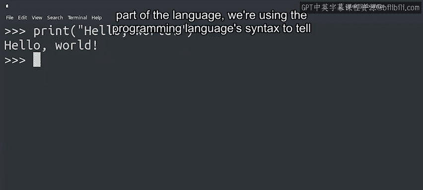
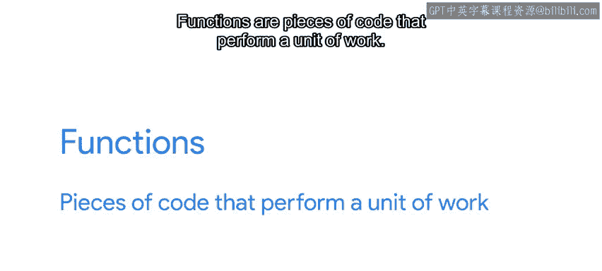
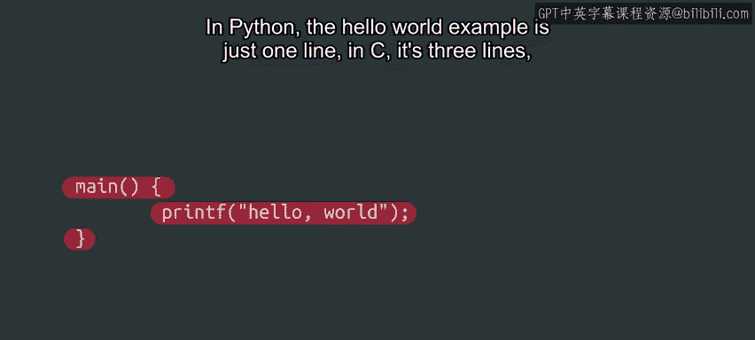

# 谷歌《用Python进行IT自动化办公1、2课（Python、控制操作系统）｜Google IT Automation with Python》中英字幕 - P10：9_Hello World.zh_en - GPT中英字幕课程资源 - BV1gw411E7E1

Now that you've got an idea of what Python code looks like。

 let's check out one of the most basic examples and dive deeper into what's going on。 Get ready。

 We're going to use a Python interpreter to make our computers say hello to the world。😊。

When we run this code， either locally on our machine or on a web interpreter。

 the words hellello world appear on the screen， just like magic。😊，Actually， it's not magic。

 It's because print is a Python function that writes what we tell it to on the screen。

 Like the statement， Hello world， for example， the print function is part of the basic Python language。

 Whenever we use keywords or functions that are part of the language。

 we're using the programming languages syntax to tell a computer what to do。😊。

So what are functions and keywords， Funs are pieces of code that perform a unit of work。

We'll talk a lot more about functions later on， and you'll even learn how to write your own keywords are reserved words that are used to construct instructions。

These words are the core part of the language and can only be used in specific ways。

 Some examples include if， while， and for。We'll explain all of those and a bunch more later in the course。

 As we called out， the keywords and functions used in Python are what makes up the syntax of the language。

 Once we understand how they work， we can use them to construct more complex expressions that get the computer to do what we want it to do。

 Last off， noticeice how hello world is written between double quotation marks。

 wrapping text in quotation marks indicates that the text is considered a string。

 which means it's text that will be manipulated by our script in programming。

 any text that isn't inside quotation marks is considered part of the code。Now， for a bit of trivia。

Do you know why we greeted the whole world in our example？Well。

 printing Hello World has been the traditional way to start learning a programming language since way back in the 70s when it was used as the first example in a famous programming book called the C programming Langu。

 That example looked like this。In Python， the Hello world example is just one line。 In C。

 it's three lines in other languages。 It could be even more While learning to write Hello world won't teach you the whole language。

 It gives you a first impression of how functions are used and how a program written in that language looks。

 All right， Now that we've written our first piece of Python code。

 I think you're ready for something a bit more challenging than Hello world。 Read， let's do it。😊。

