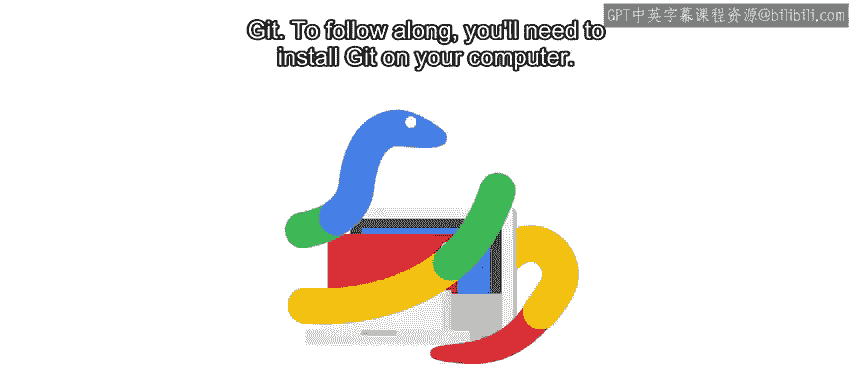
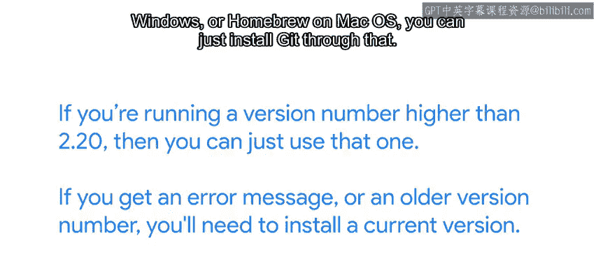

# 谷歌《用Python进行IT自动化办公3、4、5、6课（Git、debug、云端、实践）Google IT Automation with Python》中英字 - P10：9_安装 Git.zh_en - GPT中英字幕课程资源 - BV1LW4y1F7XW

🎼。う。

In this course， we'll cover many different things that you can do with Git。To follow along。

 you'll need to install Git on your computer On top of this。

 we'll show you how to interact with Git through the command line。

So if you aren't yet already familiar with the command line， this is your opportunity to brush up。

Our examples will be shown on a computer running Linux， but you can use Git on any operating system。

There are versions of Git available for all popular operating systems。 So before we get any further。

 let's get git installed in your computer。 The first step is to check whether you already have it installed。

You can do this by running Git dash dash version。If you're running a version number higher than 2。20。

 then you can just use that one。

If you get an error message or an older version number。

 you'll need to install the current version if you use a package management system like a or yum on Linux。

 Choee on Windows or Homer on MacOS。

You can just install Git through that。 If you don't use a package management system。

 then you can download the latest executable installer from the official website and deploy it on your computer on Linux。

 installing and using Git is pretty straightforward。

 You can install it with the command app installed Git or yum install Git。And after that。

 you'll have Get installed and ready to use。On Mac OS。

 you can even have it installed when you on Gitash version。If Git isn't installed。

 this command will ask you if you want to install it and then download it and install it for you。

Alternatively， you can also download it from the website and install it by following the prompts。

Once it's installed， you'll be able to use it from the command line just like any other tool。

On Windows， after downloading and executing the installer。

 you'll need to go through a bunch of different configuration options。

These options come with pre selected defaults that usually make sense to just keep pay attention to the editor question。

 though， youll probably want to change the editor to one that you feel comfortable with。

 like Noteplid plus plus or at。One interesting thing about the Windows installation is that it comes preloaded with an environment called Min GW64。

This environment lets us operate on Windows with the same commands and tools available on Linux。

So you can practice some Linux command line tools on your Windows machine。

After installing Git on your Windows machine， you'll be able to use Git from the Linux command line。

And if you selected the default option for the path environment question。

 you'll be able to also run it from the PowerShell command line。

 If you want to understand more about each option involved in the installation on Windows。

 check out the optional video where we'll talk about available options and when you might want to select something different from the default。

Throughout this course， we'll talk about how to do things from the command line。

Some integrated developer environments or IDEs let us interact with Git through graphical interfaces。

 and it's fine to use those if you feel more comfortable with them。

We'll focus on the command line because it's standard and also because once you've mastered the command line。

 you'll definitely be able to use any graphical tool out there。In the next video。

 we'll look into the options you can set when installing Git on a Windows machine。

This video is optional if you already set up Git in your computer。

 you can jump ahead to the next video。