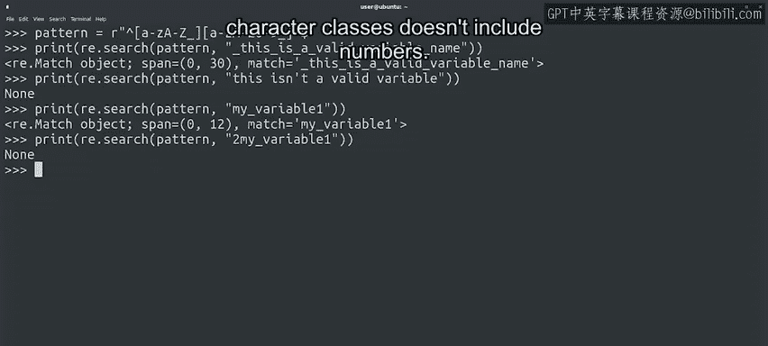

# 谷歌《用Python进行IT自动化办公1、2课（Python、控制操作系统）｜Google IT Automation with Python》中英字幕 - P110：36_正则表达式实践.zh_en - GPT中英字幕课程资源 - BV1gw411E7E1

We've now looked into a bunch of syntax for using regular expressions in Python。

Armed with all this knowledge， we can start combining these special characters to create patterns to match the text that we want。

For example， say you had a list of all the countries in the world and you wanted to check which of those names start and end in A。

What would the pattern look like？Maybe something like this， uppercase A， dot star， lowercase A。

Let's try that one out。Awesome， seems like that works。 Let's try with a different country。

 Azerbaijan。😊，Surprising， maybe this happened because we didn't specify that we wanted our pattern to match the whole string。

So while Azerbaijan doesn't finish with A， it does have an A in its name， so it matches our pattern。

We need to make our patterns stricter by adding the beginning of a line and end of a line characters。

By adding a dollar sign to our pattern， we've made it clear that we only want to match lines that begin and end with the letter A。

 so aszerbjan doesn't match anymore。Let's check that it still works for a country that should match like Australia。

Using regular expressions， we can also construct a pattern that would validate if a string is a valid variable name in Python。

Do you remember what the rules were。It can contain any number of letters， numbers， or underscores。

 but it can't start with a number。So what do you think the validating pattern would look like？

We said it needs to start with a letter， So we'll start with a circumflx to indicate that we want to start from the beginning。

And now a character class with all lowercase and uppercase letters plus the underscore。

The rest of the variable can have as many numbers， letters or underscores that we want。

 So we need another character class this time containing numbers with a star at the end。Okay。

 we're almost done。 You definitely deserve a star at the end of this。One last thing。

 we want this to be the end of the string that we're matching。 Otherwise。

 we could match something that could be a variable， but that also contains additional stuff after it。

So we finish up with a dollar sign。Now we'll apply this pattern to a few examples and check that it matches correctly。

That's right。 We can use underscores anywhere in the string。 That's a valid variable name。

It matches our validation pattern because we included underscore scores in it。

Let's try something a little different。Once we use a space， it stops being a valid variable name。

It doesn't match your pattern because spaces aren't included in the possible characters。

Let's check out a variable with a number。Sure enough， we can use numbers inside the variable name。

Our pattern includes all numbers as part of the variable， but what if we start with a number？

The variable of a number at the beginning isn't a valid variable name。

 and our pattern doesn't match it because the first of two character classes doesn't include numbers。

Awesome job。 We've covered the basics of regular expressions。

There's still some more special characters to learn about and more interesting things that we can do with them。

 but I'm sure you're starting to already see the processing power that Redxs bring and how they're another super useful tool to have in your IT toolbox。

 right？This is some complex stuff， but it can also be fun。

Why not take a little time now to play around with the characters that you just learned to see what results you can get with them？

Remember， practice builds comfort and these little characters packck a powerful punch。

They can help you out big time in your IT job， so they're worth budding up to。Coming up。

 we've got a cheat sheet that summarizes all the syntax that we've seen up until now。

 Then you can put all of this new knowledge to the test with a quick quiz。Meet me in the next video。

 once you're done。

