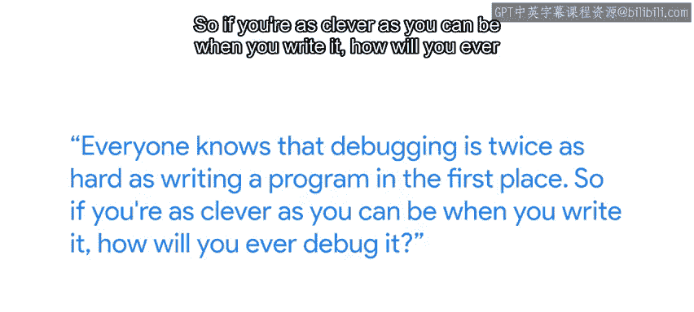
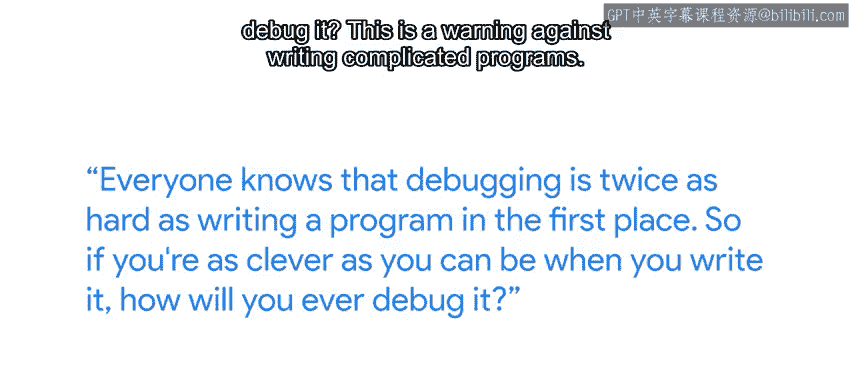

# 谷歌《用Python进行IT自动化办公3、4、5、6课（Git、debug、云端、实践）Google IT Automation with Python》中英字 - P110：52_处理困难问题.zh_en - GPT中英字幕课程资源 - BV1LW4y1F7XW

。

You might be wondering， why is debugging so hard that we need an entire course on it？Brian Knegan。

 one of the first contributors to the UniX operating System and co authorthor of the famous C programminging languagenguage book。

 among many other things， once said， everyone knows that debugging is twice as hard as writing a program in the first place。

So if you're as clever as you can be when you write it， how will you ever debug it？

This is a warning against writing complicated programs。 If the code is clear and simple。

 it will be much easier to debug than if it's clever but obscure。 the same applies to I systems。

 If the system is engineered very cleverly， it will be extremely hard to understand what's going on with it when something fails。

 It's important to focus on building systems and applications that are simple and easy to understand。

 so that when something goes wrong， we can figure out how to fix them quickly。So how do we do this。

 One piece of advice I found really valuable is to develop code in small。

 digestible chunks Every so often， I stop and test what I've written。

The hardest thing to do is to try to debug something if I'm running it for the first time only after I've completed it。

 There are so many places things could have gone wrong。

 Another lesson that's super useful is to keep your goal clear。

 If you're writing code try writing the tests for the program before the actual code to help you keep focus on your goal。

 If you're building a system or deploying an application having documentation that states what the end goal should be and the steps you took to get there can be really helpful to both keep you on track and figure out any problems that might turn up along the way。

 We called out at the beginning of this course that's solving technical problems is a bit of an art and that it can be fun when things finally clicked together on the flip side。

 The worst part of troubleshooting and debugging is when we get stuck。😊。

When we can't think of any other reasons why the program is failing or we can't figure out what else we can do to fix it in this course。

 we've given you a bunch of tools and processes to follow that can hopefully help you avoid getting stuck on a lot of these situations。

 but we can't cover absolutely everything。You might still find yourself facing an issue that you have no idea what to do about。

 and that's okay。 If you're in a sticky situation， the main thing to do is to remain calm。

We need our creative skills to solve problems， and the worst enemy of creativity is anxiety。

So if you feel that you're out of ideas， it's better to take your mind off the problem for a while。

 Maybe grab a cup of coffee or take a walk outside。

Sometimes a change of scenery is all we need for a new idea to pop up and help us figure out what we're missing。

True encoding and in life。If the problem you're trying to solve is complex and affects a lot of people。

 it can get really stressful to try to fully debug it with everyone waiting on you。

That's why it's better to focus first on the short term solution and then look for the long term remediation once those affected are able to get back to work。

 And don't be afraid to ask for help。 Sometimes just the act of explaining the problem to someone else。

 can help us realize what we're missing。 There's a technique called rubber duck debugging。

 which is simply explaining the problem to a rubber duck， It sounds whimsical。

And you may look like a quack， but it can really work。

Because when we force ourselves to explain a problem。

 we already start thinking about the issue differently and remember that no one knows absolutely everything。

 Sometimes the best way to learn new skills and techniques is to ask others for help。

 we're all in this thing together， there are times when I know that if I spend enough hours on a problem。

I'll probably figure out a solution。But is that the best use of my time。

 usually the better answer is to ask someone who has done it before to save time and frustration。

And then use the problem at hand as an opportunity to keep learning so that the next time I can do it on my own when you ask a colleague for their help with sub buggging a problem。

 Be careful not to tell them what you think the root cause of the issue might be。 Instead。

 tell them about the symptoms and see what questions they ask and what possibilities they probe。

 They might come up with completely different paths to explore。Of course。

 our lives as IT specialists would be much easier if we could avoid problems altogether。Up next。

 we'll look into some proactive approaches to catching issues before they affect any users。

