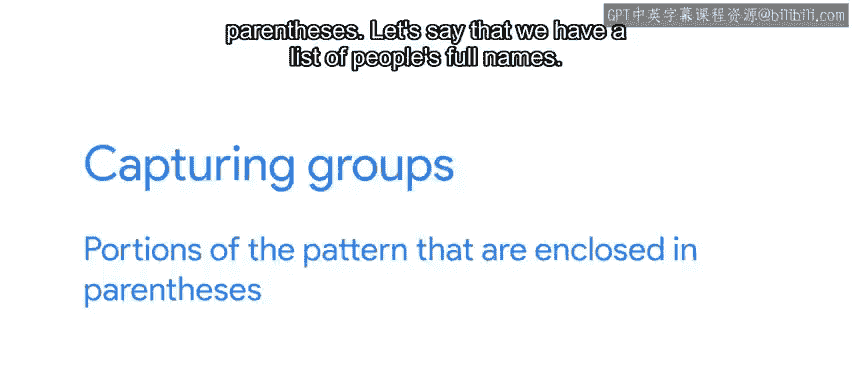
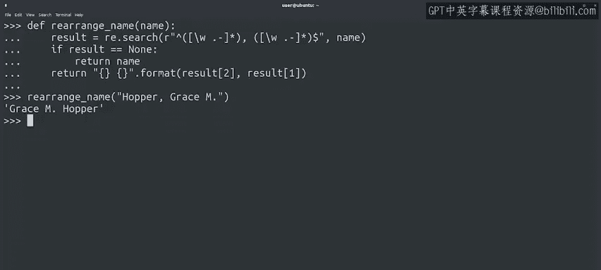
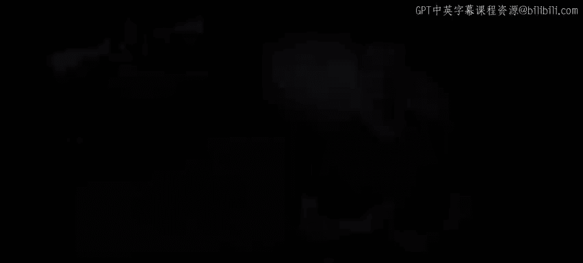

# 谷歌《用Python进行IT自动化办公1、2课（Python、控制操作系统）｜Google IT Automation with Python》中英字幕 - P111：37_捕获组.zh_en - GPT中英字幕课程资源 - BV1gw411E7E1

Up to now， we've used the search function to check if a string matched a certain pattern。

 But the only thing we've done with the result is print。

Printing is useful when we want to see if a string matches a certain pattern。

 but most of the time we want to take the information that we matched and use it for something else。

For example， we may want to extract the host name or the process ID from a log line and use that value for another operation。

For that， we need to use a concept of regular expressions called capturing groups。

Capturing groups are portions of the pattern that are enclosed in parentheses。

Let's say that we have a list of people's full names。 These names are stored as last name。

 comma first name。We want to turn this around and create a string that starts with the first name。

 followed by the last name。We can do this using a regular expression with capturing groups。

Let's see how this works。First， we'll create a matching pattern that matches a group of letters followed by a comma。

 a space， and then another group of letters。To capture our groups。

 we'll put each group of letters between parentheses like this。Great， we have a match。

 Remember that backslash W will match letters， numbers and underscores。

 The match object has more attributes and methods than the ones shown by print。

 So we're going to start using them now。 Let's look at the output of the group's method。😊。

Because we define two separate groups， the group method returns a tuple of two elements。

We can also use indexing to access these groups。The first element contains the text matched by the entire regular expression。

Each successive element contains the data that was matched by every subsequent match group。

So let's look at the element at index0。That's the whole string。Now。

 the following indexes correspond to each of the captured groups， let's check this out。

So we can construct the name that we want by using these indexes。Okay。

 so now that we've got this more or less working， let's put this into a function that would do the rearranging for us。

We'll start by defining a function called rearrange name that receives name by parameter。

Now we'll search the string with the same pattern that we saw before。If the result is none。

 it means it didn't match the format that we were expecting。 So in that case。

 it would just return the name as it is。Okay， if we're here。

 then our pattern match and our result variable will have two capture groups。

 one for the characters before the comma and another for the characters after the comma。

Let's return the rearranged version of that string。Nice， we've defined our function。

 Let's test it out with a few names。Cool， this seems to be working。

 but what if we give it something a little bit more challenging。Now。

 the regular expression didn't match because we used the backslash W character。

 which only matches letters。And so it didn't recognize the middle initial as part of the given name。

 Can you figure out how to fix it， What we need to do here is add the extra characters that we want to allow in the names。

In this example， we'd want to add spaces and dots。For other names， we can also include dashes。

 So after updating our pattern， this is what our function would look like。So as you can see。

 by adding extra characters between square brackets。

 we rearranged a name that was a little more complex。

I bet you can come up with some more examples for using capturing groups。Up next。

 we're going to cover more on repetition qualifiers。 See you there。

