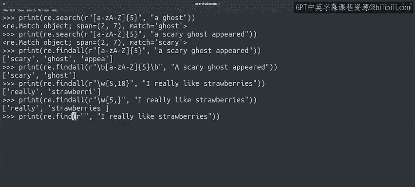

# 谷歌《用Python进行IT自动化办公1、2课（Python、控制操作系统）｜Google IT Automation with Python》中英字幕 - P112：38_更多重复修饰符.zh_en - GPT中英字幕课程资源 - BV1gw411E7E1

Up to now， we've used the star plus and question mark repetition qualifiers。

What if we wanted a pattern that repeats a specific number of times？

This could happen if we're processing a line that we know has some specific data in a column。

 or we know that we want a string of a specific length。In cases like those。

 we would manually write the same pattern as many times as we needed。

But it would be hard to read and hard to maintain。And that's why Python also offers numeric repetition qualifiers。

These are written between curly brackets and can be one or two numbers specifying a range。

For example， to match any string of exactly five letters， we can use an expression like this one。

Remember that the expression will match whichever part of the given string that fits the criteria。

In this case， we're looking for letters that are repeated five times， and ghostt has five letters。

 so a maular pattern。In this string， we actually have more matches for our search。

 but we only get the first one。Remember what we can do to find more matches？That's right。

 Use the find all function like this。Now we have an extra match for the word that's actually longer。

What if we wanted to match all the words that are exactly five letters long。

 we can do that using backslash B， which matches word limits at the beginning and end of the pattern to indicate that we want full words。

Like this。We said that we can also have two numbers in the range。For example。

 if we wanted to match a range of five to 10 letters or numbers。

 we could use an expression like this one。These ranges can also be open ended。

A number followed by a comma means at least that many repetitions with no upper boundary。

 limited only by the maximum repetitions in the source text。Okay， that looks good。Pulse check。

 Hopefully， Python isn't spooking you， and you're very much enjoying learning it。😊，Wow。

 what is it about teaching Python that makes me break out these cheesy jokes。 I can't help myself。

Now， for our final example， a comma followed by a number means from zero up to that amount of repetitions。

 Let's check that one out。

Here we looked for a pattern that was an S， followed by up to 20 alphanumeric characters。

So we got a match for strawberries， which starts with S and is followed by 11 characters。Whoa。

 that was a lot of repetition qualifiers。Ghosts and strawberries are fun and all。

 but we're ready now for a few more practical examples of how to use regular expressions。

That's coming up in our next video。 I'll see you there。

