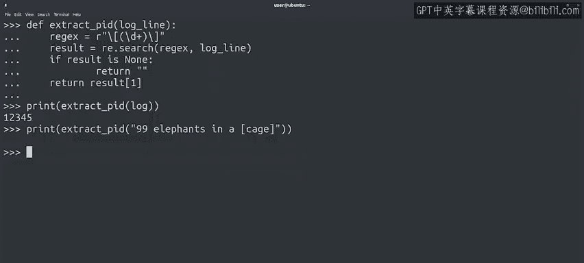

# 谷歌《用Python进行IT自动化办公1、2课（Python、控制操作系统）｜Google IT Automation with Python》中英字幕 - P113：39_使用正则表达式从 Python 中提取 PID.zh_en - GPT中英字幕课程资源 - BV1gw411E7E1

Remember the example from the beginning of our discussion of regular expressions。

It was way back in the first video of this module when we were looking at the log lines and extracting process IDs。

Well， we now have enough info to fully understand it。Let's walk through it step by step。

The first character of the pattern is the back slash， which is used as the escape character。

 This means that the next character， which is a square bracket here。

 is treated literally for matching purposes。 After the square bracket comes the first parentheses。

Since it isn't escaped， we know itll be used as a capturing group。

 the capturing group parentheses are wrapping the backslash D+ symbols。

From our discussion of special characters and repetition qualifiers。

 we know that this expression will match one or more numerical characters after the closing parentheses of the capturing group。

 we have the closing square bracket symbol also preceded by the escape character。

After calling the search function， we know that because we're capturing groups in an expression。

 we can access the matching data by accessing the value at index1。

Let's try our expression on a different string and check that it really works。

 no matter what the rest of the text is。Okay， this works fine。

But what if our string didn't actually have a block of numbers between the square brackets？Darn。

 an error。What happened？We try to access an index one of a variable that was none。

 And as Python tells us， this isn't something that we can do。 So what should we do instead。

We should have a function that extracts the processed ID or PID when possible and does something else if not。

 it's something like this。We'll start by defining a function called extract PID。Now。

 we'll use the same rex as before and we'll store the result of the search function in a result value。

 just like this。Now， we know that if the search wasn't successful， the result will be none。

 So we need to do something a little different here。

What we choose to do depends on what we want the rest of the code to do。

Let's say that if we couldn't find the PID， we'll return an empty string。And finally。

 if we're at this point， it means the result is a match object。

 so we can access the first capturing group and return that。😊。

We can now test our function with the original logline to check that it still does the right thing。

Nice， let's wrap this up by trying it out with a string that broke our code before。Great。

 it didn't match。 So it returned an empty string。 That's exactly what we wanted。

Al right， we now have a function that lets us correctly extract PIDs from log lines without it breaking other lines。

Hopefully， this is all starting to make sense now。But remember that if things are not totally clear。

 you can always review the content and practice on your own until you feel comfortable with it。

Up next， for the last step in our journey with regular expressions。

 we'll check out some of the other functions the REE module gives us。

