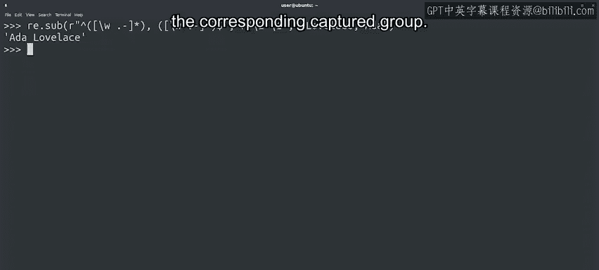

# 谷歌《用Python进行IT自动化办公1、2课（Python、控制操作系统）｜Google IT Automation with Python》中英字幕 - P114：40_分割和替换.zh_en - GPT中英字幕课程资源 - BV1gw411E7E1

Up to now， we've been using two functions from the R module。 search and find all。😊。

There are actually a few more functions that can be really handy。

 depending on what we're trying to do。One of these functions is called split。

It works similarly to the split function that we used before with strings。

 but instead of taking a string as a separator， it can take any regular expression as a separator。

For example， we may want to split a piece of text into separate sentences。To do that。

 we need to check not only for the dots， but also for question marks or exclamation marks。

 since there are also valid sentence endings。 It's something like this。

Check out how we're not escaping the characters that we wrote inside the square brackets。

That's because anything that's inside the square brackets is taken for the literal character and not for its special meaning。

Also， see how the notation marks aren't present in the resulting list。

If we want our split list to include the elements that we're using to split the values。

 we can use capturing preencies like this。This gave us both the sentences and the notation marks as elements of a list。

 another interesting function provided by the RE module is called sub it's used for creating new strings by substituting all or part of them for a different string。

Similar to the replace string method， but using regular expressions for both the matching and the replacing。

 let's see this in an example。Sa we had some logs in our system that included email addresses of users。

 and we wanted to anonymize the data by removing all of the addresses。

We could do that by using an expression。The expression that we're using for identifying email addresses has two parts。

 the part before the at sign and the part after it。Check out the part that comes before the at sign。

 We include the alphanumeric characters represented by backslash W， which includes letters。

 numbers and the underscore sign， as well as the dot， percentage sign， plus and dash。

After the at sign， we only allow the alphanumeric characters， dot and dash。

This will match all email addresses， as well as some strings that aren't really valid email addresses。

 like an address with two dots。In this scenario， we want to be better safe and sorry。

So we're going to redact anything that looks like an address。

If we wanted to validate that the address is an actual email， we would need to be a lot stricter。

We just used a regular expression for searching in a plane string for replacing。

Let's now look at an example using sub where we use regular expressions for the replacing。For that。

 we'll go back to our code that switch the order of names of people and use sub to create the new string。

So once again， we've used parentheses to create capturing groups In the first parameter。

 we've got an expression that contains the two groups that we want to match。

 one before the comma and one after the comma。😊，We want to use a second parameter to replace the matching string。

We use backslash2 to indicate the second captured group。

 followed by a space and backslash1 to indicate the first captured group。

When referring to captured groups， a backslash， followed by a number indicates the corresponding captured group。

This is a general notation for regular expressions， and it's used by many tools that support Regx's。

 not just Python。We can also use them to match patterns that repeat themselves。

 which use capturing groups as back references。 We won't look into them here。

 but if you want to learn more， you'll find a bunch more info about them online，😊，And with that。

 we've wrapped up our overview of the power of regular expressions in Python。

There were some things that we didn't get to cover。

 but our aim is to give you a foundation to build on。

We hope that you've got a pretty good picture of the many things that we can do with Bexs。

 and we encourage you to keep learning about them on your own。😊，Now， as we've said。

 regular expressions aren't easy， but they're incredibly useful， so well worth the effort to master。

To help you do this， we've got a practice quiz up next before you can jump into the next lab。

