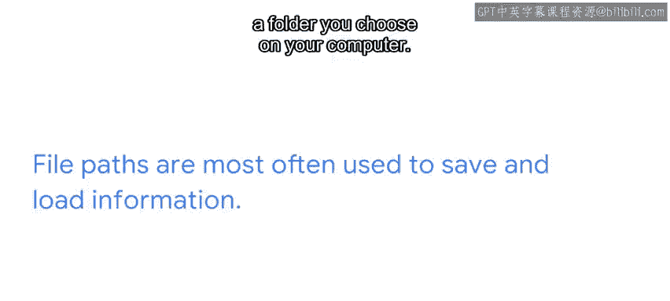

# 谷歌《用Python进行IT自动化办公1、2课（Python、控制操作系统）｜Google IT Automation with Python》中英字幕 - P115：41_文件路径.zh_en - GPT中英字幕课程资源 - BV1gw411E7E1

Welcome back。 Here's something to think about。In a number of ways， programmers are like dog trainers。

Both use tools to get something to do what they wanted to。Dog trainers use treats。

 programmers use code。For programs， including Python programs to run properly。

 an application has to call one or more files that are stored on the local computer or are in the cloud by using their file paths。

A file path is the specific location of a file on a computer or web server。In Python code。

 this is written as a string that replicates the file path on a local machine or a file on a remote server that's retrieved by its URL。

You can also use file paths to call environment variables such as libraries， applications。

 and even other languages like C+ or JavaScript。There are two types of file paths。

 relative and absolute。A relative file path is used to read and write files by the file name alone。

Relative file pass default to the specific directory where the Python command was initially run。

They are usually preferred since they are flexible enough to call the needed file on any computer。

Absolute file pass， on the other hand， Spll out the exact location of the file， drive name。

 then directory， then file name。Python programmers tend to avoid absolute file paths because the drive names can change from computer to computer。

Absolute file paths also change by operating system。 For example， in Windows。

 an absolute file path might be something like C， colon back slash my dash directory。

 back slash targetrg dash file dot T X， T。But the same absolute file path on a Mac would be forward slash users。

 forward slash username， forward slash My dash directory， forward/ targetrgfiile。txt。

And on a Linux system， it would be forward slash home， forward slash username。

 forward slash my dash directory， forward slash targetrg dash file dot T X， T。

 You see the potential issues。 It's enough to make you growl。

Although Python scripts can run on any computer that can run Python。

 scripts that rely on Windows specific passs and file systems may not work on Mac or Linux and vice versa。

However， scripts using Mac and Linux file Passs work together with no problem。

Because of the file structure differences between Windows and Mac Linux。

 many Python programmers wrapped directories using the command OS path to work around the platform differences。

File paths are most often used to save and load information。

 such as in a web scraping tool that uses Pythons to load web pages and save their contents into a folder you choose on your computer。

File paths are very straightforward as long as you're paying attention to what you're doing。

The most common file path error occurs when programmers confuse where a Python function is called with where the script calling for that function is located。

That's the basics of file passs。 The what's and why you need to know to start using them in your Python code。

 It'll help you make the right decisions。 So let's go over these basics one more time。

File paths are the specific location of a file on a computer or web server。

You can also use them the call environment variables。There are two types of file paths。

 a relative file path， typically the preferred type。

 which is used to read and write files by the file name alone and absolute file paths which spell out the exact location of a file。

Drive name， then directory， then file name。Python programmers tend to avoid absolute file paths。

Going back to our dog trainer analogy， your use of treats and commands determines what the dog will do in the same way。

 the applications， libraries and other environment variables you call using file paths determine what your code can do and the way in which it accomplishes that task。

Next time we'll talk about using file paths and programming situations。

