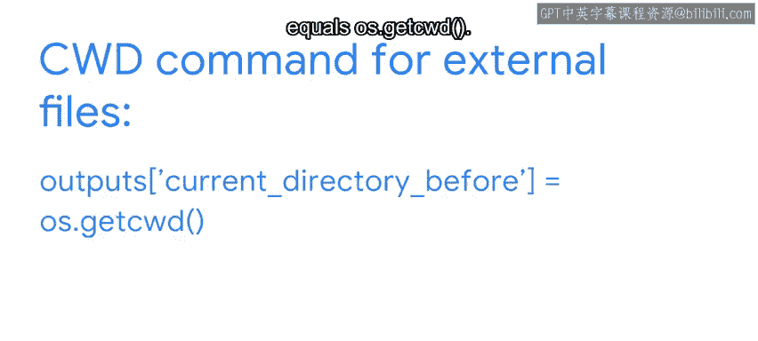
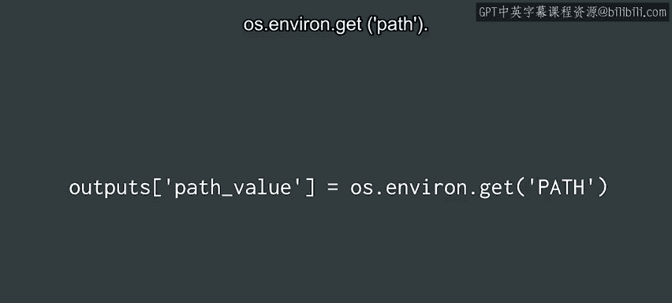
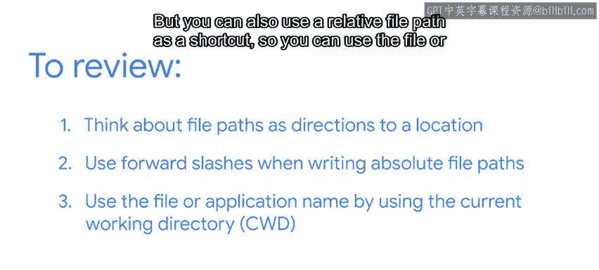

# 谷歌《用Python进行IT自动化办公1、2课（Python、控制操作系统）｜Google IT Automation with Python》中英字幕 - P116：42_如何在代码中编写文件路径.zh_en - GPT中英字幕课程资源 - BV1gw411E7E1

Hather。Once you know the basics about file paths， what they are。

 how they differ from operating system to operating system， and what they're used for。

 it's time to start thinking about writing them into your code。

Since the most common way to use FilePAs is to either save information in a target location or to load information。

 applications or environment variables from a specific location。

 it helps to think of F passs as directions to the files or directories。For example。

 say you are writing an application to retrieve certain archive content from a website and store it into a history file by date。

Your code would include the file path location for the archived content so the application would know where to look for the content parameters you specified。

Then once the content was retrieved， another line or block of code will tell the application where specifically to create the history file and store the information in it。

The key here is that once you know the directions your application can easily find and manipulate the information。

 loading， copying， and resaving it according to the commands in your code。As you know。

 the specific structure of your file path depends on the operating system or OS you're using for your code。

For example， Windows file paths typically start with a drive name like C or D。In MacC and Linux。

 it starts of a slash， which is the root。This slash is sometimes called a forward slash。

The directories in the file path are also separated by slashes。 Windows typically uses back slashes。

 so it would look like this。C， colon backslash my dash directory， backslash targetrgfiile。txt。

But you can use a forward slash for writing the file path in Python， which will look like this。C。

 colon forward slash my dash directory， forward slash target fileile。 TxT。In fact。

 using the forward slash is recommended， the backslash is a special character in Python。

 so if you use it in a file path， you have to use it again to escape every instance as shown here。

 root slashes and drive letters are important when you're using absolute file paths。

 but you can also use a relative file path and simply use the file name provided you use the current working directory or CWD for your file path。

To use the current directory， use the CWD command in your code。OS。

gecwd followed by the file name you want to access。To use the file paths to reference external files。

 you'll also need to identify the output holder。In this case。

 the getting and setting the current directory command would look like this。Outputs， open bracket。

 apostrophe， current， underscore directory， underscore before apostrophe， Close bracket equals OS。

 getcwd， open parentheses， close parentheses。

Getting and setting the current directory is only one of the ways to use file paths in Python to reference external files。

You can also list files and directories to find the file path you need using this code。Outputs。

 open bracket， apostrophe， files， underscore， and underscore directories， apostrophe。

 Close bracket equals OS。 lister， open parentheses， closed parentheses。

You can also access a file pass for environment variables by entering。Outputs， open bracket。

 apostrophe， path， underscore， value， apostrophe， closed bracket equals OS。 Nviron。

 get open parentheses， apostrophe， path apostrophe， Close parentheses。

When referencing external files， the commands you will use depend on everything you are specifically trying to accomplish with your code。

 creating or removing directories， creating， opening or removing files。

 working with different file paths， something else entirely， or some combination of tasks。 Of course。

 the best way to learn about file paths and how they work is to use them in the code you write。

As well as in projects for more advanced Python training。

This video covers only the basic principles for using file passs in your code remember when using them in your code。

 it's best to think about file passs as though they are simply the directions you follow to get to the location of the file。

 application or variable you need。Use forward slashes when writing file paths into your code。

 consider it best practice。 The slashes and the drive letter or route are important when you are using absolute file paths。

But you can also use a relative file path as a shortcut so you can use the file or application name by using the current working directory。

 CWD。

Finally， we showed you a number of examples in this video。

 rather than simply relist them and potentially cause confusion。

 we encourage you to review this video as often as you need to to view the examples in the appropriate context。

File paths are often necessary for your code。 When used correctly。

 they can make your Python code and resulting application better and more efficient。

 It all comes down to familiarity and practice。