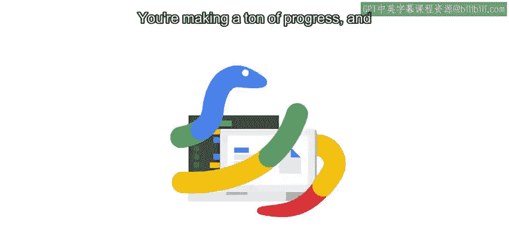

# 谷歌《用Python进行IT自动化办公1、2课（Python、控制操作系统）｜Google IT Automation with Python》中英字幕 - P118：44_模块 4 管理数据和进程介绍.zh_en - GPT中英字幕课程资源 - BV1gw411E7E1

🎼。う。

Welcome back。Congrats on completing the last lab。 You're making a ton of progress。

 and your horizons are expanding with each new tool that you learn。😊。

It must be pretty gratifying to execute a script and see perform how you expected it to right well。

 hopefully you're starting to see more and more possibilities for automation as you learn some of the tools that Python offers。

😊，Let's quickly review everything you've learned so far in the course。First。

 you install Python and set up your local environment。

Then we dove into how to manage files of Python and finally。

 we started playing with regular expressions in this module。

 we'll check out concepts that help us interact with the running operating system and we'll look at how we can get the most out of the tools available we'll kick this off by talking about how to read user data interactively then we'll explore the standard input and output data streams provided by the operating system and see how we can interact with them both from Python programs and from the system programs in a lot of our examples we'll interact with the operating system through the command line So we'll start familiarizing ourselves a bit more with the Linux shell We'll also talk about how we can execute system commands from Python。

This allows our scripts to harness the power of the rest of the operating system。

So it's important that we know how to manipulate the output of these commands and handle any generated errors we'll wrap up by diving into one important source of information for IT specialist log files we already got a peek at a few log files in some of our earlier videos Now we'll look at how we can make sense of the information these log files provide by using the tools that we've learned throughout the course。

So there's a bunch of interesting things ahead of us。 Are you excited because I'm excited。

So what are we waiting for， let's dive in。