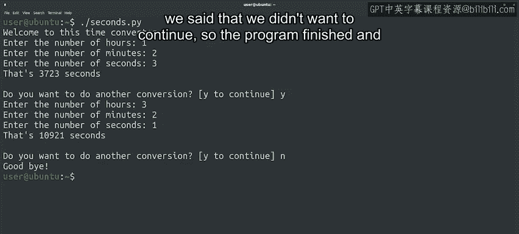

# 谷歌《用Python进行IT自动化办公1、2课（Python、控制操作系统）｜Google IT Automation with Python》中英字幕 - P119：45_交互式读取数据.zh_en - GPT中英字幕课程资源 - BV1gw411E7E1

We've talked before about reading and writing files。

Using files to store information and then processing that data with a script is a great way to build automation。

 but sometimes we need to interact with the user and ask them for certain pieces of information that just can't be stored in a file。

To do this， Python provides a function called input。

This function allows us to prompt the user for a certain value that we can then use in our scripts。

Let's see what that looks like。Here we have a script called Hello dot Pi。 It's a very simple script。

 it asks the user for their name and then prints a greeting that uses that name。

 Let's execute this script to see in action。High computer。

 the input function always returns a string if we want the data that we're reading to be a different data type like a number or date。

 then we need to convert the string to a format that we want Let's look at a different example。

This script does a bunch of things， so let's go over it piece by piece。First。

 we define a function that converts into seconds， the number of hours， minutes， and seconds。

The actual program starts by printing a welcome message and then entering a while loop。

See how we first initialize the cons variable that we'll use to check whether the user wants to continue or not。

In the body of the while loop， we asked the user to provide the number of hours， minutes。

 and seconds for the conversion。As our two seconds function requires integers。

 we're converting the value returned by the input function using the int function。

With those three values， we then call the function and print the result。After that。

 we ask a user whether they want to do another conversion or not。

 Let's try to script out and see what happens。Great， our code seems to be working properly。

We entered three numbers and it did direct conversion。

It's now asking us whether we want to continue or not。I think we have the time to answer， don't you。

Let's say yes。This time， we said that we didn't want to continue， so the program finished and exited。

And with that， we've seen how we can interactively ask the user for input。

We're only a few minutes and seconds into this module， and you've already learned a new concept。

Just imagine how much more you'll learn by the end of this module。

Interactively asking the user for input might not always be the best approach for a problem we're trying to solve。

 but it's a great tool that you just added to your IT toolbox。

