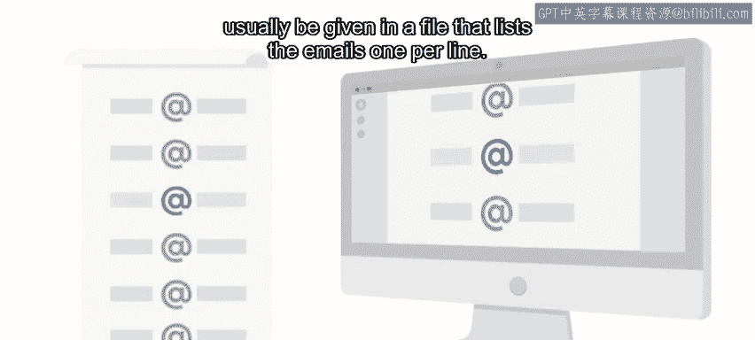
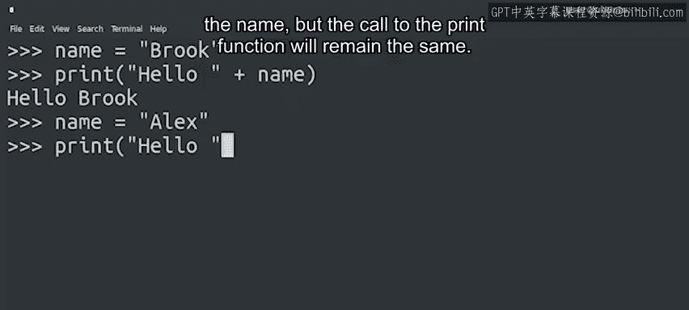

# 谷歌《用Python进行IT自动化办公1、2课（Python、控制操作系统）｜Google IT Automation with Python》中英字幕 - P11：10_从用户获取信息.zh_en - GPT中英字幕课程资源 - BV1gw411E7E1

On the whole， for a program to be useful， it needs to get at least some information from the user With this data。

 the program can take actions that are relevant to the user instead of generic actions like printing Hello world。

 Data can be provided to a computer in a bunch of different ways。😊，For example。

 on a website you might input data by entering text into text fields or clicking links。

 if you're using a mobile application， maybe you'll click on buttons or select preferenceferences from a drop down menu。

In a command line program， you might provide additional data by passing strings as parameters to the program。

 or you could have the program ask you for data interactively。 All these various platforms。

 programs and apps process data differently。 Some might take the contents of a file as data to be processed。

 Others gather data from other sources and process it in the background。

 Remember our earlier example when we automated the process of identifying and removing duplicate emails。

 there， the data provided to the program was the list of emails。

 which would usually be given in a file that lists the emails one per line。😊。

Whichever way your application gets the data， it will need to come from somewhere for our first examples in this course。

 willll just have the data as its own line in our block of code。 This is limited。

 but straightforward later in this course and in upcoming courses will introduce you to better ways of feeding data into your code For now。

 though， let's see this idea in action in a very simple example。

By having the name separate from the call to the print function。

 we're making the line of code that calls the print function generic。

 while still personalizing the greeting。If we then wanted to say hello to a different person。

 we only need to change the name， but the call to the print function will remain the same。

 Pretty simple， right。

Next up， we'll learn a few other easy things that you can get Python to do for you。

