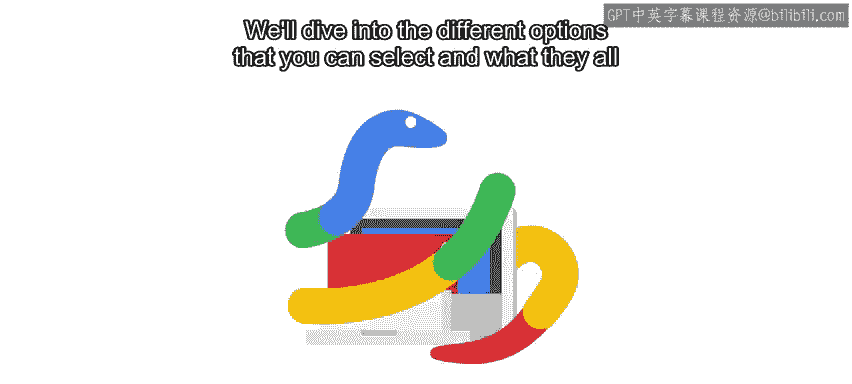
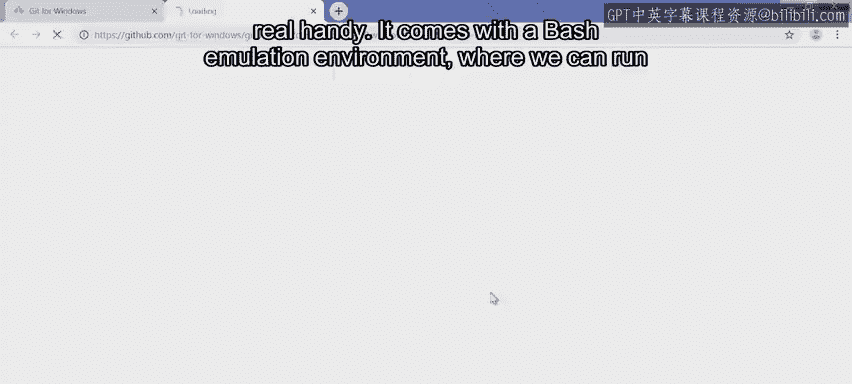
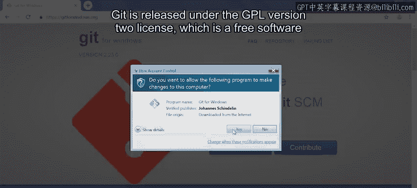
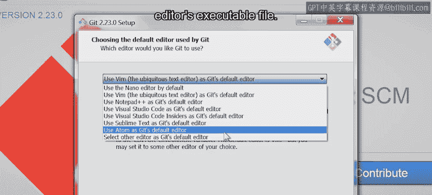
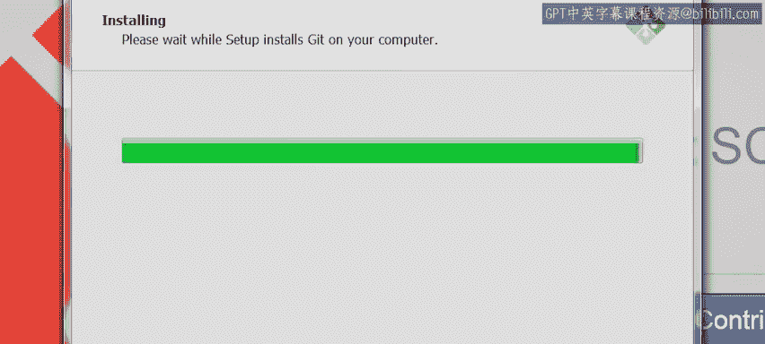

# 谷歌《用Python进行IT自动化办公3、4、5、6课（Git、debug、云端、实践）Google IT Automation with Python》中英字 - P11：10_在 Windows 上安装 Git（可选）.zh_en - GPT中英字幕课程资源 - BV1LW4y1F7XW

🎼。う。

In this video， we'll show you how you can install Git on Windows。

 We'll dive into the different options that you can select and what they all mean。

We'll start by downloading the latest version of the software from the Gitforwindows。org website。

The software package we get includes a bunch of other tools that might come in real handy。

It comes with a bash emmbulation environment where we can run all the git commands we'll explain in this course。

And a bunch of uns like utilities that will show in this and other courses。

This bundle also includes a graphical user interface to interact with Git。

 We won't look at it during this course， but you can experiment with it on your own。All right。

 we've downloaded the file。 Let's get it installed。 First， let's start by cooking keep。

The first window we get is the license of the software。

 Git is released under the GL version 2 license， which is a free software license。

 This means that if we want， we can look at Gits code to learn how it works。

 and we can even modify it to do something different。All right。

 let's accept this license and continue with the setup。

The first option we get is the installation path。 we'll keep it as is。

This window lets us select additional components to add to our Git installation。 By default。

 Git integrates with the Windows Explorer to let us run Git command line or the Git graphicphal interface in the current folder。

This software bundle comes with an extension for improving the support of how large files。

 like audio or video files get stored in the version control system。

It's a good idea to keep this enabled。The installer will also register the Git configuration files as files that should be opened with a text editor and the dot SH files as files that should be executed with bash。

All of this makes sense， so we'll keep these options selected。If you want。

 you can also enable some of the other options。That will cause the icons to be displayed on the desktop。

 true type fonts to be used in the console， or software to automatically check for updates。All right。

 let's keep going。We get prompted for the name of the folder where we want to create all the shortcuts。

 get as fine as the name for this。 so let's continue。Okay， now is the time to choose the editor。

 This is the option that you'll most likely want to adjust。

 You want to select an editor that you're comfortable with。

The installer already has a list of possible options that you could choose here。

 like Noteepad plus plus Viual Studio code or sublime text。

 and we could even select any other editor we wanted by entering the path to the editor's executable file。

For this course， we'll be using Adam in all of our examples。

 so let's choose Adam for this installation。Heads up。

 the bundle doesn't ship with any of these graphical editors installed。

 You'll need to install the one you want separately。All right。

 we're now asked to choose how we want to adjust the path environment。

This option lets us decide how we want to execute Gi from the command line。

Selecting the first option will make Gi only accessible through the embedded command line that is shipped with the bundle。

The second option， the one that's pre selected， allows us to execute Git from the embedded command line and from the Windows command prompt。

The third option will add the Uni like tools shipped together with Git to the Windows command prompt。

If you choose this option， any commands that have the same name as those in the OS will then come from the bundle and not the basic OS。

We'll keep the second option selected as it's the one that's most convenient for us while not interfering with the local tools。

This window lets us choose how we want to validate the SSL certificates used for HTPS connections。

We can choose to use the Open SSL library that's shipped together with Git or use the nativeative Windows library You'll want this second option if you need to interact with your company's internal systems。

As we'll only be interacting with GitHub， we'll keep the default options selected。

This window lets us select what we want to do about line endings。

The characters used to indicate the end of the line are different between the Windows。

 Linux and Mac OS。 so the Git software bundle lets us decide how we want to handle these differences。

The default is to store Windows line endings on the local files。

 but use UniX line endings in the files stored by Git。

This works well when you're using your Windows computer to collaborate with others using a different OS。

 The second option is to keep the line endings unchanged when copying the files locally and use Uniix line endings for the files stored in gi。

This would work well if you're using a UniX like OS or if you're the only editing through UniX like Eds on Windows。

The third option is to not do any conversions。This option doesn't work well if you're trying to work with people using a different OS。

 so it's only recommended if all your collaborators will be running the same OS as you。All right。

 let's keep the first one selected and move on。This window lets us configure the terminal emulator。

 The software bundle ships with its own terminal emulator that includes a bunch of nice features。

 like better Unicode support and a long history of commands that we can scroll。

 We'll keep that one selected。 But if you feel like you're more comfortable with the Windows default console window。

 you can choose that one。😊，Allright， we have a few extra options that we can choose to enable if we want。

 We'll keep these as they are。 That way， we'll get the performance improvements of letting Git do file system caching。

And we'll be able to use Gis Credential Manager。We don't need to use symbolic links in our repositories。

 so we'll leave that disabled。Finally， we get one last prompt before installing。

 which lets us choose which experimental features we want to select。

The features offered here will change with time as some get adopted and others get dropped。

 you can decide whether you want to work on the bleeding edge or you'd rather go with what's already well tested。

We aren't feeling too adventurous today。So we won't enable the experimental features。

 We'll just click install here to get our installation started。All right。

 Git is installing on our machine。It'll take a while for it to complete once it's done。

 we'll have all the get goodness at our fingertips。

In case you need a bit more help， you can find links for more information regarding Gits installation in our next reading。

