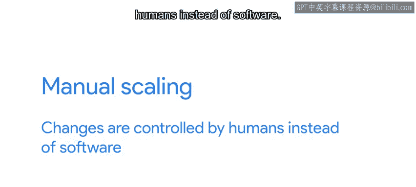

# 谷歌《用Python进行IT自动化办公3、4、5、6课（Git、debug、云端、实践）Google IT Automation with Python》中英字 - P120：3_云端扩展.zh_en - GPT中英字幕课程资源 - BV1LW4y1F7XW

One of the coolest features of deploying solutions to the cloud is how easily and quickly we can scale our deployments in a traditional I setting。

 if your team needs an extra server to improve the service。

 you need to buy additional hardware install the operating system and application software。

 and then integrate the new computer with the rest of the infrastructure。 Do all of this takes time。

 So it's not easy to quickly scale up or down if the service gets more or less usage。 In other words。

 it takes a significant amount of time to modify the capacity of the deployment。😊，In this context。

 capacity is how much the service can deliver。The available capacity is tied to the number and size of servers involved。

We get more capacity by adding more servers or replacing them with bigger servers。

 The way we measure the capacity of a system depends on what the system is doing。

If we're storing data， we might care about the total disk space available。

If we have a web server responding to queries from external users。

 we might care about the number of queries that can be answered in a second。

 which is called queries per second， or QPS。Or maybe the total bandwidth served in an hour。

And we can measure capacity in other fun ways， like the number of cat videos served in an hour or the number of digits of pie a system can calculate。

 Our capacity needs can change over time。Say you're hosting an e-commerce site that needs 100 servers to meet user demands。

As the service becomes more popular， demand might grow and you'll need to increase the available capacity。

Eventually， the system could need a0 servers to meet user demands。

This capacity change is called scaling。In particular。

 we call it upscal when we increase our capacity and downscal when we decrease it。This could happen。

 for example， if the demand for a product decreased or if the system was improved to need fewer resources。

 cloud providers typically have a lot of available capacity that can be used by their customers。

When we choose to host our infrastructure in the cloud。

 we're purchasing and using some of the provider's capacity to supplement or completely replace our onprem capacity。

This lets us easily scale our service to satisfy demand。

 There are a couple of different ways that we can scale our service in the cloud horizontally and vertically to scale a deployment horizontally。

 we add more nodes into the pool that's part of a specific service。

 Say your web service is using Apache to serve web pages。😊，By default。

 Apache is configured to support 150 concurrent connections。

If you want to be able to serve 1500 connections at the same time。

 you can deploy 10 Apache web servers and distribute the load across them。

This is called horizontal scaling。 You add more servers to increase your capacity。

And if the traffic goes up， you could just add more servers to keep up with it on the flip side。

 If you're scaling a deployment vertically， it means you're making your nodes bigger。

 When we say bigger here， we're talking about the resources assigned to the nodes like memory。

 CPU and disk space。 For example， a database server with 100 gig of disk space can store more data than with only 10 GB of space。

To scale this deployment， we can just add a bigger disk to the machine。

 And the same idea works for a CPU and memory 2。Say you have a caching server。

 and you notice it's using 95% of the available memory。

 You can deal with that by adding more memory to the node。Depending on our deployment and our needs。

 we might need to scale both horizontally and vertically to scale the capacity of our service。

In other words， adding more and bigger nodes to our pool。

 this approach to scaling isn't too different from what you'd need to do if you have your servers running on premise。

Instead of sending someone to change the physical deployment， for example。

 adding more physical Ramm to a server or adding 10 more physical machines in a server rack。

We just modify our deployment by clicking some buttons in a Web UI or using a configuration management system to automate the scaling for us。

The infrastructure built by the cloud provider will deploy any additional resources we need when talking about scaling in the cloud。

 Another aspect we need to take into account is whether the scaling is done automatically or manually。

 When we set our service to use automatic scaling， we're using a service offered by the cloud provider。

This service uses metrics to automatically increase or decrease the capacity of the system。

Say you have a system that currently has the capacity to serve 1000 cat videos per minute。

If the demand for these videos increases to 10000 per minute and it will。

 the software in charge of the automatic scaling will add resources and increase the overall capacity to meet this demand。

And when the users stop watching CAD videos， the automation will remove any unused resources so the operating costs stay small。

But early， who wants to stop watching catd videos， But make sure you set up reasonable quotas for your auto scaling systems。

 Otherwise， that viral video of acute cute cat wearing a hat might surprise you with a very uncute。

 big bill from your cloud provider on the flip side using manual scaling means that changes are controlled by humans instead of software。

Manual scaling has its pros and cons， too。When the cloud deployment isn't very complex。

 it's usually easier for smaller organizations to use manual scaling practices your company currently has a single mail server and you know that you'll want to have another one in six months。

In that case， there's no need to overcomplicate that system with an auto scalealr。

 You could simply add the extra server sometime along the way。

The trade off here is that without good monitoring or alerting。

 a system without auto scaling technologies might suffer from unexpected increases in demand。

 If you're using manual scaling for a service that becomes popular and demand grows quickly。

 you might not be able to increase the capacity quickly enough。This can stir up lots of problems。

 ranging from poor performance to an actual outage。 In this video。

 we've covered concepts that are central to any solution hosted in the cloud。

 like capacity and scaling。 As you probably noticed。

 cloud technology offers a ton of benefits for an IT team， but it also can be a little intimidating。

😊，Up next， we'll go into some of the reasons why IT teams might be hesitant to migrate to the cloud and how to overcome those fears。

