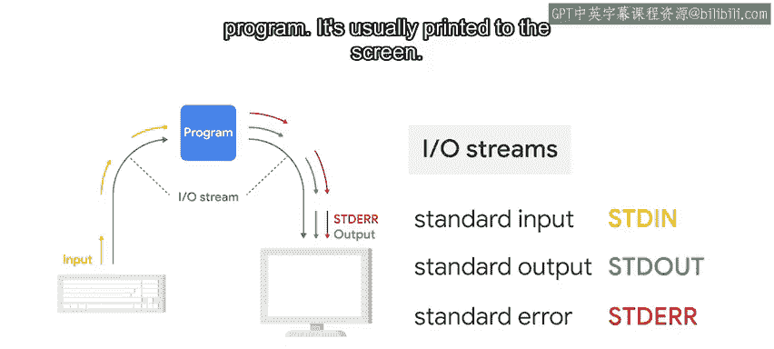
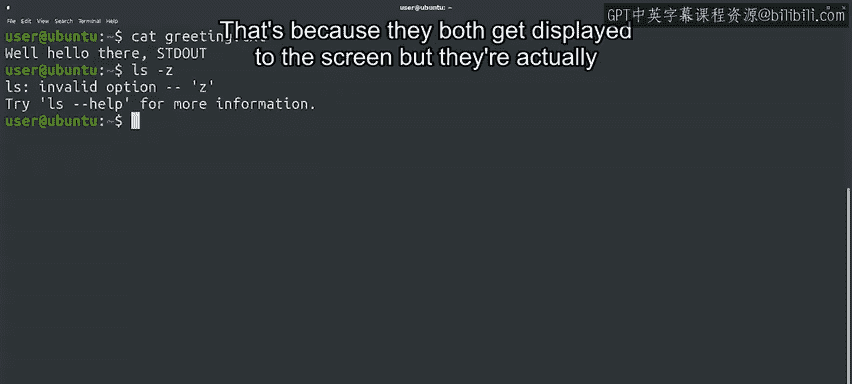

# 谷歌《用Python进行IT自动化办公1、2课（Python、控制操作系统）｜Google IT Automation with Python》中英字幕 - P120：46_标准流.zh_en - GPT中英字幕课程资源 - BV1gw411E7E1

We've now seen a couple of ways of getting information into and out of our scripts。

We know how to read and write the files and accept input from the keyboard and print it to the screen too。

But what exactly is going on behind the scenes when we do this？

How does a Python program connect to both the screen and the keyboard？Well， it uses IO streamams。

IOStams are the basic mechanism for performing input and output operations in your programs。

You can think of these streams as pathways between your programs and their input sources。

 like a keyboard or output like a screen。IO streamams aren't just available for Python programs When we run a system command on our terminal。

 IO streamams are also being used to connect that command to the terminal input and output。This way。

 we can see the results of the command or enter data interactively if that's how the program works。

We call these streams because the data keeps flowing。

A program can read input and generate output as long as it needs to achieve its goal。Okay。

 what do these streams mean in practice？Most operating systems supply three different IO streams by default。

 each with a different purpose， the standard input stream commonly referred to as STV in is a channel between a program and a source of input。

 usually in the form of text data from the keyboard。

When we use the input function to accept user input in a Python script， we're using the STD instream。

The standard output stream or STD out is a pathway between a program and a target of output。

 like a display。STD out generally takes the form of text displayed in a terminal。

 as is at play when we use the print function to write information to the screen。

The last type of prem IO streamream is called Standard error or STD U。

Standard error displays output like standard output。

 but is used specifically as a channel to show error messages and diagnostics from the program It's usually printed to the screen If you've ever run some Python code and received an error。

 then that error message was probably printed using standard errorstream。

 Let's see this consolidated in an example。

Our script here has three lines。 Each line is interacting with different stream。In the first one。

 we read from standard input。In the second one， we write a standard output。 In the last one。

 we generate an error by concatenating a string to an integer。

This error will be printed as a standard error， let's try it out。

So we first read some data through standard input and then printed it to standard output。

 Python then printed a type error because we tried to do something weird。As we called out earlier。

 these IO streams aren't restricted to just Python programs for example。

 we've been using the CA system command to display the contents of a file。When we do that。

 those contents are printed to the terminal using standard output like this。

And when one of these commands generate an error， that error is displayed to standard error。

For example， if we use an unsupported flag with the LS system command。

 which normally shows the content of directories， we get this error。

I know it looks like standard output and standard error are the same here。

That's because they both get displayed to the screen， but they're actually pretty different。

 We'll look into exactly how they're different later in the course。

 I'll keep you in suspense for now。

We'll keep coming across these streams in our Python programs so you'll start to become more familiar with them。

And later on in the course， we'll even learn how we can redirect them to other files and other processes。

The key takeaway for you to remember at this point is that IO streamams are ways for programs to give and receive information。

In the next couple of videos， we'll take a look at other ways that we can provide information to our programs。

 environment variables and command line arguments。