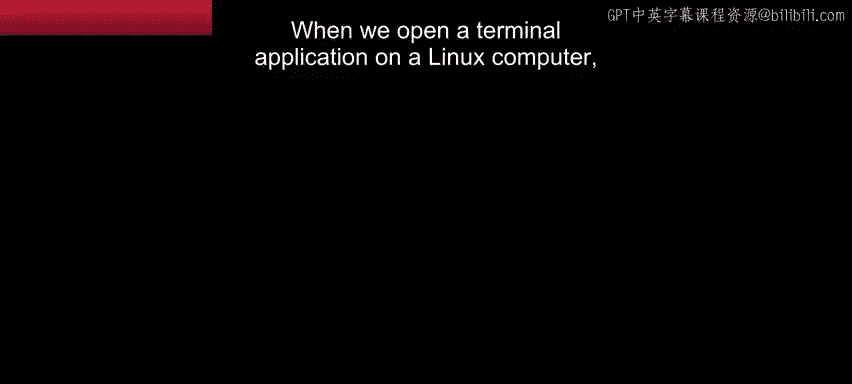
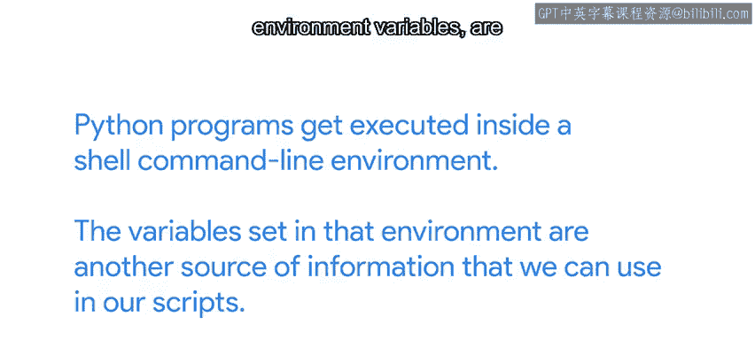
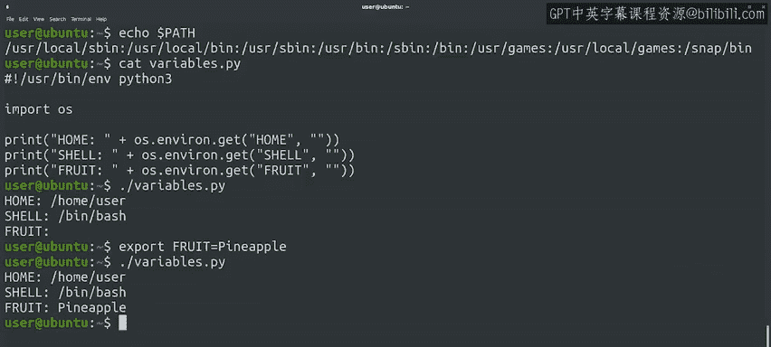

# 谷歌《用Python进行IT自动化办公1、2课（Python、控制操作系统）｜Google IT Automation with Python》中英字幕 - P121：47_环境变量.zh_en - GPT中英字幕课程资源 - BV1gw411E7E1

When we open a terminal application on a Linux computer， whether it's local or a remote machine。

 the application that reads and executes our commands is called a shell。

A shell is a command line interface used to interact with your operating system。

 The most commonly used shell on Linux is called bash。Other popular shells are ZSH and fishish。

While they operate in similar ways for this in upcoming videos， when we talk about the Linux shell。

 we mean bash。Our Python programs get executed inside a shell command line environment。

The variables set in that environment， which are called you guess it environment variables are another source of information that we can use in our scripts。

Understanding and being able to change environment variables can be really useful to quickly alter a program's behavior。

 Usually， we can do this by just making some minor changes in the environment the programs are running in。

😊，From a command line prompt， we can check these variables using the ENV or end command。

 Let's take a look。Whoa， that's a lot of different variables， but what are they for？

It all depends on the variable itself。Some are more important than others。For example。

 the path variable is a very important one。Let's print out the contents of just that one using the Echo command。

As a refresher， Echo is the command that we use to print text in the Linux shell。

And when we want to access the value of a variable in this show。

 we need to prefix the name of the variable with the dollar sign。

Here we've printed the contents of the path variable。

The shell uses this environment variable to figure out where to look for executable files when we call them while specifying a directory。

All those directories listed there are where the show will look for programs。For example。

 when we call it the Python 3 program， the shell checks each of the directories listed in the path variable in order。

And when it finds a program called Python 3， it executes it。So as we said。

 we can read the contents of these variables from Python。Let's use a Python script to check that out。

So to access the environment variables， we use the Environ dictionary provided by the OS module。

In this case， we're using a dictionary method that we haven't used before。

The get method is a bit similar to how we've been accessing dictionary values up until now。

 The difference is what happens when the value isn't present。

When we retrieve a value from a dictionary using the key as in OS do andviron square bracket fruit。

 and the key isn't present， we get an error if we use a get method instead。

 we can specify what value should be returned if the key isnt present。In other words。

 the get method allows us to specify a default value when the key that we're looking for isn't an additionctionary。

So what we're asking Python to do is try to retrieve the value associated with the key。

 but if the key is not defined， return an empty string instead。

 we're doing this for three different variables， home， shell and fruit。

Let's run the script and see what happens。Hmm， we got the values for home and shell。

 but not for fruit。Well， that's because that variable isn't defined in the current environment。

To define it in a way that our script will be able to see it。

 we need to run this in our command line。So we define the variable by just setting a value using the equal sign and leaving no spaces in between A along with this。

 the export keyword tells the shell that we want the value we set to be seen by any commands that we call。

Now， let's call our script again。

Cool， this time， we got the value that we wanted。So you now know how to get the value of any environment variables from your Python scripts。

Coming up， we'll dive into how command lines tell us whether they've succeeded or failed。

