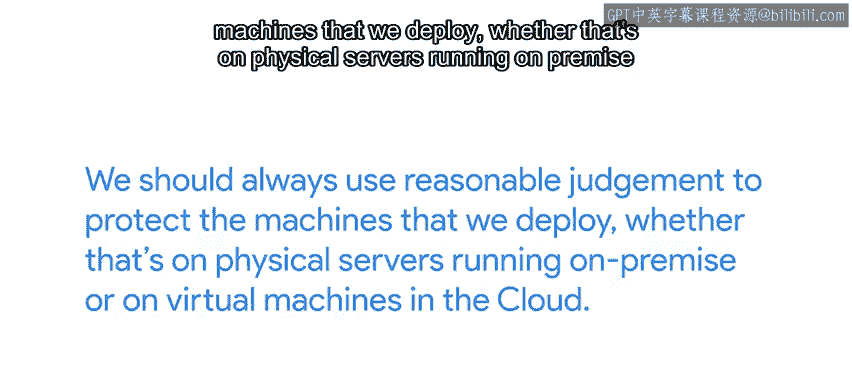

# 谷歌《用Python进行IT自动化办公3、4、5、6课（Git、debug、云端、实践）Google IT Automation with Python》中英字 - P121：4_评估云计算.zh_en - GPT中英字幕课程资源 - BV1LW4y1F7XW

If you've always worked in a traditional I T environment with servers that are physically owned by your company。

 the idea of migrating to the cloud can be pretty scary when you're running the servers yourself。

 If something breaks， you can either physically walk up to the server to fix it or SS S H into it from inside the same network。

 you can apply a quick fix and have your users back to being productive in no time。

As part of the IT team， you own the hardware， software， the network connections。

 and anything in between， which lets you have a lot of control over what's going on in the whole system。

 In the case of cloud solutions， we need to give up some of this control to the cloud provider。

We have different levels of control depending on the service model that we choose。

 whether that's software， platform， or infrastructure as a service。

When choosing to use software as a service， we're basically giving the provider complete control of how the application runs。

 We have a limited amount of settings that we can change。

 but we don't need to worry about making the system work。

This can be a great option when the software provided fulfills all of our needs。

 And we'd rather just focus on using the software instead。 But as we called out。

 there was only a limited amount of applications being offered in such a prepackaged way。😊。

If we need to create our own applications， we can use platform as a service。With this option。

 we're in charge of the code， but we aren't in control of running the application。

Or we can choose infrastructure as a service， where we can still keep a high level of control。

We decide the operating system that runs on the virtual machines。

 the applications that are installed on it and so on will still depend on the vendor for other aspects of the deployment。

 like the network configuration or the services availability。If something does break。

 you might need to get support from the vendor to fix the problem。 so when choosing a cloud provider。

 it's important to know what kind of support is available and select the one that fits your needs and know it sounds strange to give away your control over the hardware and the network and the overall infrastructure。

But personally， I find that it's pretty great to not have to worry about maintaining the machines that are running our services。

It means we can treat the servers executing the workloads as a commodity instead of special snowflakes。

 One aspect that might make you hesitant to move to the cloud is that you don't know exactly what security measures are being put in place。

So when selecting which provider to use， it's important that you check how they're keeping your instances and your data secure。

 There are a bunch of certifications like S O C1， I O 27，0。

01 and other industry recognized credentials that you can look for to verify that your provider has invested in security。

 Once you're sure that your provider is taking the right security measures。

 It might be tempting to just leave security to the professionals and forget about it。

But as cloud users， we also have a responsibility to follow reasonable security practices。Google。

 Amazon， Microsoft and other cloud providers invest heavily in security research。

 but that won't matter if the root password of your cloud instances password one。

 or the instance doesn't use a firewall。In other words。

 we should always use reasonable judgment to protect the machines that we deploy。

 whether that's on physical servers running on premise or on virtual machines in the cloud。

It's also important to keep in mind that security systems can be expensive to implement correctly。

Some highly sensitive deployments might warrant specialized security procedures like multifactor authentication。

 encrypted file systems， or public key cryptography。

 but these processes can also be expensive to implement。

It's worth considering if using these techniques as necessary for your specific use case。

 If your application stores recent patient health records。

 that's super important data that needs to be protected。

 You want to apply the most stringent security practices。

But if you're dealing with patient health records from the 1800s。

 you'll need less comprehensive security measures。 since this data is much less sensitive。

 given its age。 There's a bunch of other reasons why you might have doubts about cloud providers。

For example， you might be wary of where your data is going to be stored。

 or you might fear that the support offered won't satisfy your needs。No matter the reason。

 it's important that you carefully read the terms of service to understand the conditions and figure out if the service offered will satisfy your needs。

 You know， in a way， cloud services are a little like actual clouds。

 They come in all different shapes and sizes， and sometimes a dark。

 stormy one comes along to rain on your productive day。

But if you prepare in advance with the right security measures and maybe an umbrella。

 working in the cloud will be nothing but a breeze。

 So let's say you've decided to migrate part of your infrastructure to the cloud。

 What do you do next。Microrating into the cloud is a big topic， and it's coming up in our next video。

