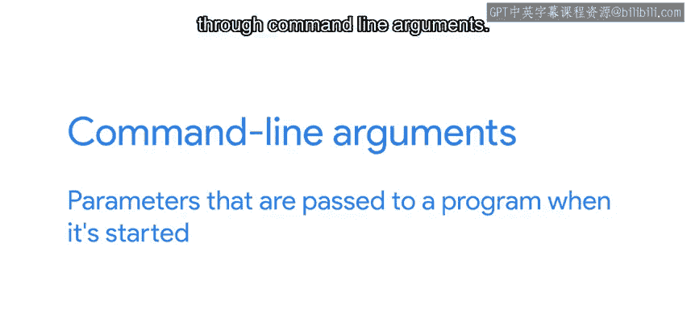
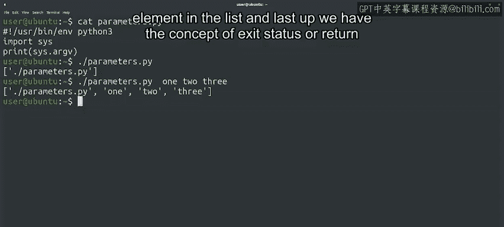
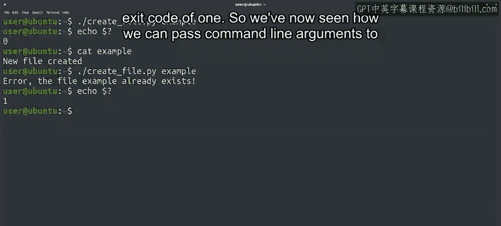

# 谷歌《用Python进行IT自动化办公1、2课（Python、控制操作系统）｜Google IT Automation with Python》中英字幕 - P122：48_命令行参数和退出状态.zh_en - GPT中英字幕课程资源 - BV1gw411E7E1

Up to now， we've seen how different programs can read from and write to standard IO streamams and how the shell environment can influence the execution of a program。

Yet another common way of providing information to our programs is through command line arguments。

These are parameters that are passed to a program when it started。

It's a super common practice to make our scripts receive certain values by command line arguments。

It allows the code of the script to be generic while also letting us run it automatically without requiring any interactive user input。

This means that these arguments are really useful for system administration tasks。

 that's because we can specify the information that we want our program to use before it even starts。

This lets us create more and more automation。And you can't argue with that。

 although you could argue my humor isn't really that humorous。

But can I say I'm a better coder than I am a comedian。Anyway。

 we can access these values using the RrgV list in the Ss module。

 Let's check this out by executing a very simple script that just prints this value。First。

 let's use our friendly cat command to look at what the script does。As you can see。

 our script just imports the Ss module and prints the Ss Arg V list。 Now。

 let's see what happens when we call the program。In this case。

 we call the script without any parameters。 The list contains one single element。

 the name of the program that we just executed。Let's try passing a few parameters。

Now we see that each of the parameters that we pass is included as a separate element in the list。

 and last up， we have the concept of exit status or returnturn code。

 which provides another source of information between the shell and the programs that get executed inside of it。

The exit status is of value returned by a program to the show in all Uni like operating systems。

 the exit status of a process is zero when the process succeedes。And different than zero if it fails。

The actual number returned gives additional info on what kind of error the program encountered。

Knowing if a command finished successfully or not is helpful information。

 which can be used by a program that's calling a command。For example。

 it can use the information to retry the command if it failed， to check the exit status of a program。

 we can use a special variable that lets us see what the exit status of the last executed command was。

The variable is the question mark variable， so to see the contents， we use Do sign question mark。

Let's try this out using the WC command， which counts the number of lines， words。

 and characters in a file。First， we'll pass it our variables pi script and check the exit value。

So here we first ran the WC command and it printed the values of lines， words。

 and characters for our Python script。Then we printed the content dollar sign question mark variable and we can see that the exit value was0。

 that's because WC ran successfully。Here， WC couldn't run for the file that we pass because it doesn't exist。

The command printed an error， and when printing the contents of the dollar sign question mark variable。

 we see that it finished with an exit value of1。So that's for system commands。

 but what about Python scripts？When a Python script finishes successfully。

 it exits with an exit value of zero， when it finishes with an error like type error or value error。

 it exits with a different value than zero。We can make it exit with whatever value is relevant。

Let's check out an example of this。This script receives a file name as a command line argument。

It first checks whether the file name exists or not。When the file doesn't exist。

 it creates it by writing a line to it。When the file exists。

 our script prints an error message and exits with an exit value of one。To try this out。

 let's first execute the script and pass a file that doesn't exist。Nice。

 looks like that was successful。Check out how it exited with the exit code zero。

 even though we didn't specify this in the code， that's because that's the default behavior。

Let's look at the contents of the file to make sure it's got what it should。Okay。

 and what do you think will happen if we now run the command again。You guess it。

 we get an error because the file already exists。And so we get an exit code of one。

So we've now seen how we can pass command line arguments to our Python programs and how we can make our programs tell us whether they've finished successfully or not。

These are both important tools that we'll use when creating automation。

 We'll use command line parameters to tell our programs what we want them to do without having to interact with them。

And we'll use exit values to know if our command succeeded or failed and then log failures and automatically retry the commands if we need to。

 Whoa， we've definitely learned a lot over these last few videos。

 Chances are it got a little tricky at some points。

 but you're doing an awesome job not letting these complex concepts stop you。😊。

Since you made it this far， you're bound to master all the ways that we can make our code interact with our shell environment。

As always， take your time to review and then head on over to the quiz to put your new knowledge to practice。

That's great。

