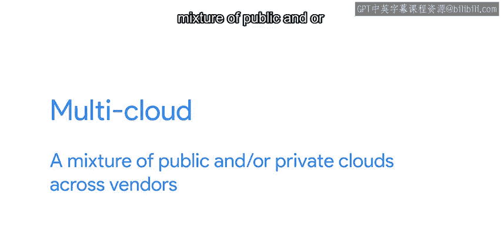

# 谷歌《用Python进行IT自动化办公3、4、5、6课（Git、debug、云端、实践）Google IT Automation with Python》中英字 - P122：5_迁移到云端.zh_en - GPT中英字幕课程资源 - BV1LW4y1F7XW

A lot of companies today are looking into migrating at least part of their IT infrastructure to the cloud。

The details of the migration will depend on what your infrastructure currently looks like and what you're trying to achieve by migrating to a cloud provider。

 In general， we're looking at a trade off between how much control we have over the computers。

 providing the services， and how much work we need to do to maintain them。

 We've called out that when we use infrastructure as a service or IAA。

 We deploy our services using virtual machines running on the cloud providers infrastructure。

We have a lot of control over how the infrastructure is designed， which can be super useful。

 For example， we can decide which of the many available machine types to use and what kind of storage to attach to them。

IAA S is especially useful to administrators using a lift and shift strategy。 So what does that mean。

 Say you work at a small organization that's expanding。As the company grows。

 physical space for employees， desks， pingang tables and printers becomes scarce。Eventually。

 the whole office might need to move to a larger space。

 This means moving not just the desks and printers， but also any servers running on premise。

 If physical servers need to be moved， you might need to take a server from the old office。

 Turn it off during a maintenance window。 load it on a truck and physically drive it to the new location。

 This could be the new office or maybe even a small data center。

 So you're literally lifting the server and moving it to a new location。

 That's where the lift in Ly and shift comes from。 when migrating to the cloud。

 the process is somewhat similar。 But instead of moving the physical server in the back of a truck。

 to migrate your physical servers running on premise to a virtual machine running in the cloud。😊。

In this case， you're shifting from one way of running your servers to another。

 The key thing to know with both approaches is that the server's core configurations stay the same。

 It's the same software that needs to be installed on the machine to provide its functionality。

 No matter if the server is hosted physically on site or virtually in the cloud。

 If you've already been using configuration management to deploy and configure your physical servers。

 Moving to a cloud setup can be pretty easy。You just have to apply the same configuration to the V Ms that are running in the cloud。

 and you'll have replicated the setup on the flip side。

 Uing this strategy means that you still have to install and configure the applications yourself。

You need to make sure that both the O S and the software stay up to date。

 The no functionality breaks when they get updated and a bunch of other things。

 depending on which specific application the server is running。

 One alternative in this case is using platform as a service or pass。

This is well suited for when you have a specific infrastructure requirement。

 but you don't want to be involved in the day to day management of the platform In an earlier video。

 we mentioned the example of an SQL database that could be used in this way。

By leaving the management of the database to the cloud provider。

 you don't need to worry about having the right disks attached to the computer。

 configuring the database or any other task related to the machine setup up。 Instead。

 you can focus on just using the database。 Another example of platform as a service or managed web applications。

When using this service， you only have to care about writing the code for the web app。

 you don't need to care about the framework for running it。

This can accelerate development because developers don't have to spend time managing the platform and can just focus on writing code。

 Some popular managed web application platforms include Amazon Elastic Beanstock。

 Microsoft App service and Google app engine。 While these platforms are very similar。

 they aren't fully compatible。 So migrating from an on premise framework and switching between vendors will require some code changes。

Another related concept that you might have heard of is containers。

 Cons are applications that are packaged together with their configuration and dependencies。

This allows the applications to run in the same way， no matter the environment used to run them。

In other words， if you have a container running an application。

 you can deploy it to your on premisem server to a cloud provider or a different cloud provider。

Whichever you choose， it will always run in the same way。

This makes migrating from one platform to the other super easy When talking about migrating to the cloud。

 you may also hear about public clouds， private clouds， hybrid clouds and multi clouds。

 Let's check out what each of these mean。 We call public cloud。

 the cloud services provided to you by a third party。😊。

It's called public because cloud providers offer services too。 You guessed it， the public。

 a private cloud is when your company owns the services and the rest of your infrastructure。

 whether that's on site or in a remote data center。It's private because it's just for your company。

 like having your own cloud in the sky。 A hybrid cloud is a mixture of both public and private clouds。

In this scenario， some workloads are run on servers owned by your company。

 while others are run on servers owned by a third party。

The trick to making the most of the hybrid cloud is ensuring that everything is integrated smoothly。

This way， you can access， migrate and manage data seamlessly， no matter where it's hosted。 Finally。

 multicloud is a mixture of public and or private clouds across vendors。

For example， a multicloud deployment may include servers hosted with Google， Amazon， Microsoft。

 and on premise。A hybrid cloud is simply a type of multicloud。

 but the key difference is that multiclouds will use several vendors。

 sometimes in addition to onsite services， using multiple clouds can be expensive。

 but it gives you extra protection。If one of your providers has a problem。

 your service can keep running on the infrastructure provided by a different provider。

 In the last few videos， we've covered a lot of different concepts related to cloud infrastructure。

 cloud services。 and how we can use them to scale in the cloud coming up。

 we've got a quiz to check that all of these concepts are making sense。 And after that。

 we'll look into how using cloud infrastructure looks in practice。

