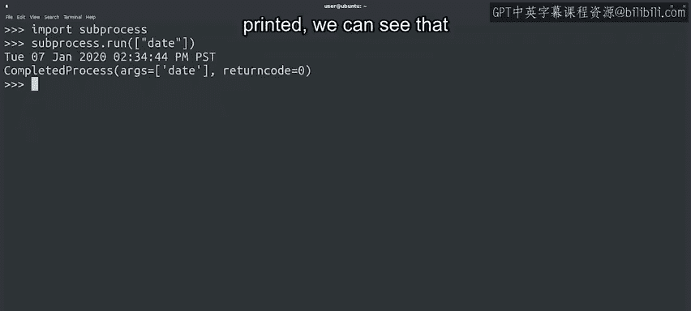
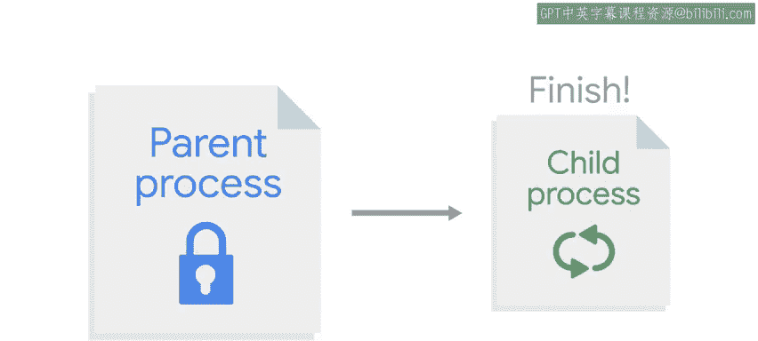
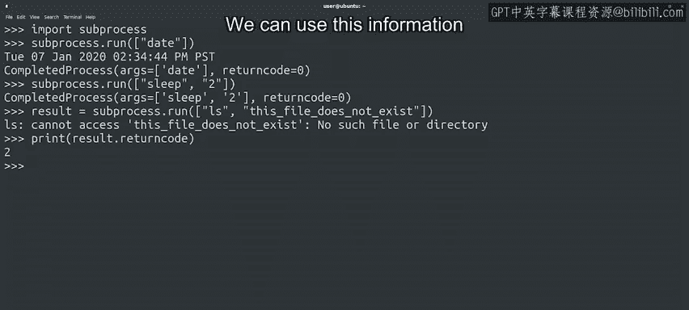

# 谷歌《用Python进行IT自动化办公1、2课（Python、控制操作系统）｜Google IT Automation with Python》中英字幕 - P123：49_在 Python 中运行系统命令.zh_en - GPT中英字幕课程资源 - BV1gw411E7E1

Welcome back。 We hope you're feeling good about streams， arguments and exits。😊。

Now we're going to submerge ourselves in subprosses。 So let's a dive in。Up to now。

 we've been using Python to interact with the operating system through Bit in functionality。

 for example， we've used file objects to read the contents of files。

 use the SXUT module to check if the disc is full and use a assist module to process standard input。

 get parameters or generate an exit code， but what if we needed to run a system program from a Python script。

 say for example， that as part of a Python script， we needed to send ICMP packets to a host to check if it's responding。

We could try to look for an external module that provides this functionality。

Or we can just run the P command， which will send packets for us。

Sometimes it's easier or faster to use a system command as part of our Python script to accomplish a task or use some functionality that doesn't exist in the Python modules neither builtin or external For these cases。

 Python provides a way to execute system commands in our scripts using functions provided by the subprocess module Let's check out an example First we'll import the subprocess module and then we'll call the date command which shows the current date using the subprocess do run function。

The run function returns an object of the completed process type。

This object includes information related to the execution of the command。

From the information that got printed， we can see that the return code of the command was zero to run the external command。

 a secondary environment is created for the child process or subprocess where the command is executed。

While the parent process， which is our script， is waiting on the subprocess to finish， it's blocked。

 which means that the parent can't do any work until the child finishes。

And I've bet a lot of parents out there saying， I know that's right。

After the external command completes its work， the child process exits and the flow of control returns to the parent。

Then the script can continue its normal execution。 Let's see this in action by calling the sleep command。

 which waits for a number of seconds that we tell it before returning。

You may have noticed that while a sleep command was running。

 the interpreter was blocked and we couldn't interact with it。

That's exactly what we mean about the parent process being blocked until the child process is done。

Check out how we called the command。The run function receives a list that starts with the name of the command that we want to call。

 followed by any other parameters that we want to pass to that command。

 So any elements following the program name are the command line arguments for it。In this case。

 we're requesting sleep to wait for two seconds。In the last two examples。

 the commands executed successfully， and so the return code inside the completed process instance was0。

Let's check out an example where the exit status isn't zero if we call LS with a file name that doesn't exist。

 LS will print an error and return an exit status different than zero。

 This will be stored in the return code attribute of the completed process instance and we can access that value in our code。

We can see that the command failed and the return code stored was two。

 letting us know that there was an error。We could use this information in the script to do something different in case the failure。

Using the run function like this is useful if we just want to run a command and only care about whether or not it was successful。

The output of the command will be printed to the screen。

 which means that our script has no control over it。

 this can be handy for system commands that either don't have useful output like CP， CHMoD。

 Sleep and many others。Or when we don't care about processing that output any further。

 in other words， when it's just fine to have the output printed to the screen。For example。

 if we're writing a script that's changing the permissions of a bunch of files in a tree of directories。

 we don't care about the output of the C Hma command。

 We only want to know if it was successful or not。If instead we want to capture the output of an external command and then operate with the results。

 we need a different strategy。We'll dive into that in the next video。 I'll see you there。

