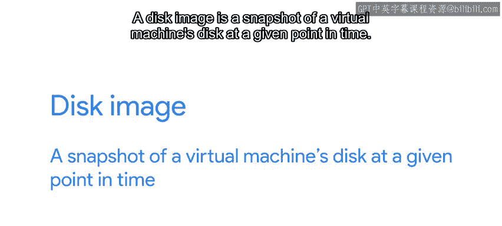

# 谷歌《用Python进行IT自动化办公3、4、5、6课（Git、debug、云端、实践）Google IT Automation with Python》中英字 - P123：6_在云中启动虚拟机.zh_en - GPT中英字幕课程资源 - BV1LW4y1F7XW

We've been talking a lot about how the cloud works。

 what the different concepts at play are and what they mean。In the next few videos。

 we'll be showing you how some common actions that you might perform on the cloud look and practice。

 As we've called out， there's a bunch of different cloud providers that you can use for your projects。

Each with some specific advantages， depending on what you're trying to achieve。

 And while some terms used by one provider might not exactly match the ones used by other providers。

 the concepts are the same。 In these videos， we'll use the Google Cloud platform to demonstrate our examples because well。

 it's the platform we know best。 All cloud providers give you a console that lets you manage the services that you're using。

This console includes pointers to a lot of different services that the providers offer。

 seeing all of the options available can be a little dizzying at first so it's a good idea to start just by familiarizing yourself with the platform before you try to do something with it this can mean for example。

 looking at the available menus and options and figuring out where the sections that let you use infrastructure as a service are located no matter the exact menu entries when you want to create a VM running in the cloud there are a bunch of parameters that you need to set。

These parameters are used by the cloud infrastructure to spin up the machine with the settings that we want。

 You'll start by choosing the name assigned to the instance。

 This name will later let you identify the instance if you want to connect to it。

 modify it or even delete it。You'll also have to choose the region and zone where the instance is running。

As we called out in an earlier video， you'll generally want to choose a region that's close to your users so that you provide better performance。

 Another important option that you'll need to select is the machine type for your VM。

Cloud providers allow users to configure the characteristics of their virtual machines to fit their needs。

 This means selecting how many processing units or virtual CPUs and how much memory the virtual machine will be allocated you might be tempted to select the most powerful VM available。

 but of course， the more powerful the VM， the more money it will cost to run it As a ciss admin。

 you may need to decide between costs and processing power to fit the needs of your organization。

When setting up instances like these， it's a good idea to start small and scale is needed On top of the CPU and memory available。

 you'll also need to select the boot disk that the VM will use。

Each virtual machine running in the cloud has an associated disk that contains the operating system it runs and some extra disk space。

 When you create the VM， you select both how much space you want to allocate for the virtual disk and what operating system you want the machine to run to create these resources We can use the web interface or the command line interface。

 The web UI can be very useful for quickly inspecting the parameters that we need to set。

The U I will let us compare the different options available and even show us an estimation of how much money our selected VM would cost per month。

 This is great for experimenting， but it doesn't scale well if we need to quickly create a bunch of machines。

 or if we want to automate the creation。 In those cases， we'll use the command line interface。

 which lets us specify what we want once and then use the same parameters many times。

 using the command line interface， lets us create， modify and even delete virtual machines from our scripts。

This is a great step towards automation， but it doesn't stop there。

 We can also automate the preparation of the contents of those virtual machines。

 Imagine spending an afternoon installing and configuring your new web server。😊。

You can do this on one machine， and the process is fairly straightforward。

 You install any necessary software。 You modify any configuration settings and then make sure that it's working correctly。

 but it would be hard to reproduce this exactly on another machine and impossible to do it on thousands of machines。

This is where reference images and templating come into play Reference images store the contents of a machine in a reusable format。

 while templating is the process of capturing all of the system configuration to let us create VMs in a repeatable way。

That exact format of the reference image will depend on the vendor。

 but often the result is a file called a disk image。

 A disk image is a snapshot of a virtual machine's disc at a given point in time。

Good tempemplating software lets you copy an entire virtual machine and use that copy to generate new ones。

 depending on the software， the disk image might not be an exact copy of the original machine because some machine data changes like the host name and I address。

 but it will have the data that we need to make it reusable on lots of virtual machines。

 This can be super helpful if we want to build a cluster of 10000 machines。

 which all have identical software。 Up next， we'll do a few demos of this process We'll show you how we can create new Vms in Google Cloud console。

 how we can customize those Vms and how we can use templating and reference images to automate the creation。

😊。