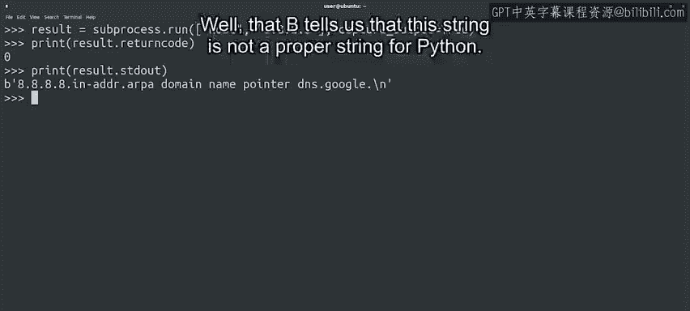
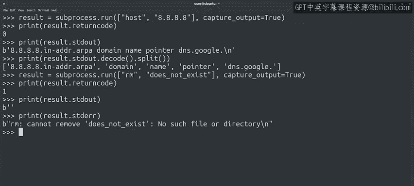

# 谷歌《用Python进行IT自动化办公1、2课（Python、控制操作系统）｜Google IT Automation with Python》中英字幕 - P124：50_获取系统命令的输出.zh_en - GPT中英字幕课程资源 - BV1gw411E7E1

If we want our Python script to manipulate the output of system command that we're executing。

 we need to tell the run function to capture it for us。

 This might be helpful when we need to extract information from a command and then use it for something else in our script。

 For example， say you wanted to create some stats on which users are logging into a server throughout the day。

You could do this with a script that calls the Who command。

 which prints the users currently lockedgged into a computer。

The script could parse the output of the command， storing the list of logged in users once per hour。

 and at the end of the day to generate a daily report。

 to be able to process the output of commands we'll set a parameter called captureture output to true when calling the run function。

For our next example， we'll call the hostt command。

 which can convert a host name to an IP address and vice versa。When calling it。

 we'll pass the capture output equals true parameter and store the result in a variable so that we can access it。

Let's give it a try。We know that the result variable is a completed process instance that we can access。

 We can check the return code attribute like we did before。

And we can also print and operate with the output generated by the command。

 which is stored in the STD out attribute。H， what's that B at the beginning of the string？Well。

 that B tells us that this string is not a proper string for Python。

It's actually an array of bytes。An array of bytes。This is a complex subject， so listen closely。

Data in computers is stored and transmitted in bytes， and each can represent up to 256 characters。

 But there are thousands of possible characters out there used to write in various languages。

 Chinese， for example， requires over 10000 different characters。

To be able to write in those languages， several specifications called encodings have been created over time to indicate which sequences of bytes represent which characters。

Nowadays， most people use UTF8 encoding， which is part of the Unicode standard that lists all the possible characters that can be represented。

 so going back to our example， when we execute the command using run。

 Python doesn't know which encoding to use to process the output of the command。

So it simply represents it as a series of bytes。If we want this to become a proper string。

 we can call the decocode method。 This method applies in encoding to transform the bytes into a string。

By default， it uses a UTF8 encoding， which is what we want。So with all that said。

 let's transform our array of bytes into a string and then split it into several pieces。In this way。

 we're operating with the output of the command that we ran。

 and we can do whatever we need to do with it。For example。

 we can choose to keep the last element of the list。

 which is the name that corresponds to the IP that we're looking for。 Great。

 So we just looked at the captured standard output。 But what about standard error。😊。

If we use the capture output parameter and the command writes any output to standard error。

 it will be stored in the STDer attribute of the completed process instance。

 Let's look at an example of this。We'll try executing the RM command。

 which we use for removing files， passing a file name that doesn't exist。

Let's check the return code of the command。Okay， it failed just like we expected。

Now let's check the contents of the STD out and STD U attributes。So we see that in this case。

 the standard output was empty。

But there was an error printed to standard error which we can access through the STD Er attribute。

This is a great example of how standard output and standard error are actually different streams。

 and so Python captures them separately。Okay， we've now seen that we can execute system commands from Python and check whether they succeeded or failed。

We've also seen how to capture their standard output and standard error streams so we can use their content in our scripts。

These skills can be super useful when writing scripts that use system commands for some involved tasks and letting our Python scripts cover a broader range of tasks。

 In the next video， we'll wrap up our discussion on subprocess module by learning some more advanced things that we can do when calling external commands。

