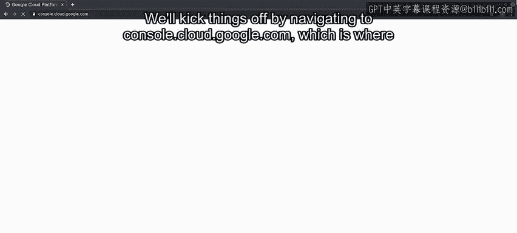
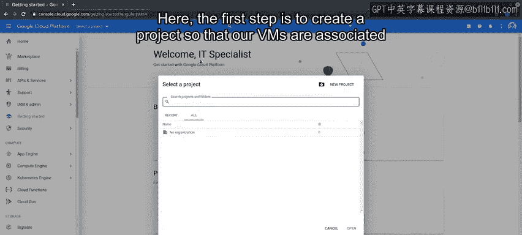
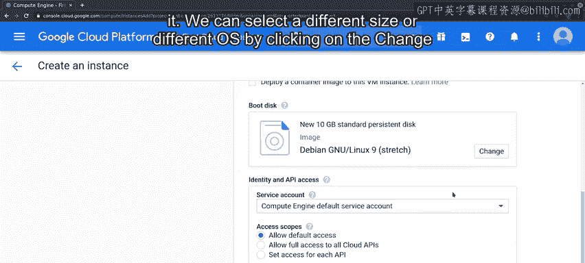
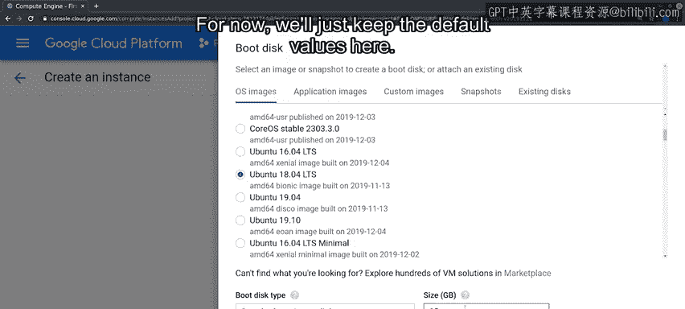
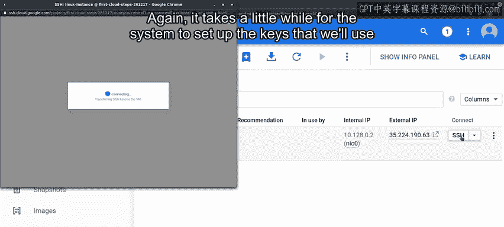
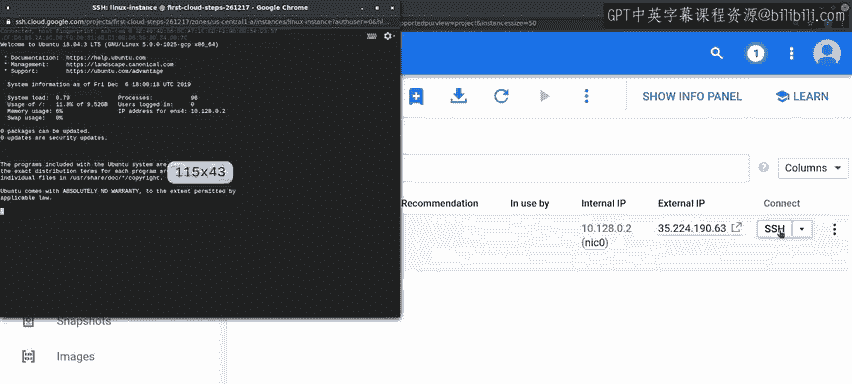
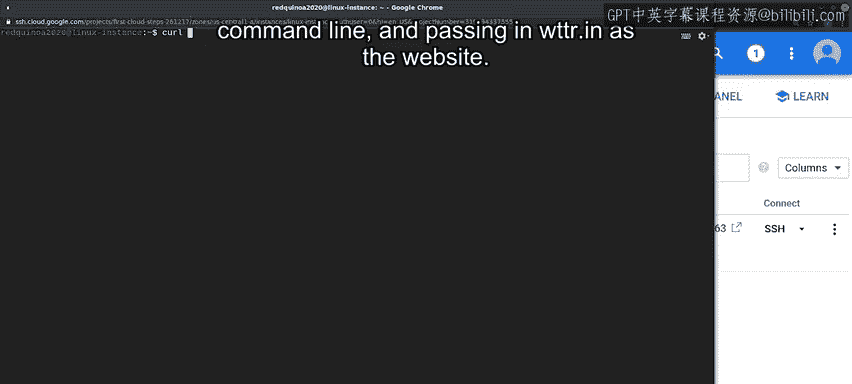

# 谷歌《用Python进行IT自动化办公3、4、5、6课（Git、debug、云端、实践）Google IT Automation with Python》中英字 - P124：7_使用 GCP Web UI 创建新的虚拟机.zh_en - GPT中英字幕课程资源 - BV1LW4y1F7XW

Okay， let's get started with creating a virtual machine on our GCP project。

 We'll kick things off by navigating to console。cloud。google。com。

 which is where you'll find the cloud console for GCP。

Here， the first step is to create a project so that our VMs are associated to that project。

We need to give our project a name。 Let's name it。 first， cloud steps。Our project is being created。

 it takes a couple of seconds。Now that we have a project， our dashboard has a lot more info。Next。

 we want to go to the menu entry that lets us create virtual machines。To do that。

 we'll go into the Comp Engine menu and select the VM instances entry。

This screen is pretty empty because we don't have any Vms yet。

 We can create a VM by pressing the create button。Here。

 we're shown the many different options that we can set for this VM that we're creating。

 We can set the name， the region and zone， the machine type， the boot disk and so on。

 We'll start by calling this machine Linux dash instance。Now it's time to select the region and zone。

If we click on the region dropdown， we can see all the regions that are currently available to create new VMs。

If we click on the zone dropdown， we can see the zones available in that region for new VMs。

For this example， we'll just keep the default regions， but as we called out。

 if you're deploying a service， you should select something that's close to your users。Next。

 we need to select the type of machine that we want to use。

We can select between general purpose and memory optimized。 And among each of those families。

 we can select a bunch of different machine types。We can select how much CPU and how much memory we want our VM to have。

The right selection will depend on what we plan to do with the computer。For our example。

 we'll just keep the default machine。After selecting the VM。

 we need to select the disk that we want to use。The default disk is 10 GB in size and comes with a Deian image on it。

 We can select a different size or different Os by clicking on the change button。

There's a long list of available operating systems to choose from。

The right option will depend on what you're trying to do with your instance。For this example。

 we'll choose one of the Uuntu versions。We can select which type of disk we want to use。

 either the standard disk， which is cheaper or the SSD version， which is faster。

And we could also change the size if we needed extra storage for our server。For now。

 we'll just keep the default values here。

After the boot disk， we're shown options to determine how access to the machine will work。

This can be very simple or very complex， depending on the rest of your project。

The default access option allows you to access the instance remotely using SSH。

 so we'll go with that one for now。And finally， the creation wizard lets us preconfigure some firewall rules。

Selecting one of these two options would let HTTP or HTTPS traffic reach our machine。Of course。

 there are more firewall rules that you might want to set。

Those can be set later on after the machine is created。In a later video。

 we'll want to connect to a web server on this machine， so let's turn HTTP on。

There are a lot more options we can set， which are tucked away under this link。

We won't look into those now since the defaults make sense for our test machine。

 but you can check them out on your own to see what other parameters you can set。

 We're basically ready to create our VM。 but before we do that， let's click on the command line link。

This will show us how we would create the same VM through the command line。Wow。

 that's a long command line。 But don't worry， you don't need to understand all of those parameters。

 The takeaway here is that you could select all the options that you want to create the Vm that you need。

 and then copy this command to create a bunch of Vms that are all exactly the same as the one you select it。

For now， we'll close this window and then create the VM using the createate button。

Our instance is being created。This takes a bit of time。

 The system is assigning the necessary resources to our machine。

 deploying the operating system image， connecting the network interfaces and so on。

 Once it's done setting up， we can connect to it using SS S H。Again。

 it takes a little while for the system to set up the keys that we'll use to log on。

 But once it's done， we can use the machine remotely。

Let's check that the machine we created is using the OS we selected。And with that。

 we've just created a VM using the web interface and connected to it using SSH。 How cool is that。

 Once you're logged into the machine， you can treat it like any normal Linux machine。

 which is pretty awesome。😊，For example， we can get a text version of the weather in our current location by calling the curl command。

 which we can use to access web pages from the command line and passing in wttr。inN as the website。

Looks like it's overcast in the cloud。Up next， we'll start experimenting with our VM by deploying a simple web application to it。

